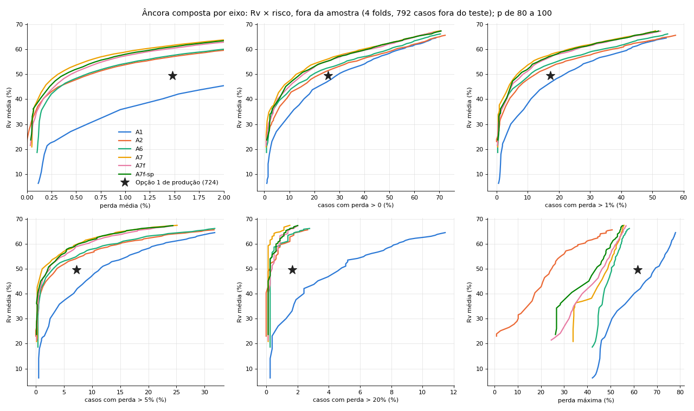

# Âncora composta por eixo — bbox de tamanho fixo

**Data:** 2026-10-28. **Natureza:** exploratória. Nenhum dataset foi gerado, nenhum artefato de
produção foi alterado e a segmentação não foi reprocessada. Este documento **não escolhe o ponto
final, não conclui sobre adotar o método e não recomenda trocar a âncora de produção.**
Antecedentes: Passos [0c](dynamic_bbox_step0c.md) e [0d](dynamic_bbox_step0d.md),
[Bbox centrado no volume — calibração](a2_center_bbox_calibration.md) e
[Caminho 2](caminho2_aorta_geometry.md), seção 3.4.

Eixos em LAS: eixo 0 látero-lateral (LL), eixo 1 ântero-posterior (AP), eixo 2 crânio-caudal (CC).
Todas as unidades são voxels de resolução integral.

## 1. Números principais

**Erro de posição** (p95 de |centro do label − âncora − viés|, em voxels). Medido fora da amostra
nos 792 casos, com viés e coeficientes ajustados nos outros 3 folds:

| Âncora | LL | AP | CC |
|---|---|---|---|
| A1 (786) | 65,1 | 56,0 | 54,0 |
| A2 | 33,2 | 60,5 | 30,0 |
| A6 | 33,2 | 56,3 | 30,0 |
| **A7** | 33,2 | **42,6** (−30% contra A2) | **25,1** (−16%) |
| A7f | 33,2 | 45,6 (−25%) | 24,9 (−17%) |

**Ponto de `Rv` igual ao da Opção 1 de produção (49,53%)**, fora da amostra (4 folds, 792 casos):

| Âncora | N | `p` | Caixa (LL × AP × CC) | Perda média | > 0 | > 1% | > 5% | > 20% | Perda máx. |
|---|---|---|---|---|---|---|---|---|---|
| A1 | 786 | 93,33 | 413 × 358 × 242 | 2,67% | 28,9% | 21,0% | 11,2% | 4,71% | 69,0% |
| A2 | 792 | 95,78 | 386 × 381 × 235 | 0,60% | 21,0% | 12,2% | 3,5% | 0,13% | 24,5% |
| A6 | 792 | 96,46 | 389 × 378 × 237 | 0,57% | 18,7% | 10,5% | 2,8% | 0,25% | 50,4% |
| **A7** | 792 | 97,64 | 395 × 368 × 237 | **0,30%** | **12,6%** | **6,3%** | **1,0%** | 0,13% | 48,5% |
| A7f | 792 | 97,13 | 392 × 376 × 234 | 0,43% | 15,3% | 8,2% | 2,3% | 0,38% | 46,1% |
| A7f-sp | 792 | 97,39 | 392 × 376 × 235 | 0,37% | 13,6% | 7,1% | 2,1% | 0,25% | 44,3% |
| *Opção 1 de produção* | *724* | — | *410 × 358 × 243* | *1,48%* | *25,4%* | *17,3%* | *7,2%* | *1,66%* | *61,7%* |

**Maior `Rv` sob cada restrição**, fora da amostra (792). Nenhuma âncora que depende da aorta
satisfaz a restrição (a), nem com `p` = 100:

| Âncora | (a) perda máx. ≤ 1% | (b) ≤ 2% com perda > 1% | (c) perda média ≤ 0,156% |
|---|---|---|---|
| A1 | — | 21,9% | 10,9% |
| A2 | **23,9%** | 32,1% | 37,1% |
| A6 | — | 35,7% | 35,7% |
| **A7** | — | **38,2%** | **42,6%** |
| A7f | — | 35,1% | 35,1% |
| A7f-sp | — | 36,1% | 40,6% |
| *Opção 1 de produção (724)* | *não satisfaz* | *não satisfaz* | *não satisfaz* |

## 2. Método

### 2.1 Âncoras (nenhuma usa rótulo na aplicação)

- **A1:** centróide da aorta de produção (`all_cases.csv` × (2, 2, 1)). Cobre os 786 casos com
  aorta detectada.
- **A2:** centro do volume (`shape / 2`).
- **A6:** LL e CC de A2, AP de A1. Nos 6 casos sem A1, o AP vem de A2, como na M5 do Passo 0d.
- **A7:**
  - **LL:** A2.
  - **AP e CC:** previsão linear do centro do label (`(min + max) / 2`), ajustada por mínimos
    quadrados em voxels. As entradas, no mesmo eixo, são A1, o centro da ascendente (janela de
    20 mm da raiz), o centro da descendente e A2, com intercepto. No AP, A2 é constante (256)
    e sai do modelo.
  - **Fallback:** nos 16 casos sem descendente detectada, a entrada não existe e a âncora usa
    A2 corrigida pelo viés mediano do treino.
- **A7f (A7 com fallback):** igual à A7, mas usa A2 corrigida pelo viés em AP e CC sempre que o
  caso é suspeito. A regressão é ajustada só nos casos de treino não suspeitos.
  - Um caso é suspeito quando cumpre pelo menos um destes critérios: fora do Critério C, sem A1,
    descendente não encontrada, ou qualquer sinal de qualidade do Caminho 2 (descendente em < 50%
    das fatias, IQR do centro > 10 mm, círculo cruzando a borda do FOV, D_desc fora de 10–30 mm,
    d < 30 mm).
  - Esses sinais são por caso, não por eixo. Por isso o fallback vale para AP e CC juntos.
- **A7f-sp:** a âncora da A7f, com tamanho ajustado pelo spacing (seção 2.2).

### 2.2 Caixa

- **Regra dos Passos 0c/0d:**
  - Offsets por caso e eixo: `min_label − âncora` e `max_label + 1 − âncora`.
  - Caixa: `âncora + P(100−p)(offset inferior)` até `âncora + P(p)(offset superior)`, com o
    mesmo `p` nos três eixos.
  - Arredondamento conservador (`floor` no mínimo, `ceil` no máximo) e clamp ao volume.
- **A7f-sp:** cada offset (lado × eixo) é previsto por uma regressão quantílica linear sobre o
  spacing axial do cabeçalho (`(sp_y + sp_x) / 2`). O quantil é `(100 − p)/100` para o lado
  inferior e `p/100` para o superior.
  - Em `p` = 100, o quantil não é definido. A reta usa o quantil 0,995 (ou 0,005) e é deslocada
    até cobrir todos os casos de treino.
- **Offsets de treino das âncoras com coeficientes (A7, A7f, A7f-sp):** os percentis são
  calculados sobre âncoras previstas fora da amostra dentro do próprio treino, por validação
  cruzada interna nos folds de treino. Assim, o tamanho da caixa reflete o erro que a regressão
  comete em casos novos, e não o resíduo dentro da amostra. Nas âncoras sem coeficientes, isso
  não muda nada.

### 2.3 Avaliação

- **População:** os 792 casos fora do teste (`split_original.csv`, `split=trainval`), sem
  Critério C.
- **Fora da amostra (oos):** para cada fold `f` de 1 a 4, tudo é ajustado nos outros 3 folds
  (coeficientes da A7, viés do fallback, percentis ou regressões quantílicas) e aplicado ao fold
  `f`. As métricas são calculadas sobre as previsões agregadas dos 4 folds.
- **Dentro da amostra (in):** tudo é ajustado e avaliado nos mesmos 792.
- **Teste (verificação):** tudo é ajustado nos 792 e aplicado aos 208 de teste.
  - O `p` de cada ponto de destaque é o escolhido na curva fora da amostra.
  - **O teste foi selecionado com informação do rótulo (interseção curada via Opção 2) e
    favorece A1 e a Opção 1** ([Passo 0](dynamic_bbox_step0.md)).
- **Grade de `p`:** 80 a 99,5 com passo 0,5, e 99,55 a 100 com passo 0,05.
- **Pontos de restrição:** o menor `p` da grade que satisfaz a restrição na própria curva, ou seja,
  o maior `Rv`.
- **Ponto de `Rv` igual ao da Opção 1:** bisseção contínua em `p` até a `Rv` média igualar 49,53%.
- **Opção 1 de produção:** caixa de `calibration_both_options.json` com A1, nos 724 casos dos 792
  que ela cobre (Critério C e aorta detectada) e nos 208 de teste.

### 2.4 Checagens

- **Todos os eixos em A2, dentro da amostra:** reproduz a seção
  "[Bbox centrado no volume — calibração](a2_center_bbox_calibration.md)", unidade voxels, nos 30
  valores de `p` comuns (90 a 100). A diferença máxima é 0 em todas as métricas
  (`a7_check_a2.csv`).
- **A1 e A6 dentro da amostra:** reproduzem M2 e M5 do Passo 0d (por exemplo, em `p` = 95:
  `Rv` 44,91% e 52,42%; perda média 1,91% e 0,78%).
- **Opção 1 de produção:** reproduz `Rv` 49,53% e perda média 1,48% nos 724.
- **Sinais de suspeita:** reproduzem as contagens do Caminho 2 nos 776 com descendente:
  17 / 9 / 25 / 5 / 2.
- **Cache:** o cache das coordenadas do label (`p0_cache`) foi refeito só com leitura dos labels
  NIfTI (`a7_extract_labels.py`), porque o diretório temporário anterior foi apagado.

## 3. Fallback

| Eixo | A6 | A7 | A7f, 792 | A7f, 208 de teste |
|---|---|---|---|---|
| LL (eixo 0) | A2 em todos | A2 em todos | A2 em todos | A2 em todos |
| AP (eixo 1) | 6 (sem A1) | 16 (sem descendente) | **111 (14,0%)** | 14 (6,7%) |
| CC (eixo 2) | — (A2 em todos) | 16 | **111 (14,0%)** | 14 |

Motivos nos 792 (um caso pode ter mais de um):

| Motivo | 792 | 208 de teste |
|---|---|---|
| Fora do Critério C | 68 | 0 |
| Sem A1 | 6 | 0 |
| Descendente não encontrada | 16 | 0 |
| Descendente em < 50% das fatias | 17 | 2 |
| IQR do centro > 10 mm | 9 | 0 |
| Círculo cruzando a borda do FOV | 25 | 13 |
| D_desc fora de 10–30 mm | 5 | 0 |
| d < 30 mm | 2 | 0 |

Dos 111 casos com fallback, 68 estão fora do Critério C. Os outros 43 estão dentro dele e são
marcados só pelos sinais da descendente.

**Coeficientes da A7 (ajuste nos 792)**, centro do label ≈ intercepto + soma dos coeficientes ×
entradas:

| Eixo | Intercepto | A1 | Ascendente | Descendente | A2 |
|---|---|---|---|---|---|
| AP | 146,4 | 0,318 | 0,117 | 0,214 | — (constante) |
| CC | 6,4 | −0,239 | 0,219 | 0,433 | 0,333 |

Os coeficientes variam pouco entre os folds (`a7_coefficients.csv`). A A7f tem coeficientes
parecidos.

## 4. Pontos de destaque — fora e dentro da amostra, e teste

### 4.1 `Rv` igual ao da Opção 1 (49,53%)

| Âncora | Avaliação | `p` | N | Perda média | > 0 | > 1% | > 5% | > 20% | Perda máx. |
|---|---|---|---|---|---|---|---|---|---|
| A1 | oos / in | 93,33 / 93,32 | 786 | 2,67 / 2,65% | 28,9 / 28,2% | 21,0 / 20,7% | 11,2 / 11,2% | 4,71 / 4,58% | 69,0 / 69,6% |
| A2 | oos / in | 95,78 / 95,83 | 792 | 0,60 / 0,59% | 21,0 / 21,2% | 12,2 / 12,0% | 3,5 / 3,4% | 0,13 / 0,13% | 24,5 / 24,5% |
| A6 | oos / in | 96,46 / 96,46 | 792 | 0,57 / 0,55% | 18,7 / 18,8% | 10,5 / 10,2% | 2,8 / 2,9% | 0,25 / 0,25% | 50,4 / 50,4% |
| A7 | oos / in | 97,64 / 97,70 | 792 | 0,30 / 0,26% | 12,6 / 11,9% | 6,3 / 5,4% | 1,0 / 0,9% | 0,13 / 0,13% | 48,5 / 42,1% |
| A7f | oos / in | 97,13 / 97,27 | 792 | 0,43 / 0,39% | 15,3 / 14,0% | 8,2 / 7,1% | 2,3 / 1,9% | 0,38 / 0,38% | 46,1 / 37,8% |
| A7f-sp | oos / in | 97,39 / 97,50 | 792 | 0,37 / 0,31% | 13,6 / 12,0% | 7,1 / 6,2% | 2,1 / 2,0% | 0,25 / 0,25% | 44,3 / 33,3% |

**Mesmo ponto, restrito aos 724 casos que a Opção 1 cobre (fora da amostra):**

| Âncora | Perda média | > 1% | > 5% | Perda máx. |
|---|---|---|---|---|
| A1 | 1,36% | 16,9% | 6,8% | 61,6% |
| A2 | 0,58% | 12,0% | 3,3% | 24,5% |
| A6 | 0,46% | 9,4% | 2,1% | 50,4% |
| A7 | **0,26%** | **5,7%** | **0,6%** | 48,5% |
| A7f | 0,39% | 7,7% | 1,7% | 46,1% |
| A7f-sp | 0,33% | 6,2% | 1,7% | 44,3% |
| *Opção 1 de produção* | *1,48%* | *17,3%* | *7,2%* | *61,7%* |

**Teste (208, ajuste nos 792, `p` da curva fora da amostra):**

| Âncora | `Rv` | Perda média | > 1% (N) | > 5% | Perda máx. |
|---|---|---|---|---|---|
| A1 | 48,35% | 0,131% | 3,4% (7) | 0,5% | 8,6% |
| A2 | 49,82% | 0,517% | 11,1% (23) | 2,9% | 16,1% |
| A6 | 49,49% | 0,256% | 5,3% (11) | 1,4% | 14,7% |
| A7 | 49,59% | **0,125%** | 3,8% (8) | 1,0% | **5,6%** |
| A7f | 49,78% | 0,339% | 6,7% (14) | 1,9% | 17,8% |
| A7f-sp | 49,55% | 0,307% | 4,3% (9) | 1,9% | 16,6% |
| *Opção 1 de produção* | *48,98%* | *0,155%* | *3,4% (7)* | *0,5%* | *12,0%* |

### 4.2 Restrições: `Rv` fora e dentro da amostra, e teste

| Âncora | Restrição | `p` oos / in | `Rv` oos / in | Teste com `p` oos: `Rv` / perda média / > 1% / máx. |
|---|---|---|---|---|
| A1 | (a) | — / 100 | — / 2,2% | — |
| A1 | (b) | 99,6 / 99,5 | 21,9 / 22,7% | 19,8% / 0% / 0% / 0% |
| A1 | (c) | 99,8 / 99,7 | 10,9 / 19,7% | 10,4% / 0% / 0% / 0% |
| A2 | (a) | 99,95 / 99,85 | 23,9 / 25,7% | 23,0% / 0% / 0% / 0% |
| A2 | (b) | 99,5 / 99,5 | 32,1 / 31,3% | 31,3% / 0,022% / 0,96% / 1,9% |
| A2 | (c) | 99,0 / 98,5 | 37,1 / 40,7% | 36,9% / 0,087% / 3,4% / 3,9% |
| A6 | (a) | — / 100 | — / 14,7% | — |
| A6 | (b) | 99,5 / 99,5 | 35,7 / 34,9% | 34,4% / 0,022% / 0,96% / 1,9% |
| A6 | (c) | 99,5 / 99,5 | 35,7 / 34,9% | idem (b) |
| A7 | (a) | — / 100 | — / 17,6% | — |
| A7 | (b) | 99,5 / 99,5 | 38,2 / 38,1% | 37,3% / 0% / 0% / 0% |
| A7 | (c) | 99,0 / 99,0 | 42,6 / 43,0% | 42,8% / 0,015% / 0,48% / 1,1% |
| A7f | (a) | — / 100 | — / 18,8% | — |
| A7f | (b) | 99,5 / 99,5 | 35,1 / 34,4% | 34,7% / 0,021% / 0,48% / 3,8% |
| A7f | (c) | 99,5 / 99,0 | 35,1 / 40,3% | idem (b) |
| A7f-sp | (a) | — / 99,9 | — / 23,7% | — |
| A7f-sp | (b) | 99,5 / 99,5 | 36,1 / 36,2% | 35,5% / 0,024% / 0,96% / 2,8% |
| A7f-sp | (c) | 99,0 / 99,0 | 40,6 / 40,9% | 40,9% / 0,090% / 2,4% / 8,4% |

Em `p` = 100 fora da amostra, a perda máxima é: A1 42,2%; A6 42,1%; A7 33,9%; A7f 24,5%; A7f-sp
26,3%; A2 0,89%. A `Rv` nesse ponto é de 6,3% a 23,7%.

## 5. Os 10 casos de maior perda da A7f no ponto `Rv` = Opção 1 (fora da amostra, `p` = 97,13)

| Caso | Fold | Perda A7f | Perda A2 no mesmo `Rv` | Fallback | Motivos |
|---|---|---|---|---|---|
| 132 | 2 | 46,1% | 0,0% | não | — |
| 355 | 2 | 24,1% | 24,5% | AP e CC | círculo cruzando a borda do FOV |
| 608 | 1 | 20,7% | 19,8% | AP e CC | círculo cruzando a borda do FOV |
| 380 | 1 | 17,9% | 15,8% | AP e CC | D_desc fora de 10–30 mm |
| 44 | 3 | 14,0% | 13,4% | AP e CC | fora do Critério C; descendente em < 50% das fatias; círculo cruzando a borda do FOV |
| 297 | 1 | 13,3% | 9,7% | AP e CC | fora do Critério C |
| 310 | 3 | 9,2% | 8,5% | AP e CC | IQR do centro > 10 mm |
| 770 | 2 | 7,9% | 6,9% | AP e CC | IQR do centro > 10 mm |
| 191 | 1 | 7,8% | 6,6% | AP e CC | descendente em < 50% das fatias |
| 601 | 1 | 6,8% | 2,3% | não | — |

- **8 dos 10 usaram fallback.** Neles, a perda é próxima da perda da A2 no mesmo `Rv`, porque a
  âncora é a A2 corrigida pelo viés.
- **O caso 132 está dentro do Critério C e não aciona nenhum sinal**, mas a detecção está errada:
  - A1 fica em LL 81 e a ascendente em LL 86 / AP 436, perto da borda direita, longe do centro do
    label (LL 270 / AP 240).
  - A "descendente" fica em LL 476 / AP 352, anterior ao centro, a d = 131 mm da ascendente.
  - A A7 desloca o AP para 432, e a caixa corta 46% do label.
- **O caso 601** também está dentro de C e sem sinais.
  - O label ocupa as fatias 3 a 233 de 243, mais que a caixa em CC (234 fatias).
  - A A7 põe o centro CC em 110, contra 118 do label; a A2 fica em 121,5. A caixa da A7 corta
    mais na ponta superior.

## 6. Gráfico

`Rv` média contra cada medida de risco, nas curvas fora da amostra (792), uma curva por âncora,
com `p` de 80 a 100. A estrela marca a Opção 1 de produção nos 724 casos que ela cobre.

## 7. Interpretação (sem escolher o ponto final)

- **A A7 reduz o erro de posição em AP e CC como no Caminho 2, agora em voxels e sem excluir
  casos.** O p95 cai 30% em AP e 16% em CC em relação à A2. No LL, a A7 é a própria A2.
- **Com `Rv` igual, a A7 tem a menor perda média e a menor fração de casos com perda nos 792.**
  - Fora da amostra, a perda média fica em 0,30% (A2: 0,60%; Opção 1: 1,48% nos 724), com 6,3% dos
    casos acima de 1% de perda (A2: 12,2%; Opção 1: 17,3%).
  - O ganho aparece em quase toda a curva (gráfico, painéis de perda média, > 0, > 1% e > 5%).
- **A A7 não melhora a perda máxima.**
  - No ponto de `Rv` igual, a perda máxima da A7 é 48,5%, contra 24,5% da A2.
  - Nenhuma âncora que depende da aorta satisfaz a restrição (a) fora da amostra, nem com
    `p` = 100: basta um caso com detecção errada e não sinalizada (como o 132) para ultrapassar 1%.
  - A A2 é a única que satisfaz (a), com `Rv` de 23,9%.
- **O fallback não melhorou a A7 nesta população.**
  - A A7f é pior que a A7 em perda média, frações e `Rv` sob (b) e (c). Ela reduz um pouco a perda
    máxima (46,1% contra 48,5%) e a perda em `p` = 100 (24,5% contra 33,9%).
  - Os 111 casos com fallback recebem o erro de posição da A2, maior em AP, e entram no mesmo
    conjunto de offsets que define a caixa. Isso alarga a caixa para todos os casos. Oito dos dez
    casos de maior perda da A7f usaram fallback.
  - O caso de maior perda (132) não seria pego por nenhum dos sinais atuais.
- **O tamanho pelo spacing ajuda um pouco sobre a A7f.**
  - No mesmo `Rv`, a perda média cai de 0,43% para 0,37% e a perda máxima de 46,1% para 44,3%.
  - Sob (b), o `Rv` sobe de 35,1% para 36,1%; sob (c), de 35,1% para 40,6%.
  - Não foi testado sobre a A7 sem fallback.
- **Otimismo de calibrar e avaliar nos mesmos casos.** Nas métricas médias, a diferença entre
  dentro e fora da amostra é pequena (perda média 0,26% contra 0,30% na A7). Nas extremas, ela é
  grande nas âncoras com coeficientes:
  - perda máxima 42,1% contra 48,5% (A7) e 33,3% contra 44,3% (A7f-sp);
  - a restrição (a) é satisfeita dentro da amostra por construção em `p` = 100, mas por nenhuma
    âncora com aorta fora da amostra;
  - na A2, que não tem coeficientes, as duas avaliações quase coincidem.
- **Teste (verificação, favorece A1 e a Opção 1):**
  - No mesmo `Rv`, a A7 fica perto da Opção 1: perda média 0,125% contra 0,155%, perda máxima 5,6%
    contra 12,0%, e 8 contra 7 casos com perda > 1%.
  - A A2 perde mais nesse conjunto (0,517%, 23 casos), como já registrado na calibração A2.
  - A7f e A7f-sp ficam entre as duas.
  - Os 208 não têm casos fora do Critério C, e só 14 aplicam fallback.
- **Cobertura:** A2, A6, A7, A7f e A7f-sp cobrem os 792 casos; A1 cobre 786. A Opção 1 cobre 724.

## 8. Tabela final — `Rv` sob cada restrição (fora da amostra, 792)

Ganho em pontos percentuais de `Rv`. A Opção 1 de produção não satisfaz nenhuma das restrições nos
724 casos que cobre (perda máxima 61,7%, 17,3% dos casos com perda > 1%, perda média 1,48%). Por
isso, o ganho contra ela é medido em relação ao seu `Rv` (49,53%), alcançado com perda bem acima
das restrições.

| Âncora | (a) `Rv` | (a) vs A2 | (b) `Rv` | (b) vs A2 | (b) vs Opção 1 | (c) `Rv` | (c) vs A2 | (c) vs Opção 1 |
|---|---|---|---|---|---|---|---|---|
| A1 | — | — | 21,9% | −10,2 | −27,6 | 10,9% | −26,2 | −38,6 |
| A2 | 23,9% | 0 | 32,1% | 0 | −17,4 | 37,1% | 0 | −12,4 |
| A6 | — | — | 35,7% | +3,6 | −13,8 | 35,7% | −1,4 | −13,8 |
| A7 | — | — | **38,2%** | **+6,1** | −11,3 | **42,6%** | **+5,5** | −6,9 |
| A7f | — | — | 35,1% | +3,1 | −14,4 | 35,1% | −2,0 | −14,4 |
| A7f-sp | — | — | 36,1% | +4,0 | −13,4 | 40,6% | +3,5 | −9,0 |

— = a restrição não é satisfeita em nenhum `p` da grade, inclusive 100.

## 9. Reprodutibilidade

- Resultados em `output/bounding_box/a7_composite_anchor/`:
  - `a7_sweep.csv`: varredura completa (âncora × avaliação oos / in / test × `p`).
  - `a7_highlights.csv`: pontos de destaque (restrições e `Rv` igual), oos, in, só os 724 e teste.
  - `a7_option1_reference.csv`: Opção 1 de produção nos 724 e nos 208.
  - `a7_position_error.csv`: erro de posição por âncora e eixo.
  - `a7_coefficients.csv`: coeficientes da A7 e da A7f por fold e nos 792.
  - `a7_fallback_counts.csv`: motivos de suspeita e contagens de fallback.
  - `a7_top10_loss_A7f.csv`: os 10 casos de maior perda.
  - `a7_check_a2.csv`: checagem contra a calibração A2.
- Scripts em `output/bounding_box/a7_composite_anchor/scripts/`:
  - `a7_extract_labels.py`: refaz `p0_cache/` (só leitura dos labels NIfTI).
  - `a7_calibrate.py`: âncoras, caixas, varredura, destaques e checagens. Reaproveita
    `a7_sweep.csv` se existir; apague o arquivo para refazer a varredura (~20 min).
  - `a7_plot.py`: figura `docs/img/a7_rv_risco.png`.
- Entradas: `c2_cases.csv` (Caminho 2), `all_cases.csv`, tabelas de shape e spacing dos Passos
  0/0c/A2, `split_original.csv`, `calibration_both_options.json`.
