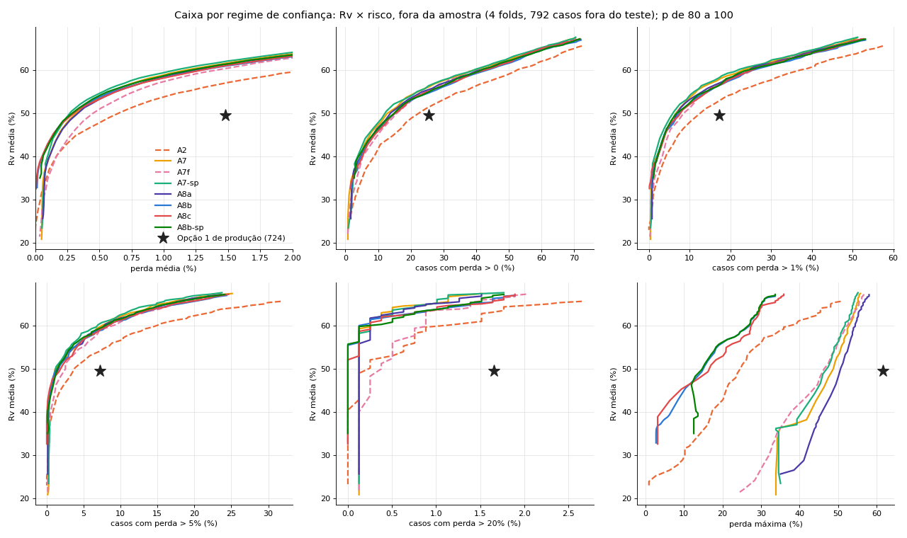

# Âncora composta — caixa por regime de confiança

**Data:** 2026-10-29. **Natureza:** exploratória. Nenhum dataset foi gerado, nenhum artefato de
produção foi alterado e a segmentação não foi reprocessada. Este documento **não escolhe o ponto
final, não conclui sobre adotar o método e não recomenda trocar a âncora de produção.**
É a continuação de [Âncora composta por eixo — bbox de tamanho fixo](a7_composite_anchor_bbox.md)
(A7). Eixos em LAS: látero-lateral (LL), ântero-posterior (AP) e crânio-caudal (CC). Unidade:
voxels de resolução integral.

Ao comparar com a Opção 1 de produção, a comparação é feita só no ponto de mesma `Rv` (49,53%).

## 1. Números principais

**Ponto de `Rv` global igual ao da Opção 1 (49,53%)**, fora da amostra (4 folds, 792 casos):

| Variante | `p` | Casos no regime de fallback | Perda média | > 0 | > 1% | > 5% | > 20% | Perda máx. |
|---|---|---|---|---|---|---|---|---|
| A2 (referência) | 95,78 | — | 0,60% | 21,0% | 12,2% | 3,5% | 0,13% | 24,5% |
| A7 | 97,64 | 16 | 0,30% | 12,6% | 6,3% | 1,0% | 0,13% | 48,5% |
| A7f | 97,13 | 111 | 0,43% | 15,3% | 8,2% | 2,3% | 0,38% | 46,1% |
| A7-sp | 97,77 | 16 | **0,26%** | 11,5% | **5,6%** | 1,3% | 0,13% | 46,7% |
| A8a | 97,69 | 111 | 0,31% | 13,1% | 6,4% | 1,6% | 0,13% | 50,4% |
| **A8b** | 97,44 | 168 | 0,27% | 14,4% | 7,2% | 1,3% | **0** | **14,6%** |
| A8c | 97,42 | 135 | 0,28% | 14,4% | 7,2% | 1,6% | **0** | 16,6% |
| A8b-sp | 97,58 | 168 | 0,27% | 14,0% | 6,6% | 1,3% | **0** | **14,6%** |
| *Opção 1 de produção (724)* | — | — | *1,48%* | *25,4%* | *17,3%* | *7,2%* | *1,66%* | *61,7%* |

**Maior `Rv` sob cada restrição**, fora da amostra (792):

| Variante | (a) perda máx. ≤ 1% | (b) ≤ 2% com perda > 1% | (c) perda média ≤ 0,156% |
|---|---|---|---|
| A2 | **23,9%** | 32,1% | 37,1% |
| A7 | — | 38,2% | 42,6% |
| A7f | — | 35,1% | 35,1% |
| A7-sp | — | 38,3% | 44,2% |
| A8a | — | 39,3% | 39,3% |
| **A8b** | — (em `p` = 100, máx. 2,7%) | **39,4%** | **45,5%** |
| A8c | — (em `p` = 100, máx. 3,2%) | 38,9% | 45,3% |
| A8b-sp | — | 39,0% | 43,7% |

— = a restrição não é satisfeita em nenhum `p` da grade, inclusive 100.

## 2. Método

### 2.1 Sinais de plausibilidade (sem rótulo)

As regras foram definidas antes de ver quais casos elas marcam, e nenhum limiar foi ajustado para
pegar algum caso específico. Os limiares são aprendidos em cada conjunto de treino (3 folds na
validação cruzada; os 792 para o teste), só nos casos de treino **não suspeitos pelos sinais
antigos** da A7f.

- **S1, discordância com o centro do volume:**
  - Mede |A7 − (A2 + viés)| em AP e em CC.
  - A "A7" aqui é a regressão da A7f, ajustada nos casos de treino não suspeitos.
  - Suspeito se exceder o percentil 99 do treino em qualquer dos dois eixos.
- **S2, distância entre aortas:** suspeito se d (mm) estiver fora de [P0,5; P99,5] do treino.
- **S3, posição das entradas:** suspeito se qualquer uma das 9 coordenadas de entrada da A7
  estiver fora de [P0,5; P99,5] daquela coordenada no treino. As coordenadas são A1, o centro da
  ascendente e o centro da descendente, cada um nos três eixos.
- Valores ausentes não acionam S1 a S3. A ausência de A1 ou de descendente é um sinal à parte.

### 2.2 Variantes (LL = A2 em todas)

| Variante | Suspeitos (regime de fallback) | Caixa | Regressão do regime confiável ajustada em |
|---|---|---|---|
| A7 | entradas incompletas (16) | única | casos de treino completos |
| A7f | sinais antigos | única | treino não suspeito |
| A7-sp | entradas incompletas | única, tamanho pelo spacing | casos de treino completos |
| A8a | sinais antigos | **uma por regime** | treino não suspeito (= A7f) |
| A8b | sinais antigos ∪ S1 ∪ S2 ∪ S3 | uma por regime | treino não suspeito pela própria regra |
| A8c | S1 ∪ S2 ∪ S3 ∪ sem A1 ∪ sem descendente (∪ entradas incompletas) | uma por regime | treino não suspeito pela própria regra |
| A8b-sp | como A8b | por regime; spacing só no confiável, percentis fixos no fallback | como A8b |

- **Regime confiável:** âncora A7 (regressão linear de AP e CC sobre A1, ascendente,
  descendente e A2).
- **Regime de fallback:** A2 corrigida pelo viés mediano do treino em AP e CC.
- **Caixa por regime:** os offsets de cada regime vêm só dos casos de treino daquele regime, com o
  mesmo `p` nos dois regimes.
- **Atribuição dos casos de treino aos regimes:** por validação cruzada interna, como na A7. Os
  limiares, a regressão e o viés que decidem o regime de um caso de treino vêm dos outros folds
  de treino.
- **Tamanho pelo spacing:** regressão quantílica de cada offset sobre o spacing axial do
  cabeçalho, como na A7f-sp.
- **Regra da caixa, avaliação, grade de `p`, restrições e bisseção:** as mesmas da seção A7.

### 2.3 Checagens

- **A7 e A7f:** reproduzem a seção anterior nas 300 linhas da varredura (2 variantes × oos / in /
  teste × 50 valores de `p`). A diferença máxima é 0 (`a8_check_a7.csv`).
- **Opção 1 de produção e A2:** são as mesmas referências da seção A7.

## 3. Sinais: limiares e contagens

**Limiares aprendidos** (média e amplitude nos 4 conjuntos de treino da validação cruzada; entre
parênteses, o valor nos 792). Cada conjunto de treino tem de 506 a 515 casos-base (681 nos 792).

| Sinal | Limiar | Média | Mín.–máx. entre folds |
|---|---|---|---|
| S1 | AP (vox) | 51,2 (51,4) | 48,0–55,6 |
| S1 | CC (vox) | 22,7 (22,2) | 22,1–24,4 |
| S2 | d mínimo (mm) | 35,8 (35,4) | 35,3–37,0 |
| S2 | d máximo (mm) | 102,0 (101,9) | 101,2–103,5 |
| S3 | A1 LL / AP / CC (vox) | [129,8; 268,1] / [183,1; 362,0] / [131,7; 238,1] | até 8,2 vox |
| S3 | ascendente LL / AP / CC | [130,7; 332,4] / [175,9; 360,5] / [107,4; 232,1] | até 18,5 vox |
| S3 | descendente LL / AP / CC | [183,1; 336,8] / [31,1; 178,3] / [150,2; 247,9] | até 16,5 vox |

A tabela completa está em `a8_thresholds_summary.csv`.

**Casos marcados** (nos 792, cada caso com os limiares do seu fold; no teste, com os limiares dos
792):

| Sinal | 792 | 208 de teste |
|---|---|---|
| S1 | 41 | 6 |
| S2 | 16 | 0 |
| S3 | 119 | 18 |
| S1 ∪ S2 ∪ S3 | 133 | 22 |
| sinais antigos | 111 | 14 |
| S1 / S2 / S3 sem sinal antigo | 17 / 7 / 49 | 4 / 0 / 7 |
| novos sem antigos | 57 | 10 |
| novos e antigos | 76 | 12 |
| antigos sem novos | 35 | 2 |
| **A8b**: antigos ∪ novos | **168 (21,2%)** | 24 |
| **A8c**: novos ∪ sem A1 ∪ sem descendente | **135 (17,0%)** | 22 |

O S3 marca mais casos do que os outros sinais: são 9 coordenadas, cada uma com 1% de cauda no
treino.

**Verificação (não foi alvo das regras):**

| Caso | Sinais antigos | S1 | S2 | S3 |
|---|---|---|---|---|
| 132 | não | **sim** | **sim** | **sim** |
| 537 | sim (fora do Critério C; descendente em < 50% das fatias) | não | sim | sim |

## 4. Regime de fallback

**Casos de treino no regime de fallback, por fold**, e `p` acima do qual o percentil desse regime
fica entre os dois maiores offsets do treino (`100·(n−2)/(n−1)`). Em `p` = 100, o percentil é o
próprio máximo.

| Variante | n de fallback no treino (4 folds) | `p` limite (4 folds) | n nos 792 |
|---|---|---|---|
| A8a | 79–88 | 98,72–98,85 | 111 |
| A8b, A8b-sp | 126–145 | 99,20–99,31 | 168 |
| A8c | 100–121 | 98,99–99,17 | 135 |

Na grade (99,5 e acima), as restrições (a) e (b) caem nessa faixa para todas as variantes A8. Nela,
a caixa do regime de fallback é definida por um ou dois casos de treino.

**Caixa de cada regime no ponto de `Rv` = Opção 1** (mediana, LL × AP × CC, voxels):

| Variante | Confiável (N) | Fallback (N) | Volume fallback / confiável | `Rv` confiável / fallback |
|---|---|---|---|---|
| A8a | 391 × 362 × 235 (681) | 400 × 418 × 237 (111) | 1,19× | 51,1% / 40,0% |
| A8b | 390 × 359 × 233 (624) | 397 × 415 × 246 (168) | 1,24× | 52,2% / 39,4% |
| A8c | 393 × 360 × 233 (657) | 392 × 417 × 251 (135) | 1,25× | 51,6% / 39,3% |
| A8b-sp | 390 × 359 × 232 (624) | 397 × 417 × 247 (168) | 1,26× | 52,4% / 39,0% |

Nas variantes de caixa única (A7, A7f, A7-sp), as duas caixas medianas são iguais (razão 0,98 a
1,01).

**Perda por regime no mesmo ponto** (fora da amostra):

| Variante | Confiável: média / > 1% / máx. | Fallback: média / > 1% / máx. |
|---|---|---|
| A7f | 0,24% / 6,2% / 46,1% | 1,61% / 20,7% / 24,1% |
| A8a | 0,27% / 5,9% / 50,4% | 0,57% / 9,9% / 13,5% |
| A8b | 0,21% / 6,6% / **9,6%** | 0,48% / 9,5% / 14,6% |
| A8c | 0,24% / 6,7% / 8,4% | 0,48% / 9,6% / 16,6% |
| A8b-sp | 0,22% / 5,8% / 11,9% | 0,46% / 9,5% / 14,6% |

## 5. Pontos de destaque — fora e dentro da amostra, e teste

### 5.1 `Rv` igual ao da Opção 1

| Variante | Perda média oos / in | > 1% oos / in | Perda máx. oos / in |
|---|---|---|---|
| A7 | 0,30 / 0,26% | 6,3 / 5,4% | 48,5 / 42,1% |
| A7f | 0,43 / 0,39% | 8,2 / 7,1% | 46,1 / 37,8% |
| A7-sp | 0,26 / 0,20% | 5,6 / 4,8% | 46,7 / 37,8% |
| A8a | 0,31 / 0,24% | 6,4 / 4,9% | 50,4 / 44,3% |
| A8b | 0,27 / 0,22% | 7,2 / 5,4% | 14,6 / 13,5% |
| A8c | 0,28 / 0,23% | 7,2 / 5,8% | 16,6 / 13,5% |
| A8b-sp | 0,27 / 0,19% | 6,6 / 4,8% | 14,6 / 12,2% |

**Teste (208, ajuste nos 792, `p` da curva fora da amostra; o teste favorece A1 e a Opção 1):**

| Variante | `Rv` no teste | Perda média | > 1% (N) | Perda máx. |
|---|---|---|---|---|
| A7 | 49,6% | 0,125% | 3,8% (8) | 5,6% |
| A7f | 49,8% | 0,339% | 6,7% (14) | 17,8% |
| A7-sp | 50,0% | 0,113% | 3,4% (7) | 6,2% |
| A8a | 50,5% | 0,101% | 3,8% (8) | 3,1% |
| A8b | 50,6% | 0,123% | 4,3% (9) | 3,8% |
| A8c | 50,2% | 0,107% | 3,8% (8) | 3,8% |
| A8b-sp | 50,5% | 0,126% | 3,4% (7) | 5,9% |
| *Opção 1 de produção* | *49,0%* | *0,155%* | *3,4% (7)* | *12,0%* |

No teste, a `Rv` das variantes A8 fica cerca de 1 ponto acima de 49,53%. Os 208 têm proporção menor
de casos de fallback (o regime de caixa maior) do que os 792. A `Rv` da Opção 1 também difere um
pouco: 49,0%.

### 5.2 Restrições: `Rv` fora e dentro da amostra, e teste

| Variante | Restrição | `p` oos / in | `Rv` oos / in | Teste (`p` oos): `Rv` / perda média / > 1% / máx. |
|---|---|---|---|---|
| A7 | (b) | 99,5 / 99,5 | 38,2 / 38,1% | 37,3% / 0% / 0% / 0% |
| A7 | (c) | 99,0 / 99,0 | 42,6 / 43,0% | 42,8% / 0,015% / 0,48% / 1,1% |
| A7-sp | (b) | 99,5 / 99,5 | 38,3 / 39,1% | 38,1% / 0,010% / 0,48% / 2,1% |
| A7-sp | (c) | 99,0 / 98,5 | 44,2 / 46,7% | 43,5% / 0,023% / 1,4% / 2,5% |
| A8a | (b), (c) | 99,5 / 99,5 e 98,5 | 39,3 / 38,7 e 46,4% | 39,3% / 0,008% / 0,48% / 1,1% |
| A8b | (a) | — / 99,85 | — / 35,0% | — |
| A8b | (b) | 99,5 / 99,0 | 39,4 / 43,2% | 39,8% / 0,005% / 0,48% / 1,1% |
| A8b | (c) | 98,5 / 98,0 | 45,5 / 47,7% | 46,8% / 0,063% / 2,4% / 2,8% |
| A8c | (a) | — / 99,7 | — / 36,1% | — |
| A8c | (b) | 99,5 / 99,5 | 38,9 / 38,1% | 39,0% / 0,006% / 0,48% / 1,1% |
| A8c | (c) | 98,5 / 98,0 | 45,3 / 47,3% | 46,0% / 0,050% / 2,4% / 2,8% |
| A8b-sp | (b) | 99,6 / 99,0 | 39,0 / 43,1% | 40,5% / 0,018% / 0,96% / 2,1% |
| A8b-sp | (c) | 99,0 / 98,5 | 43,7 / 46,7% | 44,1% / 0,036% / 1,9% / 2,4% |

Dentro da amostra, a restrição (a) é satisfeita por todas as variantes. Fora da amostra, só pela
A2. Em `p` = 100 fora da amostra, a perda máxima é: A7 33,9%; A7f 24,5%; A7-sp 35,1%; A8a 35,1%;
**A8b 2,7%; A8c 3,2%**; A8b-sp 12,5%. A `Rv` nesse ponto é 32,9% (A8b) e 32,6% (A8c).

## 6. Os 10 casos de maior perda da A8b no ponto `Rv` = Opção 1 (fora da amostra, `p` = 97,44)

A perda da A2 é medida no seu próprio ponto de `Rv` = Opção 1 (`p` = 95,78).

| Caso | Fold | Perda A8b | Perda A2 | Regime | Sinais acionados |
|---|---|---|---|---|---|
| 355 | 2 | 14,6% | 24,5% | fallback | S1; S3; círculo cruzando a borda do FOV |
| 608 | 1 | 11,0% | 19,8% | fallback | S3; círculo cruzando a borda do FOV |
| 371 | 2 | 9,6% | 6,7% | confiável | — |
| 102 | 4 | 8,4% | 0,0% | confiável | — |
| 733 | 3 | 7,6% | 0,0% | confiável | — |
| 297 | 1 | 6,3% | 9,7% | fallback | S1; S3; fora do Critério C |
| 406 | 4 | 5,5% | 5,4% | confiável | — |
| 821 | 1 | 5,4% | 3,7% | confiável | — |
| 191 | 1 | 5,3% | 6,6% | fallback | S3; descendente em < 50% das fatias |
| 376 | 2 | 5,0% | 6,7% | fallback | S1; S3 |

- O caso 132 (46% na A7f) foi para o regime de fallback na A8b e saiu da lista.
- Cinco dos dez estão no regime confiável sem nenhum sinal. Em dois deles (102 e 733), a A2 não
  perde nada no mesmo `Rv`.

## 7. Gráfico

`Rv` média contra cada medida de risco, nas curvas fora da amostra (792), com `p` de 80 a 100. A2 e
A7f aparecem tracejadas. A estrela marca a Opção 1 de produção nos 724 casos que ela cobre.

## 8. Interpretação (sem escolher o ponto final)

- **A caixa por regime resolve o alargamento causado pelo fallback.**
  - Com os mesmos suspeitos, a A8a melhora a A7f no mesmo `Rv`: perda média de 0,43% para 0,31%,
    e casos com perda > 1% de 8,2% para 6,4%.
  - Sob (b), a `Rv` sobe de 35,1% para 39,3%.
  - A caixa do regime de fallback fica 1,19× maior em volume que a do confiável.
  - A A8a não muda a perda máxima (50,4%), porque o caso 132 continua no regime confiável.
- **Os sinais de plausibilidade cortam a cauda.**
  - Com S1 a S3, a A8b e a A8c mandam o caso 132 para o fallback. A perda máxima no ponto de
    `Rv` = Opção 1 cai de 46% a 50% para 14,6% (A8b) e 16,6% (A8c).
  - Nenhum caso fica acima de 20% de perda; a A2 tem um.
  - Em `p` = 100, a perda máxima fora da amostra cai para 2,7% (A8b) e 3,2% (A8c). Mesmo assim,
    nenhuma variante satisfaz a restrição (a) fora da amostra.
- **O custo dos sinais está nas médias.**
  - A A8b manda 168 casos (21%) para o regime de fallback e a A8c manda 135 (17%). A A7 manda 16.
  - Os casos de fallback ficam com a caixa maior e com o erro de posição da A2.
  - Por isso, no mesmo `Rv`, a fração com perda > 1% da A8b (7,2%) é um pouco maior que a da A7
    (6,3%) e a da A7-sp (5,6%).
  - O S3 sozinho marca 119 casos, porque são 9 coordenadas com cauda de 1% cada.
- **Os sinais antigos de qualidade da descendente pouco acrescentam aos novos.**
  - A A8c, sem eles, fica perto da A8b: sob (c), 45,3% contra 45,5%; perda máxima 16,6% contra
    14,6%; mesma fração > 1%.
  - Ela marca 33 casos a menos que a A8b.
- **O tamanho pelo spacing ajuda a A7, mas não a A8b.**
  - Sobre a A7, a A7-sp reduz a perda média de 0,30% para 0,26% no mesmo `Rv` e sobe a `Rv` sob
    (c) de 42,6% para 44,2%. A perda máxima segue alta (46,7%).
  - Sobre a A8b, a A8b-sp não melhora: (b) 39,0% contra 39,4%; (c) 43,7% contra 45,5%. A perda
    máxima é igual no mesmo `Rv` e maior em `p` = 100 (12,5% contra 2,7%).
- **A caixa do fallback depende de poucos casos.**
  - O regime de fallback tem de 79 a 145 casos por fold de treino.
  - Em `p` ≥ 99,2–99,3 (A8b), o percentil desse regime fica entre os dois maiores offsets do
    treino. Os pontos de destaque das restrições (a) e (b) caem nessa faixa ou perto dela.
- **Otimismo de calibrar e avaliar nos mesmos casos.**
  - Nas variantes A8, a diferença entre dentro e fora da amostra é maior do que na A7 sob as
    restrições: na A8b, (b) 43,2% contra 39,4% e (c) 47,7% contra 45,5%.
  - Dentro da amostra, a A8b satisfaz (a) com `Rv` de 35,0%; fora, não satisfaz.
  - No mesmo `Rv`, a diferença é pequena nas médias (perda média 0,22% contra 0,27%).
- **Teste (verificação, favorece A1 e a Opção 1):**
  - No mesmo `p`, as variantes A8 têm `Rv` de 50,2% a 50,6% no teste, contra 49,0% da Opção 1.
  - A perda média fica em 0,10% a 0,13%, contra 0,155% da Opção 1; a perda máxima em 3,1% a 3,8%,
    contra 12,0%; e 8 ou 9 casos com perda > 1%, contra 7.
  - A A7f perde mais no teste (0,339%; 14 casos > 1%), por causa da caixa única alargada.

## 9. Tabela final por variante (fora da amostra, 792)

Ganho em pontos percentuais de `Rv` contra a A2 sob a mesma restrição. A comparação com a Opção 1
de produção é feita só no ponto de mesma `Rv` (49,53%): perda média, % de casos com perda > 1% e
perda máxima.

| Variante | (a) `Rv` | (b) `Rv` | (b) vs A2 | (c) `Rv` | (c) vs A2 | No `Rv` = Opção 1: perda média | > 1% | perda máx. |
|---|---|---|---|---|---|---|---|---|
| A2 | 23,9% | 32,1% | 0 | 37,1% | 0 | 0,60% | 12,2% | 24,5% |
| A7 | — | 38,2% | +6,1 | 42,6% | +5,5 | 0,30% | 6,3% | 48,5% |
| A7f | — | 35,1% | +3,1 | 35,1% | −2,0 | 0,43% | 8,2% | 46,1% |
| A7-sp | — | 38,3% | +6,2 | 44,2% | +7,1 | **0,26%** | **5,6%** | 46,7% |
| A8a | — | 39,3% | +7,2 | 39,3% | +2,2 | 0,31% | 6,4% | 50,4% |
| A8b | — | **39,4%** | **+7,3** | **45,5%** | **+8,4** | 0,27% | 7,2% | **14,6%** |
| A8c | — | 38,9% | +6,8 | 45,3% | +8,2 | 0,28% | 7,2% | 16,6% |
| A8b-sp | — | 39,0% | +7,0 | 43,7% | +6,6 | 0,27% | 6,6% | **14,6%** |
| *Opção 1 de produção (724)* | | | | | | *1,48%* | *17,3%* | *61,7%* |

— = a restrição (a) não é satisfeita fora da amostra em nenhum `p`, inclusive 100.

## 10. Reprodutibilidade

- Resultados em `output/bounding_box/a8_regime_box/`:
  - `a8_sweep.csv`: varredura (variante × oos / in / test × `p`), global e por regime (`conf_*`,
    `fb_*`).
  - `a8_highlights.csv`: pontos de destaque, com métricas e caixa por regime.
  - `a8_thresholds.csv`, `a8_thresholds_summary.csv`: limiares por fold e resumo.
  - `a8_signal_flags.csv`: sinais por caso (antigos, S1, S2, S3).
  - `a8_signal_counts.csv`: contagens da seção 3.
  - `a8_regime_train_sizes.csv`: casos de treino por regime e `p` limite.
  - `a8_top10_loss_A8b.csv`: os 10 casos de maior perda.
  - `a8_check_a7.csv`: checagem contra a seção A7.
- Scripts em `output/bounding_box/a8_regime_box/scripts/`:
  - `a8_calibrate.py`: importa `a7_calibrate.py` (em `../a7_composite_anchor/scripts/`, que
    precisa estar no mesmo diretório ao rodar) e `p0_cache/`. Reaproveita `a8_sweep.csv` se
    existir.
  - `a8_plot.py`: figura `docs/img/a8_rv_risco.png`.
