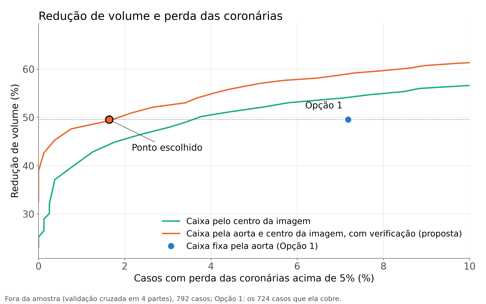
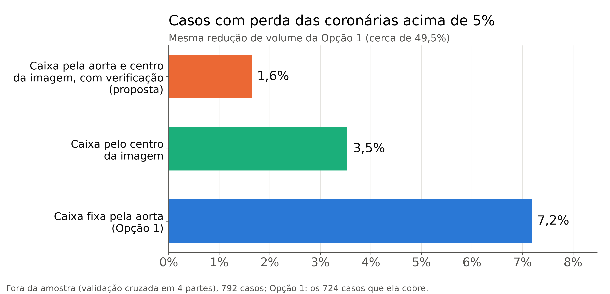
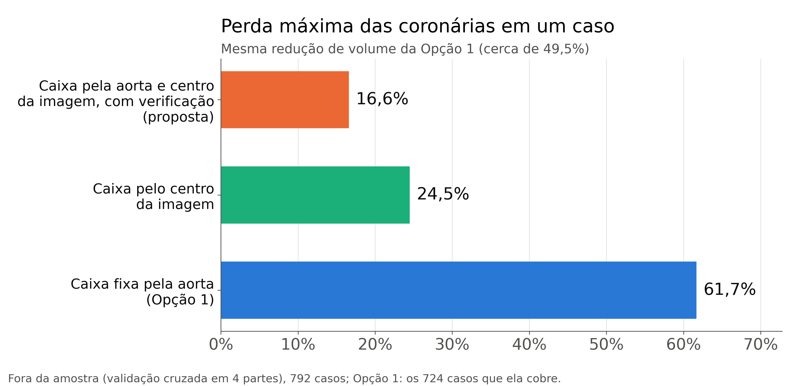
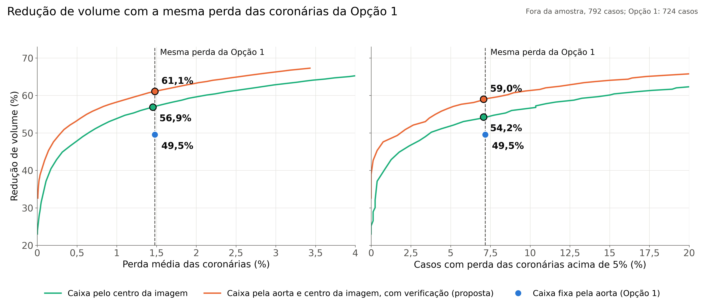
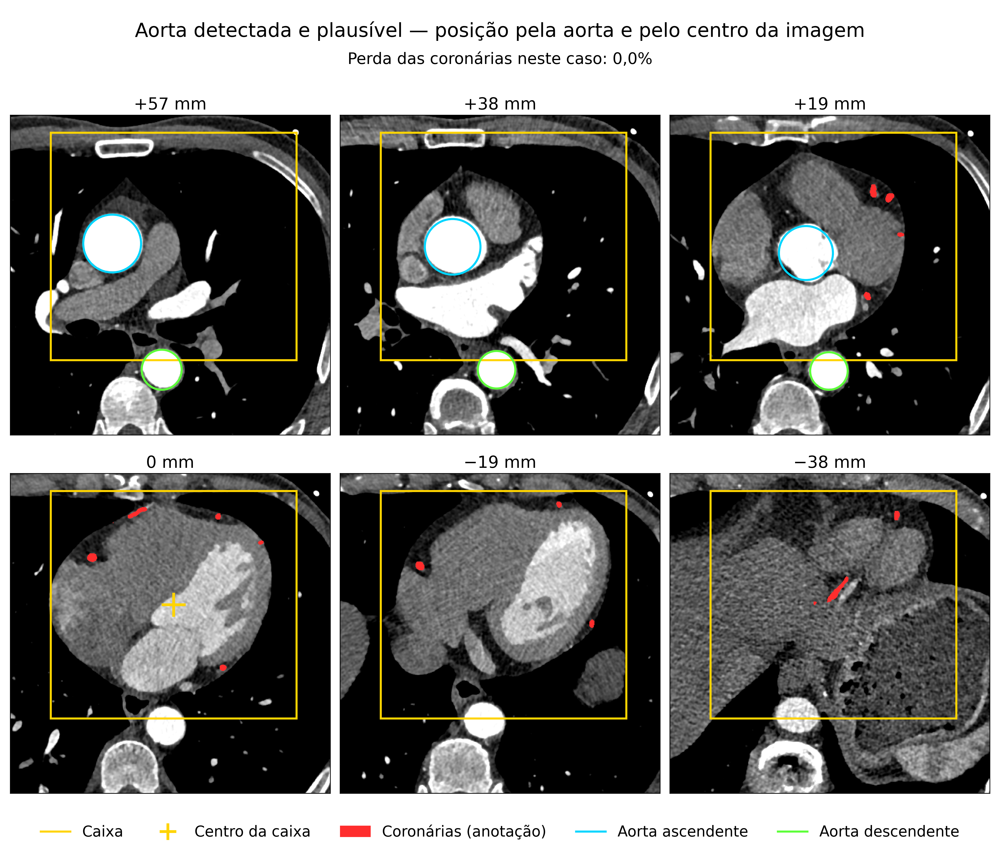
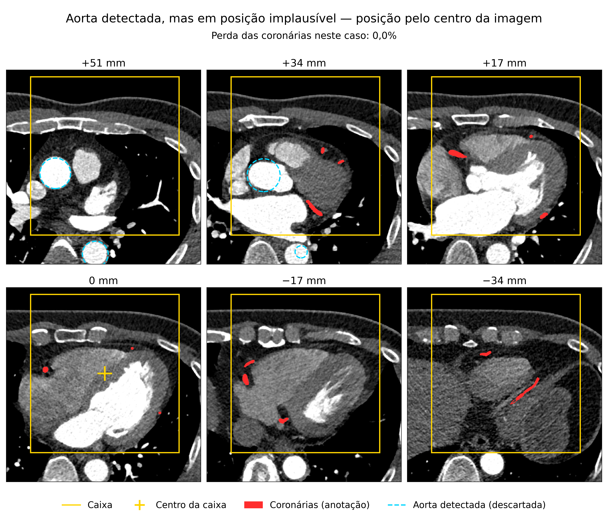
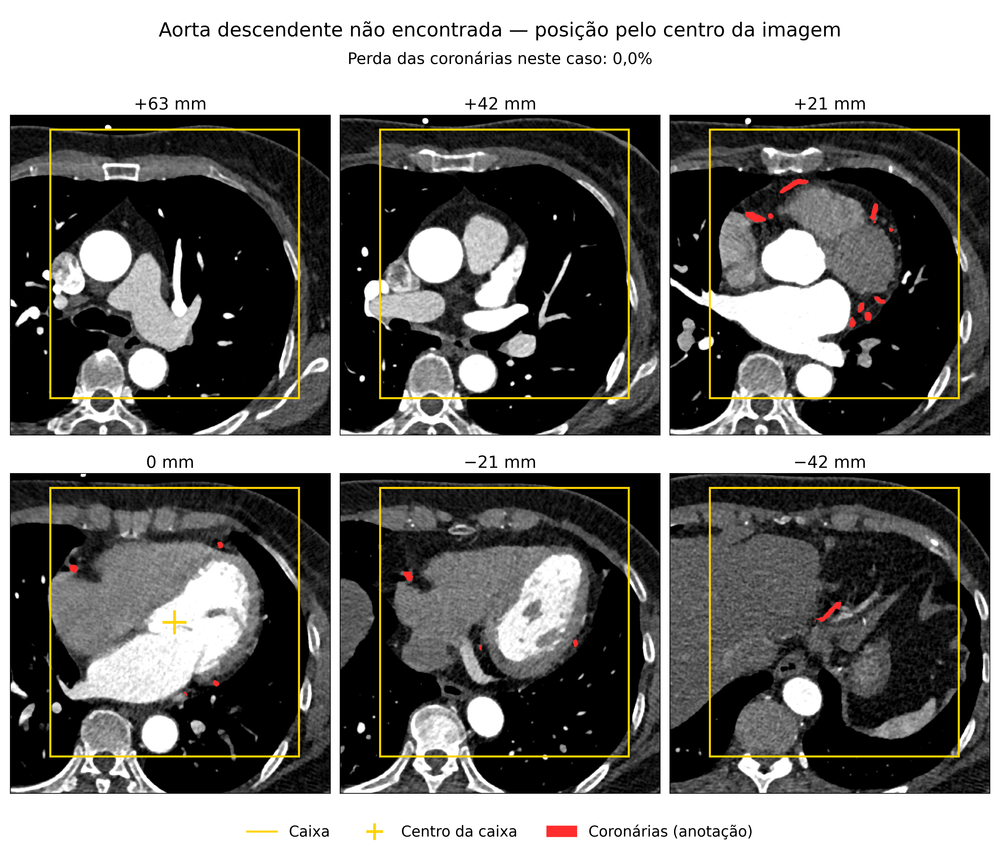
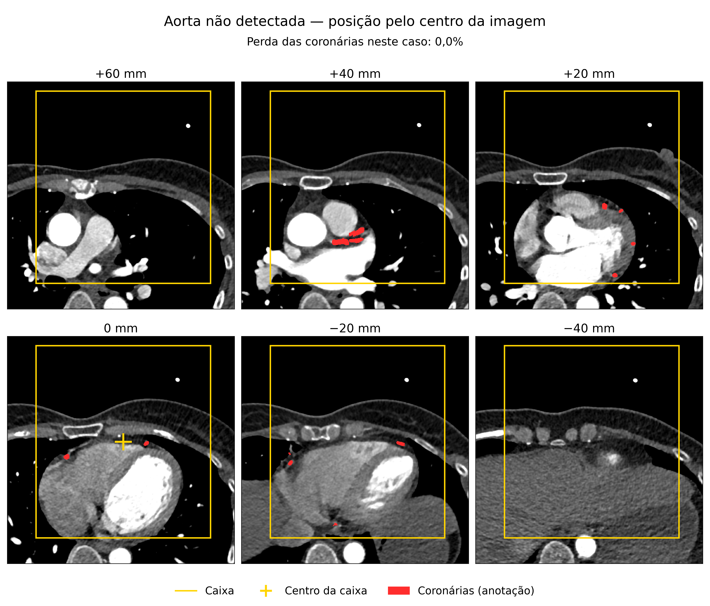

# Apresentação da proposta de recorte

**Método.** A caixa de tamanho fixo é posicionada pela aorta (ascendente e descendente) e pelo centro da
imagem. Quando a aorta não é detectada ou está em posição implausível, a caixa é posicionada só pelo
centro da imagem e fica um pouco maior.

Os resultados abaixo vêm de validação cruzada em 4 partes nos 792 casos fora do teste: cada caso é
avaliado com um ajuste que não o viu. A Opção 1 é avaliada nos 724 casos que ela cobre.

## Redução de volume e perda das coronárias

## Mesma redução de volume da Opção 1

| Método | Casos cobertos | Redução de volume (%) | Perda média das coronárias (%) | Casos com perda > 1% (%) | Casos com perda > 5% (%) | Casos com perda > 20% (%) | Perda máxima em um caso (%) |
|---|---:|---:|---:|---:|---:|---:|---:|
| Caixa fixa pela aorta (Opção 1) | 724 | 49,5 | 1,48 | 17,3 | 7,2 | 1,7 | 61,7 |
| Caixa pelo centro da imagem | 792 | 49,6 | 0,60 | 12,2 | 3,5 | 0,1 | 24,5 |
| Caixa pela aorta e centro da imagem, com verificação (proposta) | 792 | 49,5 | 0,28 | 7,2 | 1,6 | 0,0 | 16,6 |

## Mesma perda das coronárias da Opção 1: quanto a redução de volume aumenta?

Com a mesma perda das coronárias da Opção 1, a proposta reduz o volume em 59,0% a 61,1%, conforme a
medida de perda, contra 49,5% da Opção 1.

Nesse ponto, mais casos perdem um pouco de anotação: os casos com perda acima de 1% sobem de 17,3% para
22,5% a 28,0%, e, na mesma perda média, os casos com perda acima de 5% sobem de 7,2% para 9,6%. As perdas
grandes diminuem: os casos com perda acima de 20% caem de 1,7% para 0,3% a 0,4%, e a perda máxima cai de
61,7% para 27,1% a 28,1%.

O ponto congelado continua sendo o de mesma redução de volume, porque é ele que isola o efeito da posição
da caixa na comparação do Capítulo 3.

| Método | Ponto | Redução de volume (%) | Perda média das coronárias (%) | Casos com perda > 1% (%) | Casos com perda > 5% (%) | Casos com perda > 20% (%) | Perda máxima em um caso (%) | Casos cobertos |
|---|---|---:|---:|---:|---:|---:|---:|---:|
| Caixa fixa pela aorta (Opção 1) | — | 49,5 | 1,48 | 17,3 | 7,2 | 1,7 | 61,7 | 724 |
| Caixa pelo centro da imagem | Mesma perda média | 56,9 | 1,45 | 27,0 | 10,4 | 0,8 | 30,5 | 792 |
| Caixa pela aorta e centro da imagem, com verificação (proposta) | Mesma perda média | 61,1 | 1,48 | 28,0 | 9,6 | 0,4 | 28,1 | 792 |
| Caixa pelo centro da imagem | Mesmos casos com perda > 5% | 54,2 | 1,04 | 19,7 | 7,1 | 0,6 | 27,9 | 792 |
| Caixa pela aorta e centro da imagem, com verificação (proposta) | Mesmos casos com perda > 5% | 59,0 | 1,12 | 22,5 | 7,1 | 0,3 | 27,1 | 792 |

A caixa pelo centro da imagem tem poucos tamanhos possíveis, por isso a perda dela não acerta exatamente o
valor da Opção 1. Só nos 724 casos que a Opção 1 cobre, os pontos mudam pouco: a proposta fica com 60,0% a
61,5% de redução de volume.

Mesmos pontos nos casos de teste (208, ajuste nos 792):

| Método | Ponto | Redução de volume (%) | Perda média das coronárias (%) | Casos com perda > 1% (%) | Casos com perda > 5% (%) | Casos com perda > 20% (%) | Perda máxima em um caso (%) | Casos cobertos |
|---|---|---:|---:|---:|---:|---:|---:|---:|
| Caixa fixa pela aorta (Opção 1) | — | 49,0 | 0,15 | 3,4 | 0,5 | 0,0 | 12,0 | 208 |
| Caixa pelo centro da imagem | Mesma perda média | 57,0 | 1,40 | 22,6 | 12,0 | 0,5 | 20,9 | 208 |
| Caixa pela aorta e centro da imagem, com verificação (proposta) | Mesma perda média | 61,4 | 1,12 | 20,2 | 6,7 | 0,0 | 19,7 | 208 |
| Caixa pelo centro da imagem | Mesmos casos com perda > 5% | 54,6 | 1,02 | 16,8 | 7,7 | 0,0 | 19,2 | 208 |
| Caixa pela aorta e centro da imagem, com verificação (proposta) | Mesmos casos com perda > 5% | 59,5 | 0,82 | 16,8 | 5,8 | 0,0 | 17,3 | 208 |

Casos de teste selecionados entre os que todas as versões do recorte processam. Nesses casos, a Opção 1
perde bem menos (perda média de 0,15%), então os dois pontos já não têm a mesma perda dela.

## Casos de teste (208, parâmetros congelados)

| Método | Casos cobertos | Redução de volume (%) | Perda média das coronárias (%) | Casos com perda > 1% (%) | Casos com perda > 5% (%) | Casos com perda > 20% (%) | Perda máxima em um caso (%) |
|---|---:|---:|---:|---:|---:|---:|---:|
| Caixa fixa pela aorta (Opção 1) | 208 | 49,0 | 0,15 | 3,4 | 0,5 | 0,0 | 12,0 |
| Caixa pelo centro da imagem | 208 | 49,8 | 0,52 | 11,1 | 2,9 | 0,0 | 16,1 |
| Caixa pela aorta e centro da imagem, com verificação (proposta) | 208 | 50,2 | 0,11 | 3,8 | 0,0 | 0,0 | 3,8 |

Casos de teste selecionados entre os que todas as versões do recorte processam.

## As duas situações da proposta

| Situação | Casos (de 792) | Tamanho da caixa (mm, látero-lateral × ântero-posterior × crânio-caudal) | Redução de volume (%) | Casos com perda > 5% (%) |
|---|---:|---:|---:|---:|
| Aorta detectada e plausível | 657 | 137 × 126 × 117 | 51,6 | 1,5 |
| Aorta não confiável | 135 | 138 × 148 × 130 | 39,3 | 2,2 |

O tamanho da caixa usa o espaçamento mediano dos 792 casos.

## Cortes axiais: um caso por situação

Em cada situação, o caso mostrado é o de perda das coronárias mais próxima da mediana da situação; em
empate, o de menor número. Nas quatro situações, a mediana é 0%.

Neste caso, a aorta ascendente foi detectada só acima da caixa, por isso não aparece nos cortes.

---

Parâmetros congelados: `output/bounding_box/apresentacao_proposta/a8c_frozen.json`. As tabelas em CSV e
Markdown, os casos escolhidos e os scripts ficam na mesma pasta.
