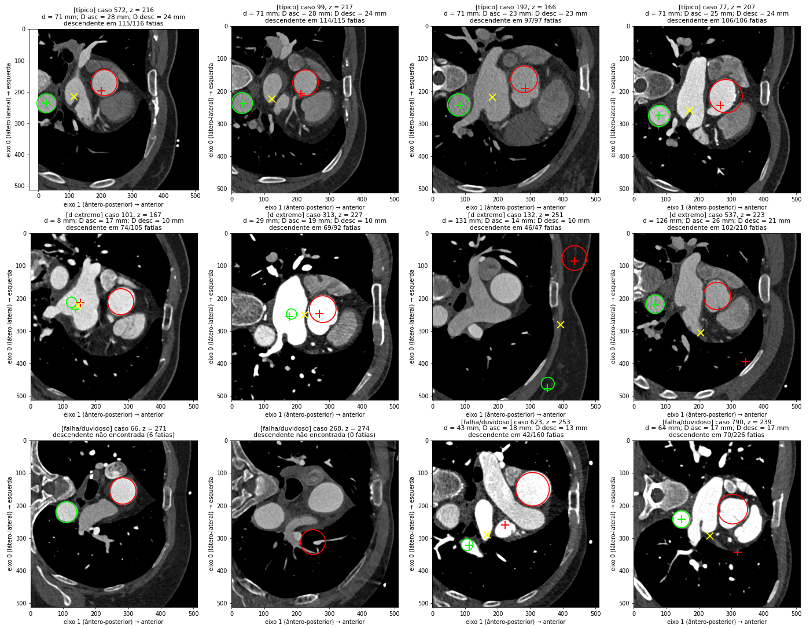

# Caminho 2 — geometria da aorta ascendente e descendente

**Data:** 2026-10-22. **Natureza:** exploratória. Nenhum dataset foi gerado e nenhum artefato de
produção foi alterado (`all_cases.csv`, calibração, manifestos e `cropped_*` são só lidos). O rótulo
coronário entra só como alvo; nenhuma característica usa o rótulo.

**Pergunta:** a geometria das duas aortas (diâmetros, centros, distância entre elas) explica a
extensão e a posição da árvore coronária? Inspiração: Zair et al. (2022), *Heart Outer Surface
Segmentation from Computed Tomography Images*. Nesse artigo, a região cardíaca é um círculo axial de
raio R = d + 2 × D_asc, em que d é a distância entre os centros das duas aortas e D_asc é o diâmetro
da ascendente.

**População:** os 792 casos fora do teste (`split_original.csv`, `split = trainval`), sem Critério C.
Os resultados também aparecem separados entre dentro do Critério C (724 casos) e fora dele (68). Os
208 de teste não entram em nenhum ajuste; aparecem só na verificação do Passo 4.

**Eixos** (orientação LAS, conferida no cabeçalho NIfTI):

| Eixo no código | Nome anatômico | Sentido crescente |
|---|---|---|
| eixo 0 ("y") | látero-lateral (LL) | esquerda do paciente |
| eixo 1 ("x") | ântero-posterior (AP) | anterior |
| eixo 2 (z) | crânio-caudal (CC) | cranial |

> **Ajuste em relação ao pedido.** O pedido descrevia a descendente como o círculo de **maior** eixo 1.
> Em LAS, o eixo 1 cresce para anterior. Por isso, a descendente (posterior, junto à coluna) é o círculo
> de **menor** eixo 1. Os cortes da figura de controle confirmam isso: a ascendente aparece em eixo 1
> ≈ 280–300 e a descendente em ≈ 40–100. A análise segue a anatomia: descendente = círculo posterior.

---

## 1. Método

### 1.1 Passo 1 — características da aorta (sem rótulo)

- **Pré-processamento e ascendente:** idênticos aos de produção (`load_and_preprocess_image` e
  `detect_aorta_circles`, `config/pipeline_config.json`, resolução reduzida por 2 nos eixos 0 e 1),
  sem Level Set. O rastreamento começa na fatia mais cranial e desce. Nos 995 casos em que a produção
  deu certo, o número de círculos reproduz `num_circles_detected` de `all_cases.csv` caso a caso.
- **Cache reutilizável:** `scratchpad/c2/c2_cache/<id>.npz`, 1000 casos, 42 MB. Por fatia, guarda o
  centro, o raio, o acumulador da Hough e a média e o desvio de HU no disco de 0,7 r, tanto para a
  ascendente quanto para os candidatos à descendente.
- **Raiz:** o menor z rastreado. É a aproximação, sem Level Set, do z mínimo da máscara.
- **Janela da ascendente:** da raiz até 20 mm acima (41 fatias com z de 0,5 mm). Na janela, o centro
  é a mediana dos centros rastreados (eixos 0, 1 e 2).
- **Diâmetro da ascendente — duas medidas:**
  - **Faixa larga (principal).** A faixa de produção (raio de 18 a 30 px reduzidos) impõe diâmetro
    mínimo de ~25 a 28 mm, e o rastreamento ainda calcula a média com círculos vizinhos. Isso deixa a
    medida presa à faixa. Por isso, rodei a Hough de novo na janela, com raio de 6 a 22 mm, numa ROI
    em torno do centro rastreado. Em cada fatia, ficou o pico de maior acumulador a até 6 mm desse
    centro; o diâmetro é a mediana sobre as fatias.
  - **Faixa de produção** (`ascP_D`): mediana dos raios rastreados na janela.
  - As duas se correlacionam pouco (Pearson 0,47). No controle visual da janela da raiz, a faixa larga
    se ajustou melhor ao lúmen.
- **Descendente:** só nas fatias em que a ascendente foi detectada (não interpolada).
  - **Faixa de raio própria:** 5 a 14 mm, o que dá 6 a 19 px reduzidos com o spacing típico (Zair et
    al. citam diâmetro de 16 ± 3 mm).
  - **Hough:** só nas colunas posteriores ao centro da ascendente (eixo 1 menor), com 25 picos por fatia.
  - **Filtros por candidato:**
    - |HU médio − HU médio da ascendente na mesma fatia| ≤ 120 HU (mesmo contraste);
    - desvio-padrão ≤ 80 HU (lúmen homogêneo);
    - no máximo 50% do disco saturado (os voxels acima do p99,7, que o pré-processamento zera, ficam
      fora das estatísticas);
    - borda a pelo menos 2 px da borda da ascendente (círculo distinto);
    - centro à esquerda do centro da ascendente (eixo 0 maior).
  - **Escolha entre fatias:**
    - Para cada candidato, conto o suporte: em quantas fatias há candidato a até 6 mm dele.
    - Entre os agrupamentos com suporte ≥ 50% do máximo, fico com o mais posterior (junto à coluna).
    - Em cada fatia, escolho o candidato de maior acumulador a até 12 mm desse modo.
  - **Centro e diâmetro:** a mediana sobre as fatias escolhidas.
  - **Descendente encontrada:** ≥ 10 fatias válidas.
- **Distâncias:** d e seus componentes no plano axial, sempre descendente − ascendente:
  - dLL > 0: a descendente está à esquerda da ascendente;
  - dAP < 0: a descendente está posterior à ascendente.
- **Raio de Zair:** R = d + 2 × D_asc. `RP` é o mesmo raio calculado com o diâmetro de produção.
- **Unidades:** tudo em voxels de resolução integral (reduzido × (2, 2, 1), mesma convenção da âncora
  de produção) e em mm (× spacing do cabeçalho).

### 1.2 Passo 2 — alvos (rótulo, só para análise)

Rótulo == 1, em resolução integral. Por eixo:
- extensão = max − min + 1;
- centro = (min + max) / 2;
- min e max relativos ao centro da ascendente (janela da raiz) e ao centro da descendente.

### 1.3 Passo 3 — relação

- **Correlações:** Spearman, Pearson e R² univariado, para cada característica × cada alvo.
- **Regressão linear multivariada**, com até 3 características escolhidas por relevância anatômica:

  | Alvo | Características |
  |---|---|
  | Extensão LL | dLL, D_asc, D_desc |
  | Extensão AP | dAP, D_asc, D_desc |
  | Extensão CC | d, D_asc, D_desc |
  | Centro (cada eixo) | coordenada da ascendente e da descendente no mesmo eixo |
  | Limites relativos | as mesmas características da extensão no eixo |

- **Fora da amostra:** os 4 folds de `split_original.csv` (treina em 3, prevê o 4º). R²_oos =
  1 − Σ(y − ŷ)² / Σ(y − ȳ_treino)².
- **Fator de redução do erro:** sqrt(1 − R²_oos).
- **Cauda:** p95 do |resíduo| fora da amostra, comparado com o p95 de |y − mediana do treino| (sem
  modelo).
- **Spacing como referência.** Em mm, característica e alvo são multiplicados pelo mesmo spacing, que
  varia de 0,29 a 0,46 mm entre casos (FOV de 148 a 238 mm). Isso cria uma correlação comum que não
  vem da aorta. Por isso, o spacing axial do cabeçalho (`sp`, sem rótulo) entra como característica
  de referência, junto com um modelo de controle "sp + as 3 características".
- **Posição (3.4):** erro do centro do label, por eixo e em mm, contra cada âncora. O viés é corrigido
  pela mediana dos folds de treino, como no Passo 0b. A âncora (e) é a regressão linear do centro
  sobre A1, ascendente, descendente e A2, também fora da amostra pelos folds.

### 1.4 Passo 4 — círculo de Zair como caixa axial

- **Caixa:** quadrado circunscrito ao círculo de raio k × R, cortado nos limites da imagem.
- **Centro:** ponto médio entre os centros da ascendente e da descendente. **Não consegui conferir no
  texto do artigo como o centro é definido** (só tive acesso a resumos), então o ponto médio é uma
  suposição.
- **Perda axial:** fração do label com (eixo 0, eixo 1) fora do quadrado, em qualquer z.
- **Redução de área:** 1 − área do quadrado / (512 × 512).
- **Calibração de k:** nos 724 casos com Zair válido e dentro do Critério C (os casos em que a Opção 1
  existe), para atingir a perda axial média da Opção 1 de produção restrita aos eixos 0 e 1 nesses
  mesmos casos: **0,950%**.
- **A2 axial:** centro do volume, com percentis dos offsets nos eixos 0 e 1 tirados dos 792. O p foi
  ajustado para a mesma perda média nos mesmos 724.

---

## 2. Passo 1 — detecção

| Conjunto | N | Ascendente | Descendente | Fatias com descendente (mediana [p5]) | Fração das fatias da ascendente (mediana) |
|---|---|---|---|---|---|
| 792 fora do teste | 792 | 791 | **776** | 100 [57,5] | 0,99 |
| dentro do Critério C | 724 | 724 | 724 | 102 [64] | 0,99 |
| fora do Critério C | 68 | 67 | 52 | 66 [14] | 0,80 |
| 208 de teste | 208 | 208 | 208 | 99,5 [66] | 1,00 |

- **Sem descendente nos 792 (16 casos, todos fora do Critério C):** 66, 86, 268, 306, 331, 347, 383,
  436, 593, 606, 657, 724, 738, 822, 834, 924.
  - O caso 86 não tem ascendente.
  - Em 14 dos 16, a ascendente tem ≤ 12 fatias rastreadas (o caso 347 tem 23). A falha herda a parada
    precoce do rastreamento de produção.
- **Duvidosos entre os 776 encontrados: 53** (10 deles fora do Critério C). Um caso conta como
  duvidoso se cumprir pelo menos um destes critérios:

  | Critério | Casos |
  |---|---|
  | Descendente em < 50% das fatias | 17 |
  | Centro com IQR > 10 mm entre fatias | 9 |
  | Círculo cruzando a borda do FOV | 25 |
  | D_desc fora de 10–30 mm | 5 |
  | d < 30 mm | 2 |

  No teste, 14 casos têm algum desses sinais. Os duvidosos continuam na análise; a lista sai das
  colunas de `c2_cases.csv`.

**Distribuição nos 776 (mediana [p5–p95]):**

| Característica | mm | Referência de Zair et al. |
|---|---|---|
| D_asc, faixa larga | 24,2 [14,9–30,2] | 21 ± 3 |
| D_asc, faixa de produção | 28,7 [25,1–33,7] | — |
| D_desc | 22,0 [16,6–26,4] | 16 ± 3 |
| d | 70,9 [43,9–91,9] | — |
| dLL | 19,4 [0,4–38,2] | — |
| dAP | −67,5 [−86,5 a −42,0] | — |
| R (faixa larga) | 119,1 [81,2–146,8] | — |
| R (faixa de produção) | 128,2 [101,7–155,7] | — |

*Figura: corte axial (resolução integral) na fatia mediana da descendente.*
- **Círculos:** vermelho = ascendente rastreada naquela fatia; verde = descendente escolhida.
- **Marcadores:** cruz vermelha = centro da ascendente na janela da raiz; cruz verde = centro da
  descendente; X amarelo = centro de Zair (ponto médio).
- **Linha 1, típicos (d ≈ mediana):** as duas detecções estão corretas.
- **Linha 2, d extremo — todos são erros de detecção, não anatomia extrema:**
  - 101 e 313 (d de 8 e 29 mm): a "descendente" é um vaso junto à ascendente.
  - 132 e 537 (d de 131 e 126 mm): a ascendente da janela da raiz cai fora da aorta, porque o
    rastreamento de produção derivou antes de parar.
- **Linha 3, falhas e duvidosos:**
  - 66 e 268: rastreamento da ascendente curto demais (6 e 1 fatias).
  - 623 e 790: a raiz ficou longe da aorta (a cruz vermelha está fora do círculo vermelho).

---

## 3. Passo 3 — a relação existe?

### 3.1 Correlação com a extensão (mm, 776 casos, Spearman)

| Característica | Extensão LL | Extensão AP | Extensão CC |
|---|---|---|---|
| sp (spacing, referência) | 0,39 | 0,51 | 0,08 |
| D_asc (faixa larga) | 0,23 | 0,27 | 0,04 |
| D_asc (produção) | 0,37 | 0,46 | 0,09 |
| D_desc | 0,37 | 0,46 | 0,08 |
| d | 0,30 | 0,45 | −0,03 |
| dLL | 0,23 | 0,10 | −0,02 |
| dAP | −0,28 | −0,49 | 0,04 |
| R | 0,31 | 0,44 | −0,01 |

Em voxels, as mesmas correlações caem: o melhor R² univariado é 0,04 (LL), 0,08 (AP) e 0,07 (CC).
Todos os pares estão em `c2_correlations.csv` (Pearson, Spearman, valor-p, R², por grupo e unidade).

**Centro do label (voxels, Spearman):**
- AP: com o eixo 1 da ascendente, 0,67; com o da descendente, 0,61.
- CC: com o z da ascendente, 0,61; com o da descendente, 0,71.
- LL: ≤ 0,26 com qualquer característica.

### 3.2 Regressão multivariada (até 3 características), R² dentro / fora da amostra

**Unidade mm:**

| Alvo | Características | Todos (776) | Dentro de C (724) | Fora de C (52) | Só sp (R²_oos) | sp + as 3 (R²_oos) |
|---|---|---|---|---|---|---|
| Extensão LL | dLL, D_asc, D_desc | 0,112 / 0,098 | 0,125 / 0,110 | 0,027 / −0,079 | **0,147** | 0,170 |
| Extensão AP | dAP, D_asc, D_desc | 0,188 / 0,171 | 0,190 / 0,174 | 0,207 / 0,121 | **0,268** | 0,299 |
| Extensão CC | d, D_asc, D_desc | 0,008 / −0,004 | 0,009 / −0,003 | 0,030 / −0,018 | −0,003 | −0,002 |
| Centro LL | ascendente e descendente no eixo 0 | 0,273 / 0,263 | 0,297 / 0,285 | 0,156 / 0,004 | 0,578 | 0,599 |
| Centro AP | ascendente e descendente no eixo 1 | 0,650 / 0,642 | 0,664 / 0,654 | 0,613 / 0,480 | 0,477 | 0,707 |
| Centro CC | ascendente e descendente no eixo 2 | 0,507 / 0,506 | 0,561 / 0,553 | 0,221 / −0,182 | 0,074 | 0,521 |

**Unidade voxels:**

| Alvo | Todos (776) | Dentro de C | Fora de C | Só sp (R²_oos) |
|---|---|---|---|---|
| Extensão LL | 0,048 / 0,033 | 0,056 / 0,039 | 0,075 / −0,034 | 0,202 |
| Extensão AP | 0,048 / 0,041 | 0,046 / 0,041 | 0,128 / 0,046 | 0,079 |
| Extensão CC | 0,009 / 0,001 | 0,009 / 0,001 | 0,024 / −0,003 | −0,003 |
| Centro LL | 0,059 / 0,055 | 0,073 / 0,069 | 0,000 / −0,134 | 0,015 |
| Centro AP | 0,465 / 0,444 | 0,474 / 0,451 | 0,472 / 0,333 | 0,015 |
| Centro CC | 0,507 / 0,506 | 0,561 / 0,553 | 0,221 / −0,182 | 0,074 |

### 3.3 Melhor R² fora da amostra por alvo e cauda (todos os 776)

Melhor modelo entre as 14 características univariadas e o multivariado, sem os modelos de controle.
"p95 sem modelo" = p95 de |y − mediana do treino|.

| Alvo (unidade) | Melhor modelo | R²_oos | sqrt(1 − R²) | p95 do \|resíduo\| | p95 sem modelo | Razão p95 |
|---|---|---|---|---|---|---|
| Extensão LL (mm) | D_asc (produção) | 0,121 | 0,94 | 20,0 | 21,1 | 0,95 |
| Extensão AP (mm) | D_asc (produção) | 0,192 | 0,90 | 17,9 | 19,0 | 0,94 |
| Extensão CC (mm) | z da descendente | 0,070 | 0,96 | 17,8 | 18,5 | 0,96 |
| Extensão LL (vox) | eixo 0 da descendente | 0,036 | 0,98 | 62,1 | 62,0 | 1,00 |
| Extensão AP (vox) | eixo 1 da descendente | 0,083 | 0,96 | 47,8 | 48,2 | 0,99 |
| Centro LL (vox) | multi | 0,055 | 0,97 | 32,8 | 32,6 | 1,00 |
| Centro AP (vox) | multi | 0,444 | 0,75 | 42,9 | 60,5 | 0,71 |
| Centro CC (vox) | multi | 0,506 | 0,70 | 25,0 | 35,0 | 0,72 |

**Limites relativos às aortas (mm, melhor R²_oos | razão p95):**

| Alvo | Relativo à ascendente, min | Relativo à ascendente, max | Relativo à descendente, min | Relativo à descendente, max |
|---|---|---|---|---|
| LL | 0,540 (eixo 0 da ascendente) \| 0,68 | 0,485 (multi) \| 0,75 | 0,509 (eixo 0 da descendente) \| 0,72 | 0,209 (eixo 0 da descendente) \| 0,88 |
| AP | 0,411 (multi) \| 0,60 | 0,131 (multi) \| 0,93 | 0,372 (multi) \| 0,77 | 0,499 (multi) \| 0,75 |
| CC | 0,592 (z da ascendente) \| 0,59 | 0,587 (z da ascendente) \| 0,58 | 0,312 (z da descendente) \| 0,80 | 0,225 (z da descendente) \| 0,87 |

### 3.4 Posição: p95 do |erro| do centro do label (mm, viés corrigido pela mediana dos folds)

776 casos com as três âncoras (A1 existe em todos eles):

| Eixo | A1 (produção) | Ascendente (raiz) | Descendente | A2 (centro do volume) | (e) combinação linear | R²_oos de (e) |
|---|---|---|---|---|---|---|
| LL (eixo 0) | 21,7 | 23,8 | 20,3 | **11,6** | **11,6** | 0,60 |
| AP (eixo 1) | 18,7 | 21,7 | 22,5 | 20,8 | **14,8** | 0,72 |
| CC (eixo 2) | 24,2 | 29,5 | 15,3 | 15,0 | **12,3** | 0,51 |

Por grupo (p95 em mm; A1 / ascendente / descendente / A2 / (e)):

| Eixo | Dentro de C (724) | Fora de C (52) |
|---|---|---|
| LL | 20,9 / 21,9 / 20,2 / 11,6 / 11,5 | 35,5 / 54,5 / 26,9 / 11,2 / 11,8 |
| AP | 18,8 / 20,2 / 22,5 / 21,0 / 14,8 | 17,5 / 27,6 / 21,8 / 19,3 / 15,1 |
| CC | 18,3 / 18,5 / 13,5 / 15,0 / 11,8 | 45,6 / 62,9 / 31,4 / 15,2 / 18,2 |

O R²_oos de (e) é o do centro em coordenadas absolutas em mm. Em LL, ele vem quase todo de A2 em mm
(shape / 2 × spacing), não das aortas.

---

## 4. Passo 4 — o círculo de Zair como caixa axial

- **Alvo de perda:** a Opção 1 de produção, só nos eixos 0 e 1, nos 724 casos (Zair válido ∩ Critério
  C), tem perda axial média de **0,950%**.
- **k calibrado:** **1,017** com a faixa larga; **0,781** com a faixa de produção.
- **A2 axial:** p = **91,40**.
- **Escala do quadrado:** com k = 1, o lado 2R excede o FOV axial em **93%** dos casos (faixa larga) e
  em **99,5%** (faixa de produção). O FOV mediano é de 179 mm e o 2R mediano, de 238 mm.

| Conjunto | Método | N | Perda média (%) | > 1% | > 5% | > 20% | Perda máx. (%) | Redução de área média (mediana) |
|---|---|---|---|---|---|---|---|---|
| **792: 724 mesmos casos** | Zair sem ajuste, faixa larga (k = 1) | 724 | 1,035 | 5,8% | 4,7% | 2,2% | 60,5 | 4,9% (0,0%) |
| | Zair sem ajuste, faixa de produção (k = 1) | 724 | 0,141 | 1,7% | 0,7% | 0,1% | 35,5 | 1,6% (0,0%) |
| | Zair recalibrado, faixa larga (k = 1,017) | 724 | 0,949 | 5,1% | 4,7% | 1,8% | 59,7 | 4,4% (0,0%) |
| | Zair recalibrado, faixa de produção (k = 0,781) | 724 | 0,950 | 7,3% | 4,7% | 1,5% | 55,3 | 12,5% (10,7%) |
| | A2 axial (p = 91,40) | 724 | 0,945 | 18,1% | 6,5% | 0,6% | 30,0 | 50,0% (50,0%) |
| | Opção 1, eixos 0 e 1 | 724 | 0,950 | 13,8% | 5,9% | 0,4% | 61,4 | 44,4% (44,0%) |
| **792: todos com Zair válido** | Zair recalibrado, faixa larga | 776 | 0,901 | 5,0% | 4,5% | 1,7% | 59,7 | 4,3% |
| | Zair recalibrado, faixa de produção | 776 | 0,917 | 7,0% | 4,5% | 1,5% | 55,3 | 12,3% |
| | A2 axial | 776 | 0,935 | 17,8% | 6,4% | 0,5% | 30,0 | 50,0% |
| | Opção 1, eixos 0 e 1 | 776 | 1,127 | 15,2% | 7,2% | 0,5% | 61,4 | 44,5% |
| **Só fora de C (52)** | Zair recalibrado, faixa larga | 52 | 0,223 | 3,8% | 1,9% | 0,0% | 9,9 | 2,5% |
| | Zair recalibrado, faixa de produção | 52 | 0,460 | 1,9% | 1,9% | 1,9% | 23,9 | 8,9% |
| | A2 axial | 52 | 0,787 | 13,5% | 5,8% | 0,0% | 15,8 | 50,0% |
| | Opção 1, eixos 0 e 1 | 52 | 3,594 | 34,6% | 25,0% | 1,9% | 23,2 | 45,5% |
| **208 de teste (fora da amostra)** | Zair sem ajuste, faixa larga | 208 | 0,078 | 1,0% | 0,5% | 0,0% | 12,7 | 3,0% |
| | Zair sem ajuste, faixa de produção | 208 | 0,001 | 0,0% | 0,0% | 0,0% | 0,2 | 0,8% |
| | Zair recalibrado, faixa larga | 208 | 0,066 | 1,0% | 0,5% | 0,0% | 11,4 | 2,6% |
| | Zair recalibrado, faixa de produção | 208 | 0,209 | 1,9% | 1,4% | 0,5% | 22,7 | 11,8% |
| | A2 axial | 208 | 0,904 | 15,4% | 8,2% | 0,0% | 17,2 | 50,0% |
| | Opção 1, eixos 0 e 1 | 208 | 0,124 | 3,4% | 0,5% | 0,0% | 8,0 | 44,2% |

As perdas por caso estão em `c2_zair_axial_percase.csv`.

---

## 5. Interpretação

1. **Extensão: as aortas explicam pouco.**
   - O melhor R² fora da amostra em mm é 0,12 (LL), 0,19 (AP) e 0,07 (CC). Isso reduz o erro típico em
     4% a 10% (sqrt(1 − R²) de 0,90 a 0,96) e a cauda p95 em 4% a 6%.
   - O spacing do cabeçalho sozinho explica mais (0,15 em LL e 0,27 em AP). Somar as três
     características da aorta ao spacing acrescenta só 0,02 a 0,03 de R².
   - Em voxels, onde a escala comum some, o R² cai para 0,03 a 0,08.
   - Ou seja: a correlação aparente em mm vem, em boa parte, do tamanho do paciente e do FOV, e não da
     geometria aórtica em si.
   - Em CC, nenhuma característica explica a extensão.
2. **Posição: há relação nos eixos AP e CC, e ela é sobretudo posicional.**
   - O centro da árvore acompanha as coordenadas AP e CC das aortas (R²_oos de 0,44 e 0,51 em voxels;
     razão p95 de 0,71 e 0,72).
   - Contra o centro do volume (A2), a melhor combinação linear reduz o p95 de 20,8 para 14,8 mm em AP
     (−29%) e de 15,0 para 12,3 mm em CC (−18%). Em LL, o ganho é nulo (11,6 contra 11,6 mm).
   - Nenhuma âncora isolada das aortas (A1, ascendente ou descendente) supera A2 em LL nem em CC. Em
     AP, A1 (18,7 mm) supera A2 (20,8 mm); a ascendente (21,7) e a descendente (22,5) não. Mesmo
     assim, nenhuma delas chega perto da combinação.
   - Isso repete o padrão do Passo 0b: o ganho de posição vem de combinar fontes, eixo a eixo.
3. **Limites relativos às aortas.** Os R² de 0,4 a 0,6 dessas tabelas vêm, na maior parte, da
   coordenada da própria aorta usada como característica. A regressão desfaz o erro da âncora e
   devolve, na prática, uma posição no referencial do volume. Não indicam que o tamanho ou a distância
   das aortas preveja onde o label termina; os modelos multivariados só de tamanho ficam entre 0,0 e
   0,5, e os maiores valores aparecem em AP, em que dAP mede o próprio eixo.
4. **Fora do Critério C, tudo piora.**
   - A detecção da descendente cai para 52 de 68 casos.
   - A ascendente da raiz chega a p95 de 54 mm em LL e 63 mm em CC.
   - Vários R²_oos ficam negativos.
   - A falha herda o rastreamento da ascendente de produção: quando ele para cedo ou deriva, o centro
     da raiz e a distância d ficam errados. A figura de controle mostra isso nos quatro casos de d
     extremo.
5. **O círculo de Zair não funciona como caixa no ImageCAS.**
   - O FOV do ImageCAS já é cardíaco (mediana de 179 mm). O quadrado de lado 2R ≈ 238 mm é maior que
     a imagem em 93% a 99,5% dos casos, então a redução de área mediana é 0%.
   - Com a mesma perda média da Opção 1 (0,95%), o quadrado de Zair reduz a área em 4% a 12%; A2 axial
     reduz 50% e a Opção 1, 44%.
   - A perda do Zair se concentra em poucos casos com detecção errada: 4,7% dos casos acima de 5% de
     perda, e máximo de até 60%. A2 tem mais casos com perda pequena: 18% acima de 1%, mas só 0,6%
     acima de 20%.
   - A perda quase nula nos 208 de teste reflete só o tamanho da caixa (quase a imagem toda). Não é
     ganho de localização.
   - A fórmula foi pensada para um FOV torácico, em que o coração ocupa uma fração menor da imagem.
6. **Ressalvas.**
   - O centro de Zair foi suposto no ponto médio (não confirmei no texto do artigo).
   - "Raiz" é o menor z rastreado, não o z mínimo da máscara do Level Set.
   - O melhor R² de cada alvo é escolhido entre 14 candidatos, o que dá um viés otimista pequeno.
   - Os 53 casos duvidosos não foram excluídos.

---

## 6. Resumo por eixo

Melhor R² fora da amostra (4 folds, 776 casos) e a redução de margem correspondente. Redução =
1 − sqrt(1 − R²); entre parênteses, a redução da cauda: 1 − razão p95.

| Eixo | Extensão: melhor R²_oos (mm) | Redução de margem | Extensão: só spacing (R²_oos, mm) | Posição: melhor R²_oos, características da aorta (vox) | Redução de margem | Posição: p95 da melhor âncora contra A2 (mm) |
|---|---|---|---|---|---|---|
| **Látero-lateral (eixo 0)** | 0,121 (D_asc de produção) | 6% (cauda 5%) | 0,147 | 0,055 (ascendente + descendente) | 3% (cauda 0%) | 11,6 (combinação) contra 11,6 → 0% |
| **Ântero-posterior (eixo 1)** | 0,192 (D_asc de produção) | 10% (cauda 6%) | 0,268 | 0,444 (ascendente + descendente) | 25% (cauda 29%) | 14,8 (combinação) contra 20,8 → 29% |
| **Crânio-caudal (eixo 2)** | 0,070 (z da descendente) | 4% (cauda 4%) | −0,003 | 0,506 (ascendente + descendente) | 30% (cauda 28%) | 12,3 (combinação) contra 15,0 → 18% |

---

## 7. Reprodutibilidade

**Saídas** em `output/bounding_box/caminho2_aorta_geometry/`:

| Arquivo | Conteúdo |
|---|---|
| `c2_features.csv`, `c2_extract_meta.csv` | Passo 1, por caso, mais spacing e shape |
| `c2_cases.csv` | Características, alvos, âncoras, sinais de qualidade, split e Critério C |
| `c2_detection_rate.csv` | Taxa de detecção |
| `c2_correlations.csv` | Pearson e Spearman, por unidade e grupo |
| `c2_regressions.csv`, `c2_best_per_target.csv` | R² dentro e fora da amostra, fator sqrt, p95 |
| `c2_position_anchors.csv` | Passo 3.4 |
| `c2_zair_axial.csv`, `c2_zair_axial_percase.csv`, `c2_zair_calibration.json` | Passo 4 |

**Scripts** em `scripts/`, na ordem de execução:

1. `c2_extract.py`: detecção de círculos, gera o cache `c2_cache/`; ~2 h para 1000 casos com 24
   processos.
2. `c2_asc_wide.py`: diâmetro da ascendente com faixa larga.
3. `c2_features.py`, que usa a seleção da descendente de `c2_select.py`.
4. `c2_analyze.py`: Passos 2 a 4.
5. `c2_control_figure.py`: gera `docs/img/caminho2_controle_deteccao.png`.

**Dependências:**
- Os caches ficam no scratchpad da sessão (`c2/c2_cache`, `c2/c2_asc_wide`, `p0_cache`), fora do
  repositório. `p0_cache` guarda as coordenadas do label em resolução integral e vem dos Passos 0 e 0c
  e da calibração A2.
- Python do `.venv` do repositório.
