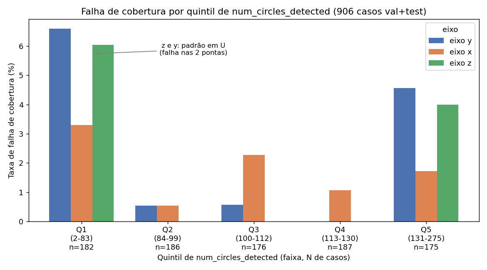
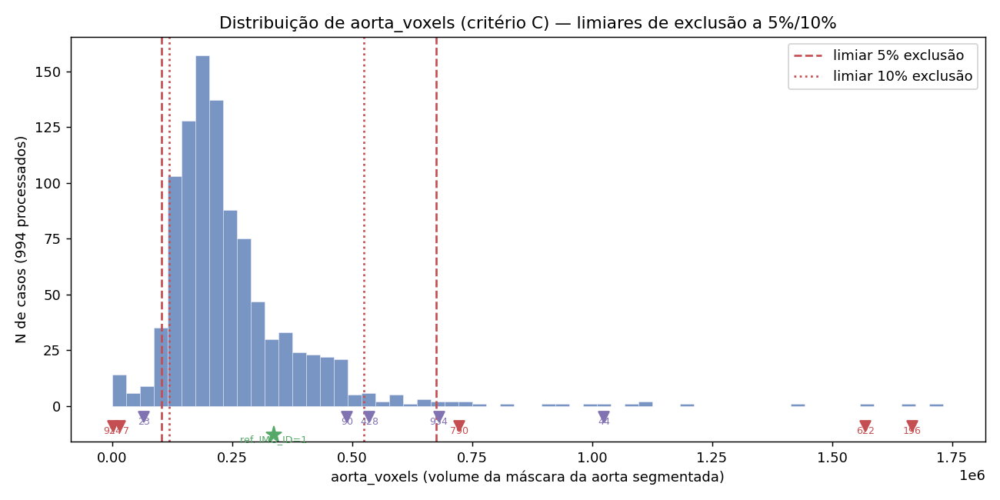
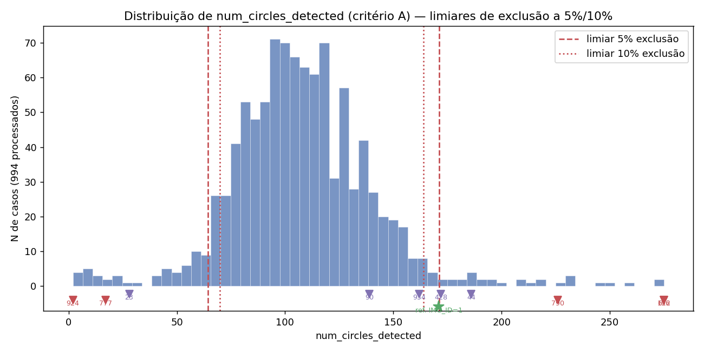
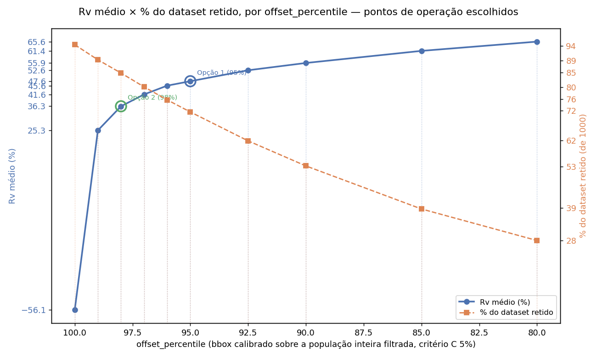
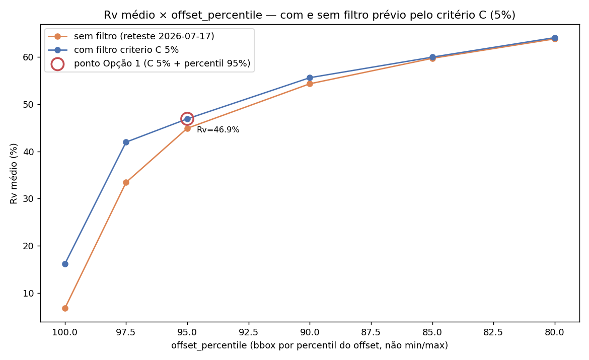
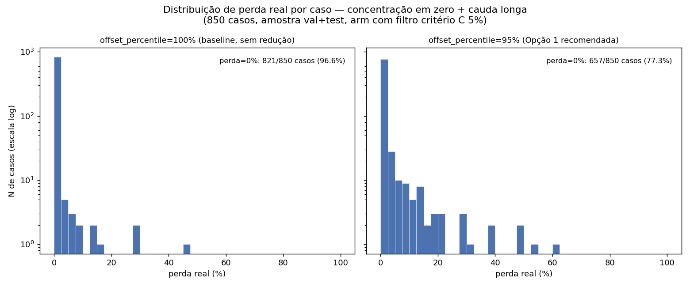
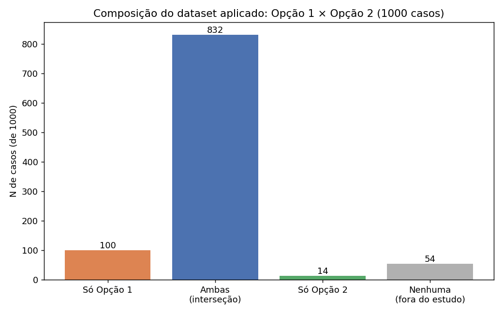
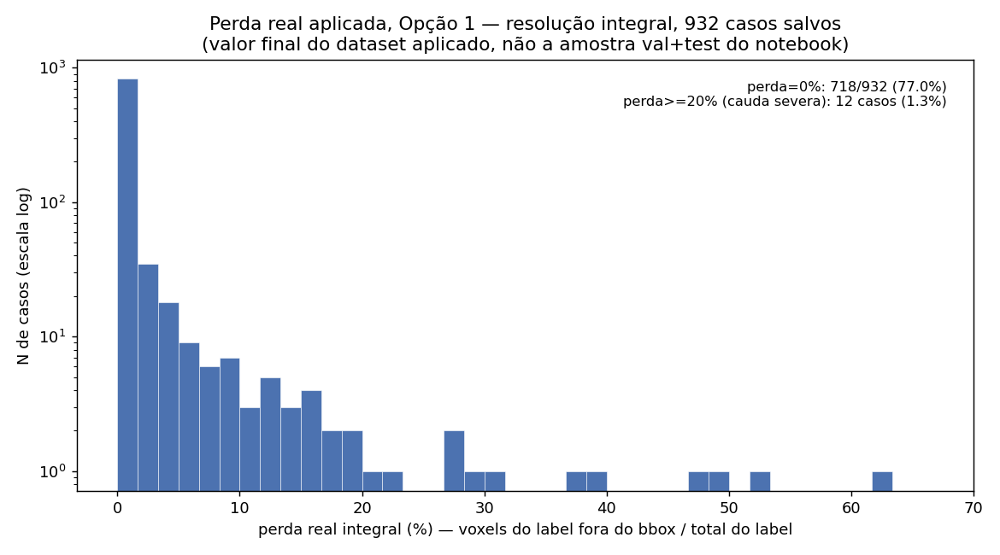

# Relatório: datasets recortados (bounding box), critérios de exclusão e interseções

**Data do relatório:** 2026-09-10. **Escopo:** análise pós-hoc do dataset já migrado de
`output/bounding_box/cropped_dataset_option{1,2}/` (neste repositório) para
`D:\Doutorado\dataset\cropped_option{1,2}\` (esta máquina) — a aplicação em si (recorte real,
1000/1000 casos, 0 erros) foi feita em 2026-08-06 e está registrada em
[STATUS.md](STATUS.md) e na memória do assistente. Este documento **não reprocessa nenhuma
imagem/máscara**: reaproveita os CSVs de diagnóstico já gerados (`output/bounding_box/
aorta_anchor*/`) e o manifesto final (`D:\Doutorado\dataset\cropped_manifests\manifest_all.csv`),
com ênfase específica em **quem ficou de fora de cada opção e por quê**, e na **interseção real**
entre as duas opções.

Este relatório complementa, sem repetir, a narrativa técnica completa em
[step6v2_aorta_anchor.md](step6v2_aorta_anchor.md) e o resumo de decisão em
[STATUS.md](STATUS.md). Os gráficos-síntese usados na reunião de acompanhamento de 2026-07-29
estão em `notebooks/reuniao_2026-07-29_diagnostico_e_correcao_z_coverage.ipynb` — as figuras 1 a 6
abaixo são regeradas a partir dos mesmos CSVs desse notebook (sem alterar nenhum valor), e as
figuras 7-8 são novas, construídas sobre o manifesto do dataset efetivamente aplicado.

## 1. Onde estão os dados agora

| Pasta em `D:\Doutorado\dataset\` | Conteúdo | N de casos |
|---|---|---|
| `original/` | dataset ImageCAS bruto (1000 casos, 5 blocos de 200) | 1000 |
| `cropped_option1/` | Opção 1 — perda parcial tolerada | **932** |
| `cropped_option2/` | Opção 2 — perda real zero garantida | **846** |
| `cropped_manifests/` | `manifest_all.csv` (por caso, as duas opções), `calibration_both_options.json`, `block_*.csv` | 1000 linhas (todos os casos processados, incluídos ou não) |

Os diretórios `cropped_option1/2` são grandes (40 GB e 43 GB) e não são versionados no git
(`.gitignore`); os manifestos (CSV/JSON, leves) continuam versionados em
`output/bounding_box/cropped_dataset_manifests/` no repositório, além de existirem agora também na
cópia local em `D:\Doutorado\dataset\cropped_manifests\` (mesmo conteúdo).

## 2. Teoria e metodologia por trás dos critérios

### 2.1 O problema original: bbox por âncora da aorta, cobertura ruim

O bbox de produção (etapa 6 v2) usa o centróide da máscara da aorta segmentada (Hough + Level Set)
como âncora, com offsets (distância da âncora até cada face do bbox) calibrados
**deterministicamente** por agregação estatística simples (mínimo/máximo dos offsets observados no
split de treino do ImageCAS) — ver [[phd_thesis_context]] para por que isso precisa continuar sendo
uma agregação e não um modelo aprendido. A calibração original por min/max produzia um bbox de
480×414×312 voxels (resolução integral) com `Rv` (redução volumétrica) de só **~5%** — ganho de
eficiência computacional insuficiente para sustentar a hipótese central da tese.

A investigação de 2026-07-21 a 07-27 (detalhada em `step6v2_aorta_anchor.md`) isolou a causa: a
calibração por mínimo/máximo é **dominada pelos casos extremos** (5 casos definem sozinhos as 6
faces do bbox — um por eixo/direção, exceto y_max/x_min que colidem no mesmo caso). Um único caso
com falha de rastreamento do detector de aorta (Hough sob- ou super-detectando círculos) infla o
offset calibrado para todos os 1000 casos.

### 2.2 O achado-chave: padrão em U por `num_circles_detected`

A Figura 1 (reproduzida do notebook de 2026-07-29, dados de 906 casos val+test) mostra a taxa de
falha de cobertura por quintil de `num_circles_detected` (número de círculos Hough detectados na
segmentação da aorta):

**Leitura:** a falha de cobertura em z (e, de forma mais fraca, em y) é **zero** nos 3 quintis
centrais (Q2-Q4, ~55% dos casos) e concentrada nos dois quintis extremos (Q1: poucos círculos
detectados = under-tracking; Q5: muitos círculos detectados = over-tracking). O eixo x, que não
depende tão diretamente da extensão detectada da aorta, serve de controle e não mostra o mesmo
padrão. Este padrão em U foi o gatilho direto para testar **exclusão de casos-outlier** (em vez de
tentar corrigir o mecanismo de detecção) — origem dos critérios A, B e C.

### 2.3 Três critérios de exclusão testados

| Critério | Métrica | Elegível para produção? | Motivo |
|---|---|---|---|
| **A** | `num_circles_detected` (caudas da distribuição) | Sim, mas inferior a C | Captura o padrão em U diretamente, mas nunca recupera o caso 90 mesmo a 20% de exclusão |
| **B** | `envelope_extent` do label coronário, por eixo | **Não** — reclassificado como curadoria de dataset | Depende do label verdadeiro do caso (só existe porque o ImageCAS é anotado); não é aplicável a uma imagem nova sem anotação |
| **C** | `aorta_voxels` (volume da máscara da aorta segmentada) | **Sim — vencedor, único elegível para produção** | Derivável só da imagem (sem label); primeiro critério a capturar os 5 casos calibradores extremos simultaneamente (a 10% de exclusão); Jaccard(A,C)=0,52 vs. Jaccard(\*,B)≈0,07 |

A Figura 2 mostra a distribuição de `aorta_voxels` nos 994 casos com segmentação bem-sucedida
(critério C), com os limiares de exclusão a 5% e 10% calculados **só no split de treino** (evita
vazamento) marcados como linhas verticais, e marcadores no eixo (rug plot) para os 5 casos
calibradores originais (roxo), os 5 piores casos de cobertura já inspecionados visualmente
(vermelho) e o caso de referência IMG_ID=1 (verde):

A Figura 3 mostra o mesmo tipo de gráfico para o critério A (`num_circles_detected`), incluído para
comparação — não é o critério de produção final, mas motivou a mesma investigação:

**Leitura de ambas:** os casos calibradores e os piores casos de cobertura se concentram nas caudas
das duas distribuições — o mesmo achado documentado por percentil na tarefa 3b do
`step6v2_aorta_anchor.md`. Um detalhe relevante: a referência IMG_ID=1 fica próxima do centro em
`aorta_voxels`, mas seu `num_circles_detected` (171) fica muito perto do limiar superior de 5% do
critério A (171,1) — só por coincidência, ilustrando por que um corte marginal em torno de uma
métrica ruidosa pode capturar casos "normais" que caem perto da borda por acaso, não por qualidade
de segmentação ruim.

### 2.4 Achado crítico: calibrar sobre a população inteira dá `Rv` negativo

Ao excluir os outliers pelo critério C e calibrar o bbox por **mínimo/máximo dos offsets** sobre
**toda** a população filtrada (não só o treino) — necessário para garantir 100% de cobertura por
construção — o `Rv` resultante é **negativo** na maioria das configurações testadas (o bbox fica
maior que a imagem original). Isso ameaçava metade da hipótese central da tese (eficiência
computacional), não só a cobertura. Ver linha `offset_percentile=100%` na Tabela 1 abaixo: `Rv`
médio de **−56,06%**.

### 2.5 Solução: otimização N × Rv com perda real zero garantida

A saída foi trocar "cobrir 100% de tudo" por "cobrir 100% de quem sobrevive a um corte de bbox mais
agressivo": em vez de calibrar por mínimo/máximo absoluto, calibrar por **percentil** dos offsets
(`offset_percentile`) sobre a população inteira filtrada pelo critério C (5% de exclusão → 944
casos elegíveis de 994 processados). Um caso só entra no dataset final de um dado
`offset_percentile` se seu **label real** (voxel a voxel, resolução integral) couber **inteiramente**
no bbox resultante — perda real zero é **obrigatória**, não tolerada.

**Tabela 1 — curva N×Rv, perda real zero garantida** (`task_n_rv_curve_zero_loss.csv`, base:
critério C a 5% → 944 casos candidatos, dos 994 `status=ok`; note que este `n_final` é calculado
sobre o **cache de máscaras em resolução reduzida**, ligeiramente diferente do valor aplicado em
resolução integral — ver seção 4.3):

| `offset_percentile` | N final (ref.) | % retido | `Rv` médio | `Rv` mínimo |
|---|---|---|---|---|
| 100% | 944 | 94,4% | **−56,06%** | −139,1% |
| 99% | 893 | 89,3% | 25,32% | −14,4% |
| **98% (Opção 2)** | **848** | **84,8%** | **36,26%** | 2,2% |
| 97% | 801 | 80,1% | 41,65% | 27,8% |
| 96% | 757 | 75,7% | 45,63% | 32,7% |
| **95% (Opção 1, curva de perda parcial)** | 716\* | 71,6%\* | 47,64%\* | 35,2%\* |
| 92,5% | 618 | 61,8% | 52,61% | 41,4% |
| 90% | 533 | 53,3% | 55,92% | 45,6% |
| 85% | 387 | 38,7% | 61,41% | 52,4% |
| 80% | 280 | 28,0% | 65,61% | 57,5% |

\* Note que a Opção 1 **não** usa este valor de N: ela usa `offset_percentile=95%` mas sobre a
**curva de perda real parcial** (`task5_percentile_bbox_tradeoff_real_vs_proxy.csv`, seção 2.6), que
tolera perda e por isso retém **todos os 932 casos da população**, não só 716 — os dois "95%" da
tabela e do texto são calibrações diferentes, tratadas juntas aqui só porque compartilham o mesmo
valor de percentil por coincidência numérica.

A Figura 6 mostra essa curva graficamente, com eixo Y esquerdo para `Rv` médio e eixo Y direito
para % do dataset retido, e os dois pontos de operação efetivamente escolhidos marcados:

**Leitura da fronteira de trade-off:** o "joelho" mais nítido da curva fica entre 100%→99% (só 51
casos saem, mas `Rv` salta 81,4 pontos percentuais — de longe a transição mais barata por ponto de
`Rv` ganho). Dali em diante o custo marginal cresce suavemente (de ~4 a ~27 casos perdidos por ponto
percentual de `Rv`), sem um segundo joelho nítido — um plano de retornos decrescentes, não um
segundo ponto de inflexão. **Não há um ponto "correto" identificável só pelos dados**: a escolha de
quanto do dataset o Cap. 1/3 pode perder é uma decisão humana, não estatística.

### 2.6 A curva alternativa: redução percentual direta, com perda parcial tolerada

Em paralelo, foi testada uma segunda estratégia (tarefa 5, sem excluir casos adicionais além do
critério C): reduzir o bbox por percentil do offset, mas **tolerando perda parcial real** do label
coronário (não exigindo 100%). A Figura 5 compara essa curva `Rv`×percentil com e sem o filtro
prévio do critério C a 5%:

**Leitura:** as duas curvas têm formato parecido — `Rv` cresce rápido ao sair de 100% e desacelera a
partir de ~90%. A curva com filtro prévio (azul) fica sistematicamente acima da sem filtro
(laranja) em todo o intervalo: remover outliers de segmentação antes ajuda o `Rv` em qualquer nível
de percentil, não só no ponto escolhido. O ponto **Opção 1** (critério C 5% + `offset_percentile=95%`
sobre esta curva) fica marcado — `Rv` médio ≈ 46,9%.

A Figura 4 mostra a distribuição da perda real por caso (não o proxy geométrico de caixa, mas
voxels do label coronário fora do bbox / total de voxels do label), comparando o baseline sem
redução (`offset_percentile=100%`) com o ponto recomendado (`95%`), numa amostra de 850 casos
val+test:

**Leitura:** em ambos os níveis a distribuição se concentra fortemente em perda zero (821/850 a
100%; 657/850 a 95%), com uma cauda longa de casos com perda maior — o eixo Y em escala log é
necessário porque a concentração em zero esconderia a cauda numa escala linear.

### 2.7 Os 13 casos da cauda severa (perda ≥20%) no ponto recomendado da Opção 1

No ponto Opção 1 (critério C 5% + `offset_percentile=95%`), 13 dos 850 casos da amostra têm perda
real ≥20% da árvore coronária:

| `img_id` | perda real (%) | split | observação |
|---|---|---|---|
| 132 | 61,2 | test | pior caso severo conhecido (usado no piloto de etapas 7-8) |
| 191 | 53,2 | test | não caracterizado |
| 601 | 49,9 | test | perto do limiar do critério C a 5% |
| 941 | 47,6 | test | não caracterizado |
| 754 | 39,4 | test | não caracterizado |
| 321 | 37,8 | test | não caracterizado |
| 976 | 30,9 | test | perto do limiar do critério C a 5% |
| 499 | 29,9 | test | não caracterizado |
| 554 | 28,3 | test | perto do limiar do critério C a 5% |
| 529 | 28,0 | test | não caracterizado |
| 401 | 22,3 | val | não caracterizado (também usado no piloto de etapas 7-8, como caso "brando") |
| 202 | 21,4 | test | não caracterizado |
| 246 | 20,7 | test | perto do limiar do critério C a 5% |

**Achado registrado explicitamente no notebook de 2026-07-29**: nenhum destes 13 coincide com os 5
casos calibradores originais nem com os 5 piores casos de cobertura já inspecionados visualmente —
todos são casos novos. Apenas **5 de 13** (132, 246, 601, 976, 554) ficam perto da borda do limiar
do critério C a 5% — candidatos a serem capturados com um corte um pouco mais agressivo (7-10%). Os
**outros 8-9 casos não são explicados por nenhum critério de qualidade de segmentação testado**
(`aorta_voxels` e `num_circles_detected` "normais" para eles) — candidatos a variabilidade
anatômica real, não artefato de segmentação, ou a um mecanismo de falha ainda não identificado.

### 2.8 Limitação categórica registrada para a seção de discussão do Capítulo 2

Apontada por Dany (orientador), citando Alan: qualquer critério estatístico-populacional
(`aorta_voxels`, `num_circles_detected`, `envelope_extent`) captura variabilidade normal da
população, mas **não pode, por natureza, capturar anomalias anatômicas categóricas verdadeiras**
(ex.: situs inversus, coração deslocado) — um padrão que não se repete na população não pode ser
aprendido ou regularizado por nenhuma estratégia baseada em comportamento médio. Isto **não é uma
limitação de volume de dados, é categórica**; identificar esses casos exigiria revisão por
radiologista, fora do escopo do pipeline determinístico. Registrar como limitação explícita do
método, não como falha — ver [STATUS.md](STATUS.md).

## 3. As duas opções aplicadas ao dataset completo (2026-08-06)

| | **Opção 1** — perda parcial tolerada | **Opção 2** — perda zero garantida |
|---|---|---|
| Critério de exclusão de caso | C (`aorta_voxels`), 5% — thresholds calibrados **só no split de treino** | C (`aorta_voxels`), 5% — thresholds calibrados sobre **toda a população filtrada** (achado 2.4) |
| `offset_percentile` | 95% sobre a curva de **perda real parcial** (seção 2.6) | 98% sobre a curva de **perda real zero garantida** (seção 2.5) |
| População candidata | 932 casos | 944 casos |
| Regra de inclusão final | **todo** caso da população entra, sem filtro adicional — perda real registrada por caso, não usada para incluir/excluir | só entra o caso cujo label real (voxel a voxel, resolução integral) cabe **100%** no bbox |
| **N final salvo** | **932** | **846** |
| `Rv` médio | ≈46,9-47% | 36,26% |
| bbox (resolução integral, y×x×z) | 408,5×357,2×243,1 | 436,2×379,0×257,4 |
| Garantia de perda zero | Não — mediana 0%, cauda de 12-13 casos com perda severa (seção 2.7) | Sim, por construção, para todo caso incluído |

As duas opções foram deliberadamente mantidas para comparação em **treino real** (não decididas só
pela curva `Rv`/N) — decisão da reunião de 2026-07-29 com o Dany, registrada em
[STATUS.md](STATUS.md). A comparação final usará DSC/HD/AHD + VRAM/tempo de treino, ainda pendente
de acesso à máquina de treino.

## 4. Composição final do dataset aplicado — quem ficou de fora, e das duas opções

Esta seção analisa o **resultado real da aplicação** (`manifest_all.csv`, 1000 linhas, uma por
`img_id` de 1 a 1000, 0 erros de processamento) — não mais a amostra val+test do notebook, mas o
dataset completo de fato salvo em `D:\Doutorado\dataset\cropped_option{1,2}\`.

### 4.1 Falhas estruturais anteriores a qualquer critério

Antes mesmo do critério C, **6 casos nunca entram em nenhuma das duas populações**: a segmentação
da aorta falhou por completo (máscara vazia, "não é possível calcular o centróide") —
`img_id` 86, 268, 606, 657, 822 e 834. Estes 6 casos já contam como `status=error` em
`output/bounding_box/aorta_anchor/all_cases.csv` (994 `ok` de 1000) e são a mesma base usada em
todos os critérios A/B/C — não é um problema introduzido pela etapa de corte.

### 4.2 Diagrama de composição: Opção 1 × Opção 2 × fora do estudo

| Categoria | N de casos | Descrição |
|---|---|---|
| **Interseção** (salvos nas duas opções) | **832** | Passam no critério C em ambas as calibrações **e** têm perda real zero mesmo no bbox mais apertado (98%) — o núcleo "seguro" do dataset, independente da opção escolhida |
| Só Opção 1 | **100** | De onde: 95 casos estão na população de ambas as opções, mas são excluídos da Opção 2 por perda real >0 no bbox mais apertado; 5 casos entram só na população da Opção 1 (calibração de threshold ligeiramente diferente — treino vs. população inteira, seção 2.4) |
| Só Opção 2 | **14** | Entram só na população da Opção 2 (calibração sobre a população inteira inclui alguns casos que a calibração só-treino da Opção 1 excluiria) e têm perda real zero |
| **Fora de ambas** | **54** | 6 falhas estruturais (segmentação da aorta, seção 4.1) + 45 excluídos do critério C em **ambas** as calibrações + 3 casos que só entram na população da Opção 2 mas são excluídos por perda real >0 |

**Leitura**: a maior parte do dataset (832/1000 = 83,2%) é robusta à escolha da opção — esses casos
aparecem tanto no dataset de treino/avaliação da Opção 1 quanto da Opção 2. A decisão entre as
opções afeta diretamente **114 casos** (100 só-Opção-1 + 14 só-Opção-2) — a "zona de disputa" entre
tolerar perda parcial vs. exigir cobertura total —, além dos 54 casos que ficam de fora
independentemente da escolha.

### 4.3 Discrepância documentada: 846 (aplicado) vs. 848 (curva de referência)

A Tabela 1 (seção 2.5) lista `n_final=848` para `offset_percentile=98%`, mas o dataset realmente
aplicado (Opção 2) tem **846** casos salvos — 2 a menos. **Isto não é um bug**: a curva de
referência da Tabela 1 checa "o label cabe inteiro" usando o **cache de máscaras em resolução
reduzida** (mais rápido, usado para explorar a fronteira de trade-off sem reprocessar 1000 volumes
em resolução integral repetidas vezes); a aplicação real (`apply_bbox_full_dataset.py`) faz essa
mesma checagem diretamente na máscara em **resolução integral** — mais precisa, e de qualquer forma
necessária porque os arquivos completos já precisam ser carregados para o corte final. Os ~2 casos
adicionais excluídos (candidatos identificados: 59, 170, 43, 645, 764) têm perda real integral
mínima (0,0099%-0,05%) — exatamente o tipo de discrepância de borda entre perda integral e reduzida
já documentado no piloto de 5 casos de etapas 7-8 (~0,4-0,8 pontos percentuais por caso, atribuída à
reamostragem nearest-neighbor mudando a contagem de voxels na borda da máscara).

### 4.4 Perda real aplicada, Opção 1 — valor final (não a amostra do notebook)

A Figura 4 (seção 2.6) usa uma amostra de 850 casos val+test do notebook de diagnóstico. A Figura 8
abaixo é o equivalente calculado sobre os **932 casos efetivamente salvos** na Opção 1 do dataset
aplicado (resolução integral, valor final):

**Leitura:** 718/932 casos (77,0%) têm perda real exatamente zero mesmo sem essa garantia ser
exigida; 12 casos (1,3%) têm perda severa (≥20%) — um a menos que os 13 documentados na amostra
val+test do notebook (a amostra do notebook incluía também o split de treino calibrador, que não é
salvo/avaliado da mesma forma no dataset final; a lista de `img_id` da cauda severa é praticamente a
mesma, com a mesma composição qualitativa: poucos casos perto do limiar do critério C, maioria não
caracterizada).

## 5. Resumo executivo

- **Teoria**: bbox por âncora/offset de mínimo-máximo é dominado por outliers de segmentação da
  aorta (padrão em U por `num_circles_detected`, Figura 1); a correção passa por excluir esses
  outliers (critério C, label-free, elegível para produção) e substituir a calibração por
  mínimo-máximo por calibração por percentil, aceitando que nem todo caso da população pode ter bbox
  garantidamente pequeno **e** cobertura total simultaneamente (achado do `Rv` negativo, seção 2.4).
- **Duas opções em teste real**: Opção 1 (932 casos, perda parcial tolerada, `Rv`≈47%) e Opção 2
  (846 casos, perda zero garantida, `Rv`=36,3%) — decisão de qual adotar é adiada até resultado
  comparativo de treino real (DSC/HD/AHD + VRAM/tempo), não decidida só pela curva `Rv`/N.
  Sem decisão de "vencedor" registrada no repositório até esta análise.
- **Quem fica de fora**: 54 casos ficam fora de ambas as opções (6 por falha estrutural de
  segmentação da aorta, 45 pelo critério C em ambas as calibrações, 3 por perda residual mesmo
  entrando na população da Opção 2). Mais 114 casos (100+14) dependem de qual opção é escolhida — a
  zona de disputa real entre as duas estratégias.
- **Limitação explícita**: nenhum critério estatístico-populacional pode capturar anomalias
  anatômicas categóricas verdadeiras (seção 2.8) — a registrar na discussão do Capítulo 2, não como
  falha do método.

## 6. Fontes dos dados usados neste relatório

- `D:\Doutorado\dataset\cropped_manifests\manifest_all.csv` — manifesto final por caso (1000
  linhas), usado nas seções 4.1-4.4.
- `D:\Doutorado\dataset\cropped_manifests\calibration_both_options.json` — offsets e extensão do
  bbox de cada opção, população candidata (`population_img_ids`).
- `output/bounding_box/aorta_anchor/all_cases.csv` — 994 casos `status=ok`/6 `error` de 1000, base
  de todos os critérios A/B/C.
- `output/bounding_box/aorta_anchor_z_diagnosis/num_circles_quintile_coverage.csv` — Figura 1.
- `output/bounding_box/aorta_anchor_z_diagnosis/task4_exclusion_criterion_evaluation.csv` — limiares
  dos critérios A e C a 5%/10% (Figuras 2-3).
- `output/bounding_box/aorta_anchor_z_diagnosis/task7_percase_real_loss_c5_p95_p100.csv` — Figura 4.
- `output/bounding_box/aorta_anchor_z_diagnosis/task5_percentile_bbox_tradeoff_real_vs_proxy.csv` —
  Figura 5.
- `output/bounding_box/aorta_anchor_z_diagnosis/task5_severe_tail_case_c5_p95.csv` — tabela da seção
  2.7.
- `output/bounding_box/aorta_anchor_z_diagnosis/task_n_rv_curve_zero_loss.csv` — Tabela 1, Figura 6.
- `notebooks/reuniao_2026-07-29_diagnostico_e_correcao_z_coverage.ipynb` — notebook original de onde
  as Figuras 1-6 foram reproduzidas (mesmos dados, mesmo código de plot).

Nenhuma imagem/máscara foi reprocessada para este relatório — todas as figuras e tabelas reaproveitam
CSVs já existentes, mais o manifesto do dataset já aplicado.
