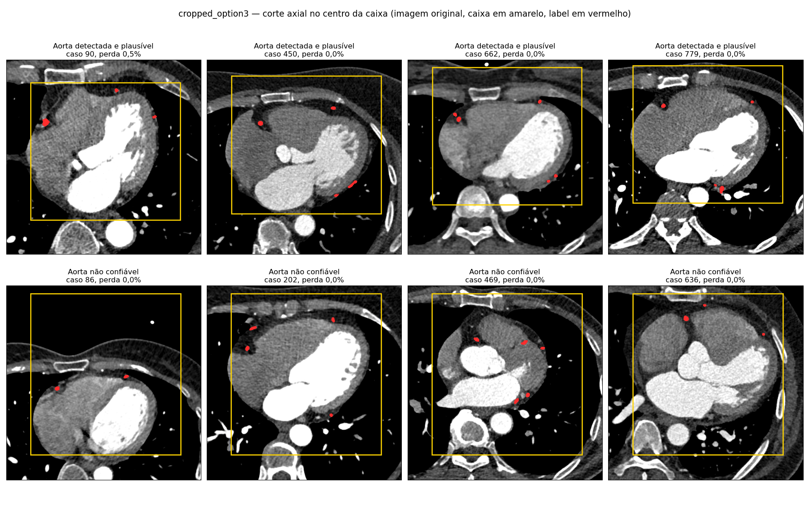

# Dataset cropped_option3 — geração

> 2026-10-30. Método congelado: variante A8c de [Âncora composta — caixa por regime de
> confiança](a8_regime_box.md), apresentada em [apresentacao_proposta.md](apresentacao_proposta.md).
> Parâmetros: `a8c_frozen.json`, ajustados só nos 792 casos `split=trainval` de `split_original.csv`,
> com o p do ponto de Rv igual ao da Opção 1 na curva fora da amostra (p = 97,4172).

## 1. Números

**Casos por regime**

| Conjunto | Aorta plausível | Aorta não confiável (fallback) | Total |
|---|---:|---:|---:|
| 792 fora do teste | 665 | 127 | 792 |
| 208 de teste | 186 | 22 | 208 |
| 1000 | 851 | 149 | 1000 |

Motivos do fallback (um caso pode ter vários):

| Conjunto | Sem aorta de produção | Descendente não encontrada | S1 | S2 | S3 |
|---|---:|---:|---:|---:|---:|
| 792 | 6 | 16 | 35 | 17 | 108 |
| 208 | 0 | 0 | 6 | 0 | 18 |

**Tamanho das duas caixas**: valor nominal dos offsets congelados. A caixa efetiva varia em ±1 voxel
pelo arredondamento conservador e encolhe quando é recortada no limite do volume; o clamp acontece em
319 dos 1000 casos, quase sempre no eixo crânio-caudal. Os valores em mm usam o spacing mediano dos 792.

| Regime | Voxels (LL × AP × CC) | mm (LL × AP × CC) | Shape mediano do recorte |
|---|---|---|---|
| Aorta plausível | 393,0 × 360,8 × 233,1 | 137 × 126 × 117 | 393 × 362 × 234 |
| Aorta não confiável | 394,7 × 423,0 × 259,6 | 138 × 148 × 130 | 395 × 424 × 261 |

**Redução de volume e perda das coronárias (%), lidas dos arquivos gerados**

| Conjunto | Regime | n | Rv | Perda média | > 1% | > 5% | > 20% | Perda máx. |
|---|---|---:|---:|---:|---:|---:|---:|---:|
| 792 | todos | 792 | 49,37 | 0,230 | 5,56 | 1,26 | 0,00 | 14,11 |
| 792 | aorta plausível | 665 | 51,50 | 0,206 | 5,41 | 1,20 | 0,00 | 7,54 |
| 792 | aorta não confiável | 127 | 38,22 | 0,352 | 6,30 | 1,57 | 0,00 | 14,11 |
| 208 | todos | 208 | 50,15 | 0,107 | 3,85 | 0,00 | 0,00 | 3,85 |
| 208 | aorta plausível | 186 | 51,60 | 0,092 | 3,23 | 0,00 | 0,00 | 3,85 |
| 208 | aorta não confiável | 22 | 37,89 | 0,233 | 9,09 | 0,00 | 0,00 | 2,76 |

**Opção 1 de produção, para comparação no mesmo Rv** (`a7_option1_reference.csv`)

| Conjunto | n | Rv | Perda média | > 1% | > 5% | > 20% | Perda máx. |
|---|---:|---:|---:|---:|---:|---:|---:|
| 724 dos 792 (os que a Opção 1 cobre) | 724 | 49,53 | 1,479 | 17,27 | 7,18 | 1,66 | 61,67 |
| 208 de teste | 208 | 48,98 | 0,155 | 3,37 | 0,48 | 0,00 | 12,00 |

Nos 792, os números acima são da caixa congelada aplicada aos próprios casos do ajuste, então não
servem de estimativa de generalização. A estimativa fora da amostra continua sendo a da seção A8 e da
apresentação: Rv de 49,53%, perda média de 0,28%, 1,6% dos casos com perda acima de 5% e perda máxima
de 16,6%.

**Tempo**

| Etapa | Tempo | Observação |
|---|---|---|
| Cache de círculos do Caminho 2 (`c2_extract.py`, 1000 casos) | 83 min | 24 processos |
| Geração do dataset (`generate_cropped_option3.py`, 1000 casos) | 35 min (2093 s) | 12 processos; mediana de 25 s por caso, dominada pela leitura e pela gravação dos NIfTI |
| Caminho completo a partir da imagem (amostra de 14 casos) | 4 a 555 s por caso | 6 processos; pré-processamento + Hough + Level Set + descendente |

Tamanho do dataset: 45,6 GB (2000 arquivos).

## 2. O que foi feito

### Parâmetros congelados

Usei o `a8c_frozen.json` gerado para a apresentação, sem mudar nenhum número. Acrescentei só
metadados: as faixas e regras da Hough da ascendente (configuração de produção) e da descendente
(raio de 5 a 14 mm, 25 picos por fatia, regras de seleção), o pré-processamento, a data de
congelamento (2026-10-29) e a nota de que nenhum parâmetro vem dos 208 de teste. Há uma cópia em
`D:\Doutorado\dataset\cropped_manifests\a8c_frozen.json`.

### Função de produção

`src/utils/segmentation/roi_composite_anchor.py`:

- `compute_composite_roi(features, shape, params)`: regime, sinais acionados, âncora e caixa (antes
  e depois do clamp) a partir das características medidas;
- `measure_composite_features(nii_img, config)` e `composite_roi_from_image(path, config, params)`:
  o caminho completo a partir da imagem, sem ler rótulo. Faz o pré-processamento de produção, o
  rastreamento da ascendente por Hough, o Level Set com os mesmos círculos (centróide = âncora de
  produção), o centro da ascendente na janela de 20 mm a partir da raiz e a descendente;
- falhas de detecção (máscara da aorta vazia, nenhum círculo, descendente com menos de 10 fatias)
  viram regime de fallback, com o motivo em `signals`. Parâmetros incompletos e shape inválido
  levantam exceção.

Dois ajustes no código existente, sem mudança de comportamento:
- `pipeline_preprocessing.preprocess_ccta_image` separa o pré-processamento da imagem da leitura do
  label;
- `aorta_anchor.detect_ascending_aorta_circles` separa a detecção da segmentação, e `segment_aorta`
  aceita círculos já detectados.

A suíte inteira passa (112 testes). Os 17 testes novos estão em `tests/test_roi_composite_anchor.py`
e cobrem os dois regimes, cada sinal isolado (S1, S2 nos dois limites, S3), aorta ausente,
descendente ausente, clamp ao volume, arredondamento conservador e a seleção da descendente.

### Equivalência

| Comparação | Casos | Regime igual | Caixa igual | Maior diferença |
|---|---:|---:|---:|---|
| Função com as entradas da análise (`c2_cases.csv` + `all_cases.csv`) × exploratória | 792 / 208 | 792 / 208 | 792 / 208 | 0 voxel |
| Função com o cache regenerado + `all_cases.csv` × exploratória | 792 / 208 | 792 / 208 | 792 / 208 | 0 voxel; características 6·10⁻¹⁴ |
| Caminho completo a partir da imagem × caminho por cache (amostra, seed 42) | 14 | 14 | 14 | âncora de produção 3·10⁻¹⁴ voxel; volume da aorta idêntico |

A referência exploratória é `a8_calibrate.make_box` com a calibração congelada
(`calib("A8c", 792, crossfit=True)`) no p congelado. A amostra a partir da imagem tem 4 casos de cada
regime nos 792, 2 de cada regime nos 208 e os 2 primeiros casos sem aorta de produção.

### Geração

`src/generate_cropped_option3.py`, no padrão de `apply_bbox_full_dataset.py` (Opções 1 e 2):

- **Entradas:** como nas Opções 1 e 2, as características vêm dos caches das mesmas rotinas de
  produção, sem refazer Hough e Level Set: a âncora de produção vem de `all_cases.csv`, e a
  ascendente e a descendente do cache de círculos.
- **Caixa:** é calculada por `compute_composite_roi`.
- **Recorte:** imagem e label são recortados com a mesma caixa por `crop_volume_and_update_affine`,
  com slicing puro, mesmo dtype (int16 / float64), mesmo spacing e a origem do affine deslocada.
- **Label:** só é lido depois da caixa calculada, para medir a perda.

A saída fica em `D:\Doutorado\dataset\cropped_option3\<bloco>\<id>.{img,label}.nii.gz`. O manifesto,
`cropped_manifests\manifest_option3.csv`, tem uma linha por caso com:
- `img_id`, `bloco`, `split` e `fold`;
- `regime`, `sinais` e um booleano por sinal, além das coordenadas que acionaram S3;
- a âncora;
- a caixa antes e depois do clamp, o shape original e o shape do recorte;
- a redução de volume, a perda das coronárias e os voxels do label antes e depois do recorte;
- as características medidas (aorta de produção, ascendente, descendente, d), o spacing, o dtype e
  o tempo.

As Opções 1 e 2 também atualizaram a origem: em 3 casos de cada uma, o affine salvo coincide com
`affine[:3, :3] @ bbox_min + origem`, com diferença 0, e o shape, o dtype e o spacing conferem.

### Caches

Os dois caches agora ficam dentro do repositório, fora do git (`.gitignore`):
- o de círculos do Caminho 2, regenerado com `c2_extract.py` (1000 casos, nenhum erro), em
  `output/bounding_box/caminho2_aorta_geometry/scripts/c2_cache/`;
- o de coordenadas do label, `p0_cache`, copiado para `output/bounding_box/p0_cache/` (1000 casos).

## 3. Verificações

| # | Verificação | Resultado |
|---|---|---|
| 1 | Pares de arquivos e erros | 1000 pares, 0 erros |
| 2 | Releitura de todos os recortes: perda e Rv contra o manifesto | 1000/1000; diferença máxima 9·10⁻¹⁶ (perda) e 7·10⁻¹⁵ (Rv); voxels do label antes e depois iguais em 1000/1000 |
| 3 | Métricas nos 792 e nos 208, gerais e por regime, contra a exploratória com os parâmetros congelados | diferença máxima 4·10⁻¹⁶ (ver nota) |
| 4 | Spacing, dtype e HU em 10 casos (seed 42, 5 por regime) | 10/10: spacing e dtype iguais, valores idênticos ao original dentro da caixa |
| 5 | Alinhamento físico em 5 casos (ponto do label: recorte → mm → original) | diferença de 0,0 mm; label = 1 no ponto do original nos 5 casos |
| 6 | Figura de controle, 8 casos (4 por regime) | abaixo |

**Nota sobre a verificação 3.** O pedido era bater com os valores dentro da amostra do ponto
congelado em `a8_sweep.csv`. Essa comparação não pode ser exata, por dois motivos:

1. o p congelado (97,4172) não está na grade da varredura, que tem 97,0 e 97,5;
2. os pontos dentro da amostra de `a8_sweep.csv` e `a8_highlights.csv` usam offsets calibrados sem
   cross-fit, enquanto a caixa congelada usa offsets calibrados com cross-fit interno, a mesma
   calibração do teste.

Por isso comparei com a exploratória aplicando exatamente a caixa congelada aos 792
(`referencia_exploratoria.csv`), e a diferença é zero. Para referência:

| Fonte (792) | p | Rv | Perda média | > 1% | > 5% | > 20% | Perda máx. |
|---|---:|---:|---:|---:|---:|---:|---:|
| Dataset gerado = caixa congelada | 97,4172 | 49,37 | 0,230 | 5,56 | 1,26 | 0,00 | 14,11 |
| `a8_highlights.csv`, dentro da amostra (Rv = Opção 1) | 97,4163 | 49,53 | 0,233 | 5,81 | 1,26 | 0,00 | 13,50 |
| `a8_sweep.csv`, dentro da amostra | 97,0 | 50,64 | 0,296 | 6,69 | 2,02 | 0,00 | 15,05 |
| `a8_sweep.csv`, dentro da amostra | 97,5 | 49,24 | 0,221 | 5,43 | 1,14 | 0,00 | 12,89 |

Nos 208 de teste, o dataset bate com a tabela de teste da apresentação: Rv de 50,15%, perda média de
0,107%, 3,8% dos casos com perda acima de 1%, nenhum acima de 5% e perda máxima de 3,85%.

## 4. Split e transferência

- `Coronary_Segmentation_deep_learning/data_list/split_option3.csv` é igual a `split_original.csv`:
  1000 casos, com os mesmos `split` e `k_fold`.
- Os 208 casos de teste são idênticos nos quatro splits (original e Opções 1, 2 e 3).
- Achado lateral: os splits das Opções 1 e 2 mantêm os mesmos casos de teste, mas os folds do
  treino foram reequilibrados dentro de cada subconjunto. Diferem de `split_original.csv` em 551 de
  724 casos (Opção 1) e em 469 de 638 (Opção 2). A Opção 3 usa os folds originais, como pedido.
- Checksums SHA-256 dos 2000 arquivos estão em `D:\Doutorado\dataset\cropped_option3\SHA256SUMS`,
  com caminhos relativos à pasta do dataset, e há uma cópia em
  `cropped_manifests\SHA256SUMS_option3`. Depois da cópia para
  `/data01/home/hcalmeida/imagecas/datasets/cropped_option3`, a conferência é `sha256sum -c SHA256SUMS`
  dentro da pasta.

## 5. Arquivos

- Código:
  - `src/utils/segmentation/roi_composite_anchor.py`;
  - `src/generate_cropped_option3.py`;
  - `tests/test_roi_composite_anchor.py`;
  - os ajustes em `pipeline_preprocessing.py` e `aorta_anchor.py`.
- Scripts de verificação, em `output/bounding_box/cropped_option3/scripts/`:
  - `eq_check.py`;
  - `check_option3_from_image.py`;
  - `reference_metrics.py`;
  - `verify_option3.py`;
  - `split_and_checksums.py`.
- Resultados, em `output/bounding_box/cropped_option3/`:
  - `equivalencia_csv.csv` e `equivalencia_cache.csv`;
  - `checagem_a_partir_da_imagem.csv`;
  - `referencia_exploratoria.csv`;
  - os arquivos `verificacao_*.csv` e `verificacao_resumo.json`;
  - `split_e_checksums.json`.
- Fora do git:
  - o dataset;
  - o manifesto e os checksums, em `D:\Doutorado\dataset\cropped_manifests\`;
  - os caches.
