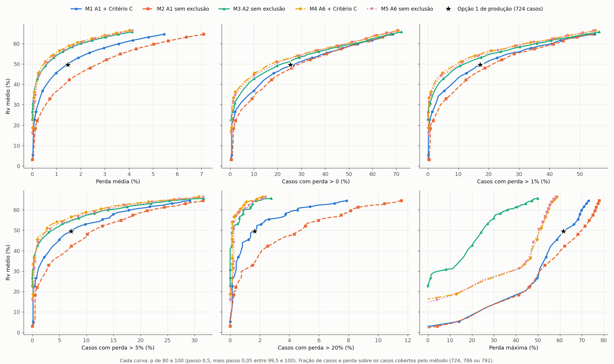

# Bbox dinâmico — Passo 0d: curvas `Rv` × risco de perda e FOV descentralizado

**Data:** 2026-09-30. **Natureza:** exploratória. Nenhum dataset foi gerado, nenhum artefato de
produção foi alterado e nenhuma segmentação foi reprocessada. Este passo continua o
[Passo 0c](dynamic_bbox_step0c.md): usa a mesma caixa de tamanho único, mas agora varre o
percentil `p` em vez de igualar uma perda média. **Não se recomenda trocar a âncora de produção.**

## 1. Método

### 1.1 Parte A — métodos e população

A população são todos os casos fora do teste (`split_original.csv`, `split=trainval`): **792**.

| Método | Âncora | Exclusão | N coberto (de 792) |
|---|---|---|---|
| **M1** | A1 (centróide da aorta) | Critério C (população da Opção 1) | 724 |
| **M2** | A1 | nenhuma; ficam fora só os casos sem aorta detectada | 786 |
| **M3** | A2 (centro do volume) | nenhuma; inclui os 6 casos sem aorta | 792 |
| **M4** | A6 (y e z de A2, x de A1) | Critério C | 724 |
| **M5** | A6; nos 6 casos sem aorta, x de A2 | nenhuma | 792 |

- **Caixa:** a mesma do Passo 0c. Para cada caso, calcula-se o offset do label em relação à
  âncora, por eixo (`min_label − âncora` e `max_label + 1 − âncora`). A caixa vai de
  âncora + P₁₀₀₋ₚ(offset inferior) até âncora + Pₚ(offset superior), com os percentis tomados
  **sobre os casos cobertos pelo próprio método**. As caixas são clampadas ao volume, e
  `Rv` = 1 − V_caixa_efetiva / V_volume.
- **M1 é a Opção 1 com a caixa recalibrada por `p`.** A Opção 1 de produção (offsets de
  `calibration_both_options.json`, sem recalibrar) aparece como um ponto separado, avaliado nos
  mesmos 724 casos.
- **Varredura:** `p` de 80 a 100, passo 0,5, como pedido. **Suplemento:** passo 0,05 entre 99,5 e
  100 (seção 2.3).
- **Medidas de risco:** perda média; fração de casos com perda > 0, > 1%, > 5% e > 20%; perda
  máxima. Todas são calculadas **sobre os casos cobertos pelo método**. Os casos excluídos (68 em
  M1/M4, 6 em M2) não entram nessas medidas, e isso favorece os métodos com exclusão.
- **Cores dos gráficos:** paleta categórica de referência (slots 1–5, ordem fixa), com marcador e
  estilo de linha distintos por método. O validador de paleta não pôde ser executado (não há
  `node` nesta máquina); a validação documentada da paleta para séries adjacentes no modo claro
  foi a referência.

### 1.2 Parte B — FOV descentralizado

- **Casos e caixas:** os 624 casos do Passo 0, com as caixas calibradas no volume original do
  Passo 0c, conjunto 1, sem recalibrar:

  | Âncora | `p` | Caixa (vox) |
  |---|---|---|
  | A1 | 97,18 | 411,1 × 357,6 × 240,6 |
  | A2 | 98,72 | 395 × 411 × 246 |
  | A6 | 97,59 | 389 × 360,8 × 237 |

- **Recortes simulados:**
  - Em z, removem-se k = 10, 20 ou 40 fatias de um lado.
  - Em x (eixo 1 do volume), removem-se k = 32, 64 ou 96 colunas de um lado.
  - Cada recorte é feito nos dois sentidos.
- **Orientação:** `aff2axcodes` = `LAS` na amostra conferida.
  - Em z, "início" remove as fatias **inferiores** e "fim" remove as **superiores**.
  - Em x, "início" remove as colunas **posteriores** e "fim" remove as **anteriores**.
- **Como cada âncora se comporta no volume recortado:**
  - A1 é a mesma posição física, apenas reindexada. Isso supõe que a segmentação da aorta daria a
    mesma máscara no volume recortado, o que **não foi testado**.
  - A2 = novo shape / 2.
  - A6 combina as duas: y e z de A2, x de A1.
- **Casos descartados:** aqueles em que o recorte corta o label. Por isso o N válido muda por
  deslocamento. Para isolar o efeito do deslocamento, cada linha traz também a perda **sem
  deslocamento** nos mesmos casos válidos.

## 2. Resultados — Parte A

### 2.1 Curvas `Rv` × risco

Valores em quatro pontos das curvas:

| `p` | Método | N | Caixa (vox) | `Rv` média | mediana | Perda média | > 0 | > 1% | > 5% | > 20% | Perda máx. |
|---|---|---|---|---|---|---|---|---|---|---|---|
| 90 | M1 A1 + C | 724 | 390 × 342 × 230 | 55,46% | 57,03% | 2,37% | 40,8% | 28,5% | 13,0% | 2,62% | 68,2% |
| 90 | M2 A1 | 786 | 392 × 344 × 235 | 54,87% | 55,74% | 3,66% | 40,6% | 28,4% | 16,4% | 5,98% | 73,4% |
| 90 | M3 A2 | 792 | 366 × 348 × 221 | 58,31% | 60,95% | 1,66% | 45,5% | 30,3% | 11,5% | 0,88% | 32,9% |
| 90 | M4 A6 + C | 724 | 368 × 342 × 221 | 58,85% | 61,30% | 1,53% | 44,9% | 28,6% | 9,9% | 0,55% | 54,5% |
| 90 | M5 A6 | 792 | 366 × 344 × 221 | 58,85% | 61,29% | 1,69% | 45,5% | 29,3% | 11,5% | 0,63% | 54,0% |
| 95 | M1 A1 + C | 724 | 415 × 363 × 243 | 47,89% | 48,75% | 1,23% | 22,4% | 15,3% | 5,9% | 1,38% | 60,5% |
| 95 | M2 A1 | 786 | 427 × 365 × 258 | 44,91% | 43,94% | 1,91% | 20,9% | 15,0% | 8,9% | 3,18% | 65,3% |
| 95 | M3 A2 | 792 | 382 × 373 × 234 | 51,09% | 53,63% | 0,70% | 25,0% | 13,8% | 4,3% | 0,25% | 25,4% |
| 95 | M4 A6 + C | 724 | 383 × 363 × 233 | 52,58% | 54,75% | 0,66% | 24,3% | 12,4% | 3,3% | 0,14% | 52,2% |
| 95 | M5 A6 | 792 | 382 × 365 × 234 | 52,42% | 54,49% | 0,78% | 24,6% | 13,8% | 4,0% | 0,25% | 51,6% |
| 97,5 | M1 A1 + C | 724 | 446 × 385 × 263 | 38,61% | 37,91% | 0,51% | 11,5% | 6,8% | 2,8% | 0,69% | 54,3% |
| 97,5 | M2 A1 | 786 | 458 × 388 × 285 | 35,70% | 34,05% | 0,90% | 10,9% | 8,1% | 3,9% | 1,78% | 56,6% |
| 97,5 | M3 A2 | 792 | 394 × 396 × 242 | 44,68% | 47,01% | 0,29% | 12,9% | 6,7% | 1,5% | 0,13% | 21,2% |
| 97,5 | M4 A6 + C | 724 | 394 × 385 × 243 | 47,12% | 48,60% | 0,31% | 13,3% | 6,2% | 1,1% | 0,14% | 49,9% |
| 97,5 | M5 A6 | 792 | 394 × 389 × 242 | 46,55% | 48,07% | 0,38% | 13,5% | 7,1% | 1,6% | 0,25% | 49,5% |
| 99 | M1 A1 + C | 724 | 470 × 408 × 277 | 31,14% | 29,99% | 0,26% | 4,7% | 2,8% | 1,1% | 0,41% | 50,9% |
| 99 | M2 A1 | 786 | 493 × 412 × 315 | 27,12% | 25,32% | 0,41% | 4,5% | 3,3% | 1,9% | 0,76% | 49,4% |
| 99 | M3 A2 | 792 | 410 × 419 × 258 | 36,88% | 38,37% | 0,08% | 5,2% | 2,2% | 0,3% | 0% | 16,2% |
| 99 | M4 A6 + C | 724 | 410 × 408 × 254 | 40,49% | 40,92% | 0,15% | 5,3% | 2,1% | 0,7% | 0,14% | 47,2% |
| 99 | M5 A6 | 792 | 410 × 412 × 258 | 39,40% | 39,40% | 0,18% | 5,2% | 2,2% | 0,6% | 0,25% | 47,0% |

**Opção 1 de produção (724 casos, caixa 408,5 × 357,2 × 243,1):** `Rv` média 49,53%, mediana
50,32%; perda média 1,479%; perda > 0 em 25,4% dos casos, > 1% em 17,3% (125 casos), > 5% em
7,2%, > 20% em 1,66%; perda máxima 61,7%.

### 2.2 Maior `Rv` sob cada restrição — grade pedida (80–100, passo 0,5)

| Restrição | M1 A1 + C | M2 A1 | M3 A2 | M4 A6 + C | M5 A6 |
|---|---|---|---|---|---|
| **(a)** perda máx. ≤ 1% | 2,88% (p 100) | 2,21% (p 100) | 22,13% (p 100) | 16,34% (p 100) | 14,65% (p 100) |
| **(b)** ≤ 2% dos casos com perda > 1% | 27,21% (p 99,5) | 22,72% (p 99,5) | 31,27% (p 99,5) | **36,55%** (p 99,5) | 34,91% (p 99,5) |
| **(c)** perda média ≤ 0,156% | 2,88% (p 100) | 2,21% (p 100) | **40,66%** (p 98,5) | 40,49% (p 99) | 34,91% (p 99,5) |

### 2.3 Suplemento — mesma tabela com o passo 0,05 entre 99,5 e 100

Com o passo de 0,5, a grade pula de 99,5 direto para 100. Em `p` = 100 as caixas dos métodos com
A1 ficam **maiores que o volume** em x (555 × 592 × 327 vox no M1), e o `Rv` cai para 2 a 3%. Na
restrição (c), por exemplo, o M1 em `p` = 99,5 tem perda média de 0,161%, a 0,005 pp do limite.
Por isso a mesma tabela foi refeita com o suplemento (`p0d_sweep_fine_99.5_100.csv`):

| Restrição | M1 A1 + C | M2 A1 | M3 A2 | M4 A6 + C | M5 A6 |
|---|---|---|---|---|---|
| **(a)** perda máx. ≤ 1% | 2,88% (p 100) | 2,21% (p 100) | **25,74%** (p 99,85) | 16,34% (p 100) | 14,65% (p 100) |
| **(b)** ≤ 2% com perda > 1% | 27,21% (p 99,5) | 22,72% (p 99,5) | 31,27% (p 99,5) | **36,55%** (p 99,5) | 34,91% (p 99,5) |
| **(c)** perda média ≤ 0,156% | 26,62% (p 99,55) | 19,72% (p 99,7) | **40,66%** (p 98,5) | 40,49% (p 99) | 34,91% (p 99,5) |

- Na restrição (a), M1, M2, M4 e M5 exigem `p` = 100 mesmo na grade fina. Em `p` = 99,95 a perda
  máxima deles ainda é de 4,1% a 14,1%, vinda de 1 a 3 casos: a perda máxima é ditada por casos
  isolados.
- Detalhe das restrições (b) e (c):

  | Restrição | Método (`p`) | Casos com perda > 1% | Perda máx. |
  |---|---|---|---|
  | (b) | M4 (99,5) | 7 | 46,9% |
  | (b) | M3 (99,5) | 6 | 11,4% |
  | (c) | M3 (98,5) | 29 | 18,3% |
  | (c) | M4 (99) | 15 | 47,2% |

## 3. Resultados — Parte B (FOV descentralizado, 624 casos)

Perda média e N de casos com perda > 1%, comparadas com o **mesmo conjunto de casos válidos sem
deslocamento** (entre parênteses). O `Rv` é medido sobre o volume **recortado**, que é menor.
Por isso ele cai para todas as âncoras mesmo com a caixa igual, e só deve ser comparado dentro de
cada linha.

| Deslocamento | N válido | A1 `Rv` | A1 perda média | A1 N > 1% | A2 `Rv` | A2 perda média | A2 N > 1% | A6 `Rv` | A6 perda média | A6 N > 1% |
|---|---|---|---|---|---|---|---|---|---|---|
| nenhum | 624 | 49,15% | 0,156% | 28 | 41,52% | 0,144% | 21 | 51,38% | 0,155% | 26 |
| z −10 inferior | 581 | 48,28% | 0,153% (0,153) | 26 (26) | 40,18% | 0,118% (0,133) | 14 (17) | 50,23% | 0,114% (0,134) | 19 (19) |
| z −10 superior | 599 | 48,06% | 0,158% (0,158) | 27 (27) | 40,14% | **0,161%** (0,127) | 18 (17) | 50,19% | **0,195%** (0,125) | 23 (22) |
| z −20 inferior | 533 | 47,57% | 0,136% (0,136) | 20 (20) | 38,64% | 0,104% (0,128) | 10 (14) | 48,94% | 0,076% (0,131) | 12 (17) |
| z −20 superior | 538 | 47,52% | 0,146% (0,146) | 23 (23) | 38,69% | 0,124% (0,115) | 14 (13) | 49,03% | **0,184%** (0,097) | **28** (16) |
| z −40 inferior | 339 | 47,20% | 0,171% (0,171) | 16 (16) | 37,45% | 0,114% (0,152) | 7 (11) | 46,60% | 0,069% (0,187) | 7 (16) |
| z −40 superior | 323 | 47,08% | 0,142% (0,142) | 13 (13) | 37,45% | 0,030% (0,052) | 3 (6) | 46,67% | 0,036% (0,102) | 3 (11) |
| x −32 posterior | 624 | 45,78% | 0,156% (0,156) | 28 (28) | 37,62% | **0,238%** (0,144) | **26** (21) | 48,15% | 0,155% (0,155) | 26 (26) |
| x −32 anterior | 606 | 46,71% | 0,141% (0,141) | 26 (26) | 37,64% | 0,097% (0,124) | 15 (16) | 49,14% | 0,159% (0,159) | 26 (26) |
| x −64 posterior | 621 | 42,12% | 0,155% (0,155) | 28 (28) | 34,97% | **0,373%** (0,088) | **43** (18) | 44,66% | 0,156% (0,156) | 26 (26) |
| x −64 anterior | 527 | 45,22% | 0,135% (0,135) | 21 (21) | 34,97% | 0,066% (0,138) | 11 (15) | 47,81% | 0,151% (0,151) | 20 (20) |
| x −96 posterior | 598 | 38,54% | 0,159% (0,159) | 28 (28) | 32,83% | **0,542%** (0,087) | **77** (17) | 41,30% | 0,161% (0,161) | 26 (26) |
| x −96 anterior | 289 | 43,99% | 0,111% (0,111) | 10 (10) | 32,99% | 0,091% (0,224) | 9 (13) | 46,80% | 0,206% (0,206) | 16 (16) |

Perdas máximas relevantes:
- **A2, x posterior:** 23,9% (k 32), 27,6% (k 64), 20,0% (k 96).
- **A6, z superior k 10:** 22,9%.
- A tabela completa, com a perda máxima de cada linha, está em `p0d_fov_shift.csv`.

## 4. Interpretação (sem recomendar trocar a âncora de produção)

**Parte A**

- **Para o mesmo nível de risco, os métodos com A2 ou A6 dão `Rv` maior que os métodos com A1**
  nas curvas contra perda média e contra fração > 1%, > 5% e > 20%, em quase toda a faixa. Com
  `p` igual, eles também têm `Rv` maior e perda média menor (tabela 2.1). No painel de
  fração com perda > 0 as curvas quase se sobrepõem: A2 e A6 espalham mais perdas pequenas
  (seção 3 do Passo 0c).
- **A perda máxima separa M3 dos demais.** Entre `p` = 90 e 99, o pior caso do M3 (A2, sem
  exclusão) fica em 16% a 33%. No mesmo intervalo, M4 e M5 ficam em 47% a 55% e M1 e M2 em 49% a
  73%. Em `p` = 80, os máximos são 50% (M3), 59% (M4/M5), 73% (M1) e 78% (M2). A A6 herda da A1 as falhas em x
  **mesmo com o Critério C** (M4): o Critério C filtra falhas de volume da aorta, não
  necessariamente o erro de posição em x.
- **O Critério C muda muito a A1 e pouco a A6.** M1 fica bem acima de M2 nas curvas; M4 ≈ M5. A
  A2 não precisa de exclusão, e M3 e M5 cobrem os 792 casos. M1 e M4 deixam 68 casos sem caixa, e
  esses casos não aparecem nas medidas de risco.
- **A Opção 1 de produção cai praticamente sobre a curva do M1.** Recalibrar a caixa da A1 por `p`
  dentro da população não muda o compromisso entre `Rv` e perda.
- **Restrições:**
  - Com perda máxima ≤ 1%, só a A2 fica abaixo de `p` = 100 (25,7%). Os métodos com A1 no eixo x
    precisam de caixas quase do tamanho do volume, porque poucos casos com falha da aorta ditam o
    pior caso.
  - Com perda média ≤ 0,156%, M3 e M4 ficam em ≈ 40,5% e o M1 em 26,6%.
  - **Esse limite de 0,156% veio dos 624 casos curados.** Nesta população de 724 a 792 casos, a
    própria Opção 1 de produção tem perda média de 1,48%. A restrição (c) é, portanto, bem mais
    exigente que o ponto de operação atual.

**Parte B**

- **A1 é invariante por construção nesta simulação.** A mesma posição física, reindexada, com a
  caixa relativa à âncora, dá exatamente a mesma perda da linha de base. A invariância real
  dependeria de a segmentação da aorta (limiar por percentil do volume, LCC por fatia, rastreamento
  Hough) produzir a mesma máscara no FOV recortado, o que não foi testado. **A simulação favorece a
  A1.**
- **A A6 é invariante em x** (usa o x da A1) e responde em z como a A2.
- **A2 no eixo x, removendo colunas posteriores (o lado mais distante da árvore):**
  - A perda cresce monotonicamente com k:

    | k | Perda média | Casos com perda > 1% |
    |---|---|---|
    | 32 | 0,24% | 26 |
    | 64 | 0,37% | 43 |
    | 96 | 0,54% | 77 |

  - Na linha de base, a perda é de 0,09% a 0,14%, com 17 a 21 casos acima de 1%.
  - Em k = 96, cerca de 19% da largura, a perda média fica ≈ 6× a da linha de base.
- **A2 no eixo x, removendo colunas anteriores:** a perda **diminui** em relação à linha de base
  nos mesmos casos. Isso é efeito de **seleção**, não robustez: só sobram os casos cuja árvore fica
  mais posterior (289 de 624 em k = 96), e a A2 se desloca justamente na direção deles.
- **Eixo z:** com k = 10 e 20, A2 e A6 têm efeitos pequenos e de sinal misto.
  - Remover fatias superiores piora (A6 z −20: 28 casos > 1% contra 16; máximo de 22,9% em z −10).
  - Remover fatias inferiores melhora.
  - Com k = 40, só metade dos casos continua válida e o mesmo viés de seleção domina.
- A simulação mede só a geometria da âncora. Não mede o efeito do FOV sobre a própria segmentação
  da aorta.

## 5. Reprodutibilidade

- Resultados em `output/bounding_box/dynamic_bbox_step0d/`:
  - `p0d_sweep.csv`: varredura da Parte A, 5 métodos × 41 valores de `p`.
  - `p0d_sweep_fine_99.5_100.csv`: suplemento com passo de 0,05.
  - `p0d_option1_production.csv`: o ponto da Opção 1 de produção.
  - `p0d_best_under_constraints.csv` e `p0d_best_under_constraints_fine.csv`: tabelas das
    seções 2.2 e 2.3.
  - `p0d_fov_shift.csv`: Parte B.
- Scripts em `output/bounding_box/dynamic_bbox_step0d/scripts/`:
  - `p0d_analyze.py`: Partes A e B.
  - `p0d_refine.py`: suplemento da grade fina.
  - `p0d_plot.py`: o gráfico.
  - Dependem do cache de coordenadas `p0_cache/` do Passo 0, estendido no Passo 0c.
- Gráfico: `docs/img/dynamic_bbox_step0d_rv_vs_risk.png`.
