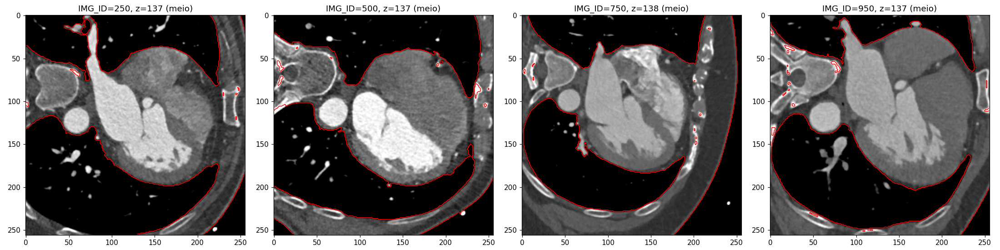
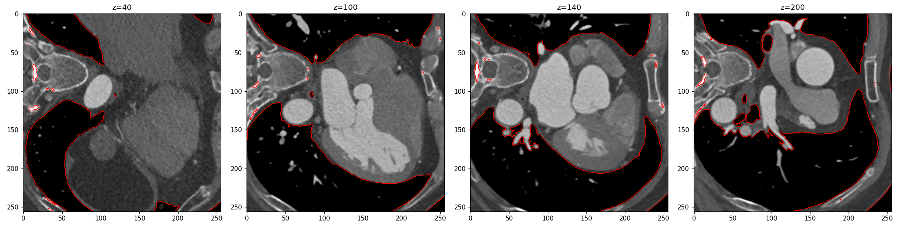

# Etapa 6 — Envelope de dimensões máximas

> Parte da sequência do Capítulo 2 (Seção 2.3.1), documentada conforme a convenção definida no
> README ("📝 Acompanhamento por etapa"). Ver também [CODE_NOTES_bounding_box.md](CODE_NOTES_bounding_box.md), Seção 8 (plano original), e [step5_centroid.md](step5_centroid.md).

## Status (2026-07-15): **substituída** por [step6v2_aorta_anchor.md](step6v2_aorta_anchor.md)

O código desta etapa (âncora = centróide do `lcc_mask`) está implementado e testado, mas **não foi
rodado sobre as 1000 imagens** — ver [Achado bloqueante](#achado-bloqueante-lcc-não-isola-o-coração)
abaixo. Na mesma sessão, decidiu-se tentar uma âncora diferente (posição da aorta via Hough+Level
Set) em vez de ajustar o LCC; essa segunda tentativa está documentada em
[step6v2_aorta_anchor.md](step6v2_aorta_anchor.md) e é o caminho ativo no momento. As funções desta
página (`compute_bounding_extent`, `envelope.py`) continuam no repositório e passam nos testes, mas
não são mais o plano corrente para a etapa 6 — mantidas por ora como referência histórica.

## O que foi implementado

- `compute_bounding_extent(mask)` —
  [src/utils/segmentation/bounding_box.py](../src/utils/segmentation/bounding_box.py). Extensão do
  bounding box mínimo (`max - min + 1` por eixo) que envolve os voxels não-nulos de uma máscara 3D,
  irmã de `compute_geometric_centroid` (mesma convenção de eixos `(Y, X, Z)`, mesmos erros
  explícitos para máscara vazia/não-3D).
- `src/utils/segmentation/envelope.py` — orquestração da etapa 6:
  - `discover_dataset_blocks(dataset_root)` — descobre dinamicamente os blocos (subpastas) do
    dataset local e os `img_id` de cada um, sem hardcodar nomes de pasta (funciona com a convenção
    `dataset/1-200`, `dataset/201-400`, ... já usada em `check_preprocessing_and_centroid.ipynb`).
  - `process_case_for_envelope(img_id, base_path, block, config)` — roda etapas 1-5 para um caso,
    retorna centróide + extensão do bbox mínimo. Erros de um caso individual (arquivo
    ausente/corrompido, etc.) ficam registrados no record (`status="error"`) em vez de propagar —
    dataset real de ~1000 casos pode ter exceções pontuais que não devem abortar o lote inteiro.
  - `process_block(...)` — processa um bloco inteiro, salvando incrementalmente em CSV após cada
    caso; **retomável**: pula casos já com `status="ok"` em execuções anteriores (`resume=True`,
    default), sempre re-tenta casos com erro.
  - `run_envelope_batch(dataset_root, config, output_dir, ...)` — roda todos os blocos descobertos
    e concatena os resultados.
  - `compute_envelope(records_df, downscale_factors)` — deriva o envelope final: maior extent
    observado por eixo (na resolução reduzida), escalado de volta para resolução integral
    multiplicando por `downscale_factors` eixo a eixo (`(Y, X, Z)`, fator 1 no eixo z).
- `src/run_envelope.py` — script executável (`uv run python src/run_envelope.py`), roda/retoma o
  lote sobre `dataset/` e salva `output/bounding_box/envelope/` (diretório **fixo**, não
  timestamped, para que retomar entre execuções funcione — ver docstring do script).
- Símbolos novos adicionados aos dispatchers lazy (`utils/segmentation/__init__.py`,
  `utils/groups/segmentation.py`), seguindo o mesmo padrão da etapa 5.

## Validação

- `tests/test_bounding_box.py` — 7 testes novos para `compute_bounding_extent` (voxel único, cubo
  simétrico, bloco assimétrico expondo troca de eixos, extensão ignora "buracos" entre voxels
  extremos, máscara não-booleana, máscara vazia, entrada não-3D).
- `tests/test_envelope.py` — 12 testes: descoberta de blocos, processamento de caso ponta a ponta
  com volumes NIfTI sintéticos reais (via `nibabel`, não mockado), registro de erro sem propagar
  exceção, retomada (pula casos `ok`, re-tenta casos `error`), agregação do envelope (máximo por
  eixo + escala para resolução integral + `argmax_case_per_axis`).
- `uv run pytest tests/ -v` — 21/21 passando.
- Além dos testes automatizados, `process_block`/`compute_envelope` foram exercitados manualmente
  sobre 5 casos reais do dataset (um por bloco) antes de decidir rodar o lote completo — foi essa
  checagem manual que revelou o achado bloqueante abaixo.

## Achado bloqueante: LCC não isola o coração

**Resumo:** a máscara `lcc_mask` produzida pelas etapas 1-4 (`load_and_preprocess_image`) não
isola o coração — ela isola o **tronco inteiro** (pele/subcutâneo, parede torácica, mediastino),
menos pulmões (ar) e osso muito denso. Isso não é um bug de código: é uma limitação física do
critério usado (threshold HU + maior componente conectado por fatia).

**Evidência quantitativa** (5 casos, um de cada pasta do dataset — `1-200`, `201-400`, `401-600`,
`601-800`, `801-1000`, IDs 50/250/500/750/950):

| IMG_ID | Fatias que tocam a borda da imagem | Fração do volume ocupada pela máscara |
|---|---|---|
| 50  | 275/275 (100%) | 57.7% |
| 250 | 275/275 (100%) | 55.6% |
| 500 | 275/275 (100%) | 62.2% |
| 750 | 277/277 (100%) | 64.4% |
| 950 | 275/275 (100%) | 64.7% |

Em **todos** os casos testados, 100% das fatias axiais têm a máscara tocando as 4 bordas da
imagem, e a máscara ocupa mais da metade do volume total — incompatível com "isolar o coração".
Isso já se refletia, sem ter sido notado antes, no "Rv preliminar" calculado em
`check_preprocessing_and_centroid.ipynb` (33,76% de redução para o IMG_ID=264 daquela sessão — ou
seja, a "máscara cardíaca" ocupava 66% do volume original).

**Evidência visual** (contorno vermelho = `lcc_mask` real, sobreposto na imagem original com janela
HU correta):



O contorno acompanha a silhueta externa do tronco (pele), não o coração — o coração (blob claro no
centro) é apenas uma pequena parte da região realmente delimitada.



**Mecanismo provável:** não existe fronteira de densidade (HU) entre o coração e o tecido
adjacente — gordura subcutânea, músculo da parede torácica, gordura mediastinal e coração ficam
todos na mesma faixa de threshold (`[-300, ~P99.7]`) e são fisicamente contíguos (sem ar ou osso
denso os separando). Threshold + LCC por fatia consegue remover ar (pulmões) e osso muito denso,
mas não consegue, por si só, separar "coração" do "resto do tronco" — e nunca teve essa intenção,
ver confirmação abaixo.

**Confirmado (Hélder, 2026-07-17):** no pipeline original de mestrado (Silva et al., 2026, base
deste fork), o LCC **nunca foi o mecanismo de isolamento cardíaco** — sempre foi apenas uma
limpeza grosseira (remove ar/pulmões e osso muito denso) antes da localização fina da aorta via
Hough Circle Transform + Level Set, etapas que foram removidas deste fork em 2026-07 e depois
parcialmente reintroduzidas como âncora da etapa 6 v2 (ver
[CODE_REMOVAL_PLAN.md](CODE_REMOVAL_PLAN.md) e [step6v2_aorta_anchor.md](step6v2_aorta_anchor.md)).
Isso resolve a pergunta que esta seção deixava em aberto (ver histórico em "Decisão pendente"
abaixo) e reforça que a etapa 6 v2 não é uma alternativa arbitrária — é o mecanismo de localização
que o pipeline original sempre usou.

**Por que isso bloqueia a etapa 6:** se o envelope for calculado sobre a máscara atual, o bbox fixo
resultante ficará próximo do tamanho da imagem original (já que a máscara toca as bordas em quase
todas as fatias) — a redução volumétrica `Rv` (uma das duas métricas centrais do capítulo) ficaria
próxima de 0%, o que não serviria ao objetivo da tese.

## Decisão pendente (histórico — já resolvida na prática)

Hélder estava ciente do achado (sessão de 2026-07-15). A direção efetivamente adotada foi
reintroduzir a aorta como âncora ([step6v2_aorta_anchor.md](step6v2_aorta_anchor.md)), que por sua
vez encontrou um achado bloqueante próprio (documentado naquele arquivo). Direções discutidas
nesta sessão, para registro:

1. Verificar no artigo/Apêndice A da tese se o LCC realmente pretendia isolar só o coração, ou se
   sempre foi uma limpeza grosseira complementada por Hough+Level Set. — **Resolvido
   (2026-07-17): confirmado que sempre foi limpeza grosseira, nunca teve a intenção de isolar o
   coração** (ver "Mecanismo provável" acima).
2. Ajustar o critério das etapas 1-4 dentro do escopo determinístico atual (ex.: erosão
   morfológica antes do LCC, threshold mais restrito, outro critério de conectividade) para tentar
   separar melhor o coração do tronco sem reintroduzir Hough/Level Set.
3. Outra direção a definir.

## Como retomar

O código está pronto e não precisa de alterações estruturais para rodar — só precisa que a entrada
(`lcc_mask` das etapas 1-4) realmente isole o coração antes de calcular o envelope sobre ela. Uma
vez resolvido o achado acima:

```bash
uv run python src/run_envelope.py
```

processa (ou retoma) o lote completo sobre `dataset/`, salva um CSV por bloco + `all_cases.csv` +
`envelope_summary.json` em `output/bounding_box/envelope/`.
