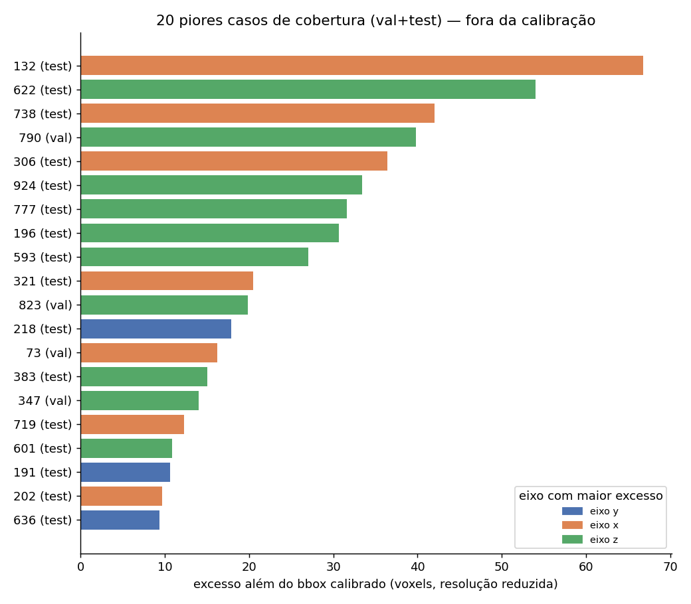

# Etapa 6 v2 — Âncora pela aorta (substitui a âncora por LCC)

> Parte da sequência do Capítulo 2 (Seção 2.3.1). Documenta a segunda tentativa da etapa 6, depois
> do achado bloqueante da primeira tentativa (via LCC) registrado em
> [step6_envelope.md](step6_envelope.md). Ver também [CODE_NOTES_bounding_box.md](CODE_NOTES_bounding_box.md).

## Por que uma segunda tentativa

A etapa 6 original (`docs/step6_envelope.md`) usava o centróide do `lcc_mask` (etapas 1-4) como
âncora para o bbox fixo. A sessão de 2026-07-15 mostrou que essa máscara isola o tronco inteiro, não
o coração — inviabilizando qualquer envelope calculado sobre ela (bbox ficaria perto do tamanho da
imagem original). **Confirmado em 2026-07-17** (ver [step6_envelope.md](step6_envelope.md#achado-bloqueante-lcc-não-isola-o-coração)):
isso não é uma limitação da reimplementação — o LCC nunca teve a intenção de isolar o coração no
pipeline original de Silva et al. (2026), sempre foi só limpeza grosseira antes da localização da
aorta. A âncora pela aorta adotada abaixo é, portanto, o mecanismo de localização que o pipeline
original sempre usou, não uma alternativa arbitrária.

Antes de adotar o LCC, Hélder já havia cogitado usar a posição da aorta (com uma margem em mm) como
base para a ROI cardíaca, e abandonou esse caminho em favor do LCC. Ao revisar o código original do
pipeline de segmentação arterial de Silva et al. (2026) — restaurado temporariamente na branch
`draft-coronary-centerline-detection` para este estudo — ficou claro que:

1. A detecção/segmentação da aorta (Hough Circle Transform + Level Set) já está implementada e
   validada em escala: a execução canônica salva em
   `output/segmentation/canonical/mid_res/test/2026-06-05_20-00-43/` (**não migrada para esta
   branch** — só citada como evidência) mostra 696/700 (99,4%) casos do split de teste com
   aorta/óstios detectados, zero erros de pipeline.
2. Uma margem fixa **só** ao redor da aorta detectada tende a cortar parte da árvore coronária: no
   caso de teste IMG_ID=1, a aorta (Hough+Level Set) foi localizada entre z=94 e z=274 (na
   resolução reduzida), mas o label real de artéria coronária desse mesmo caso vai de z=17 a
   z=182 — a árvore se estende bem abaixo de onde a aorta é rastreada (a aorta ascendente arqueia
   sobre o topo do coração; a árvore coronária desce pela superfície do coração em direção ao
   ápice). Isso é coerente com Hélder ter abandonado esse caminho antes.

## Caminho adotado (Opção A, decidida em 2026-07-15)

Em vez de usar a aorta para "segmentar o coração" com uma margem arbitrária, ou tentar isolar o
coração como etapa intermediária (o problema da tentativa anterior), a nova etapa 6:

1. Usa o **centróide 3D da máscara da aorta** (Hough + Level Set) como **âncora determinística por
   caso** — só depende da imagem, sem label, sem componente aprendido.
2. Calibra o **tamanho fixo do bbox empiricamente**, uma única vez, a partir dos limites do label
   coronário **em relação a essa âncora**, usando só o split de treino — uma agregação min/max
   determinística (não um modelo), da mesma natureza da "envelope conservador" já prevista desde o
   início do capítulo (`docs/CODE_NOTES_bounding_box.md`, Seção 8), só que relativa a uma âncora
   melhor e com offsets assimétricos por direção (não um único "extent" simétrico).
3. Valida a cobertura nos splits de validação/teste (dados fora da calibração) — evita o vazamento
   que o plano original teria (calculava o envelope sobre as 1000 imagens juntas, sem separar
   calibração de validação).

Isso conecta a etapa 6 diretamente à etapa 9 (cobertura de 100%) sem depender de "segmentar o
coração" como etapa intermediária.

## O que foi implementado

Módulos migrados da branch `draft-coronary-centerline-detection` (código herdado, não alterado),
mínimo necessário — sem vesselness nem detecção de óstios, que essa âncora não precisa:

- `src/utils/segmentation/aorta_localization.py` — `detect_aorta_circles` (Hough Circle Transform +
  rastreamento entre fatias).
- `src/utils/segmentation/aorta_segmentation.py` — `level_set_segmentation` (Morphological Geodesic
  Active Contour) + `remove_leaks_morphology`.
- `src/utils/processing/gpu_utils.py`, `src/utils/processing/binary_operations.py` — dependências
  dos dois acima (`keep_largest_component`, `binary_opening`); fallback CPU automático, GPU
  (`cupy`/`cucim`) opcional via `config["USE_GPU"]` (default `false`, sem exigir instalação).
- `config/pipeline_config.json` — blocos `CIRCLE_DETECTION` e `LEVEL_SET` (só esses; nenhum
  parâmetro de vesselness/óstios/region growing/fuzzy foi trazido de volta).

Código novo desta etapa:

- `src/utils/segmentation/bounding_box.py::compute_bounding_box_bounds(mask)` — limites
  mín/máx (inclusivos) por eixo de uma máscara 3D; complementa `compute_bounding_extent` (que só
  retorna o tamanho) quando os limites absolutos são necessários para calcular offsets em relação a
  um ponto de referência externo.
- `src/utils/segmentation/aorta_anchor.py` — módulo principal da etapa:
  - `segment_aorta(lcc_image, scaled_spacing, config)` — encadeia detecção de círculos + Level Set
    + limpeza, retorna `(mask, num_circulos_detectados)`. Máscara vazia (nenhuma aorta detectada)
    é um resultado válido, não uma exceção — tratado como falha um nível acima.
  - `process_case_for_aorta_anchor(img_id, base_path, block, config)` — roda etapas 1-4, segmenta a
    aorta, calcula a âncora (`compute_geometric_centroid` na máscara da aorta) e os limites do
    label coronário (`compute_bounding_box_bounds`). Erros por caso (aorta não detectada, arquivo
    ausente) viram `status="error"`, não interrompem o lote.
  - `process_block`/`run_aorta_anchor_batch` — mesmo padrão retomável por bloco de pasta da etapa 6
    v1, agora compartilhado via `src/utils/project/batch.py::run_resumable_batch` (extraído de
    `segmentation.envelope` nesta sessão para não duplicar a lógica de checkpoint incremental).
  - `calibrate_bbox_offsets(records_df, downscale_factors)` — para cada eixo, offset mínimo =
    o mais conservador (mais negativo) de `label_min - âncora` entre os casos de calibração; offset
    máximo = o mais conservador (mais positivo) de `label_max - âncora`. Garante, por construção,
    que `âncora + offset_min <= label_min` e `label_max <= âncora + offset_max` para todo caso
    usado na calibração.
  - `validate_coverage(records_df, calibration)` — aplica os offsets calibrados a casos **fora** da
    calibração e marca, por caso e por eixo, se o label ficaria coberto pelo bbox resultante.
- `src/run_aorta_anchor.py` — script executável: roda/retoma o lote sobre `dataset/`, calibra com o
  split de treino (`config/imagecas_splits.json`), valida cobertura em val/test, salva
  `calibration.json` + `coverage_val.csv`/`coverage_test.csv`.

## Validação

- `tests/test_bounding_box.py` — 5 testes novos para `compute_bounding_box_bounds` (consistente com
  `compute_bounding_extent`, convenção de eixos, casos de erro).
- `tests/test_batch.py` — 4 testes do runner genérico `run_resumable_batch` (skip de casos `ok`,
  reprocessa tudo com `resume=False`, re-tenta casos `error`, schema do CSV).
- `tests/test_aorta_anchor.py` — 8 testes: caminho `ok` (âncora + limites do label, com volume
  NIfTI sintético real via `nibabel`, `segment_aorta` mockada), caminho `error` (aorta não
  detectada, arquivo ausente), schema do `process_block`, calibração (offsets conservadores por
  eixo, escala para resolução integral), validação de cobertura (caso dentro/fora do bbox
  calibrado).
- `uv run pytest tests/ -v` — 38/38 passando.
- **Validação manual com dado real** (IMG_ID=1, fora dos testes automatizados): âncora
  `(y=82.3, x=154.6, z=185.8)`, 171 círculos detectados, 336651 voxels na máscara da aorta, limites
  do label `y=[53,205] x=[94,229] z=[17,182]` — consistente com a investigação anterior desta
  sessão. ~36s de processamento (detecção + Level Set) nesta máquina sem GPU.

## Execução do lote completo (1000 imagens) — concluída (2026-07-16), achado bloqueante novo

**Decisão (2026-07-15):** calibrar com o **maior split de treino disponível** entre os já
versionados no repositório — `config/imagecas_splits_train90.json` (90 casos de treino, 210 val,
700 test) — em vez do split default (`config/imagecas_splits.json`, só 30 casos de treino), para
reduzir o risco de um offset "conservador" subestimado por amostra pequena demais (ver ressalva que
motivou essa decisão, registrada abaixo em "decisões em aberto" antes de ser resolvida).
`imagecas_splits_train90.json` foi escolhido sobre `imagecas_splits_train60.json` (60 casos) por
ter mais casos de treino ainda; nenhum split com mais de 90 estava disponível no repo nesta data —
se um for criado depois, reconsiderar.

- **Comando**: `uv run python src/run_aorta_anchor.py --splits config/imagecas_splits_train90.json`
- **GPU**: não usada (`USE_GPU=false`, default) — ver achado de divergência algorítmica na sessão
  anterior (não repetir a configuração de GPU sem pedido explícito).
- **Custo estimado**: ~33-35s/caso em CPU × 1000 casos ≈ 9-10h. O processamento por caso
  (`block_<pasta>.csv` em `output/bounding_box/aorta_anchor/`) independe do split escolhido — só a
  calibração (`calibration_imagecas_splits_train90.json`) e a validação de cobertura
  (`coverage_val_imagecas_splits_train90.csv`, `coverage_test_imagecas_splits_train90.csv`) usam o
  split especificado. Rodando em background nesta sessão a partir de 2026-07-15; **retomável** — se
  interrompido, rodar o mesmo comando de novo pula os casos já processados (`status="ok"` nos CSVs
  de bloco).
- **Como acompanhar**: os CSVs de bloco em `output/bounding_box/aorta_anchor/block_*.csv` são
  atualizados incrementalmente, um caso por vez — dá para inspecionar o progresso a qualquer momento
  sem esperar o lote terminar (contar linhas com `status="ok"`).

A execução foi interrompida uma vez por um reinício não planejado da máquina (~04:42 de
2026-07-16, provavelmente atualização do Windows) com 766/1000 casos já processados; retomada com o
mesmo comando (`process_block`/`run_resumable_batch` pulou os casos já `status="ok"`) e concluída às
~11:00 de 2026-07-16. Tempo total efetivo de processamento: ~10h15min (excluindo o intervalo parado).

### Resultado — processamento por caso

**994/1000 casos processados com sucesso; 6 sem aorta detectada** (2 no split de treino, 0 no val,
4 no test — excluídos da calibração/validação, não substituídos por fallback, conforme decidido em
2026-07-15). Taxa de falha (0,6%) consistente com a execução canônica antiga citada acima (99,4%).

### Resultado — calibração (88 casos de treino válidos, `imagecas_splits_train90.json`)

```json
{
  "offset_min_reduced": {"y": -88.27, "x": -99.32, "z": -218.56},
  "offset_max_reduced": {"y": 151.97, "x": 108.03, "z": 94.02},
  "bbox_extent_reduced": {"y": 240.25, "x": 207.36, "z": 312.58}
}
```

### Resultado — cobertura (val/test, fora da calibração)

| Split | Cobertos | Total | Taxa |
|---|---|---|---|
| val | 203 | 210 | 96,67% |
| test | 659 | 696 | 94,68% |

**Não chegou a 100%** — 44 dos 906 casos de val+test (4,9%) ficam parcialmente fora do bbox
calibrado em pelo menos um eixo, mesmo com o split de treino maior disponível (88 vs. 30 casos).
Falhas espalhadas pelos 3 eixos (y: 2,7%, x: 1,7%, z: 2,2% no test), não concentradas em um só.
Magnitude do excesso (voxels fora do bbox, resolução reduzida) entre os que falham: mediana 6,9,
média 13,7, máximo 66,8 — a maioria é uma margem pequena, mas há casos claramente fora da faixa
vista no treino.

### ⚠️ Achado bloqueante novo: o bbox calibrado é enorme — `Rv` é ruim, às vezes negativo

`bbox_extent_reduced` acima, escalado para resolução integral
(`× downscale_factors = [2, 2, 1]`), dá **480,5 × 414,7 × 312,6 voxels**. Para comparação, as
imagens originais deste dataset têm tipicamente `512×512×(200-300)` voxels. Ou seja, o bbox
calibrado cobre **~94% da altura (y) e ~81% da largura (x) da imagem inteira**, e em **z chega a
ultrapassar o tamanho total** de boa parte dos casos (que têm 200-300 fatias, contra 312,6
necessários).

Calculei `Rv` real (não a estimativa otimista por caso da notebook) numa amostra de 60 casos reais,
usando o espaçamento físico de cada um:

- **Rv médio: 5,0%** (mediana 13,6%, desvio-padrão 11,8%, faixa: **-15,3% a 13,6%**)
- Valores negativos acontecem quando o bbox calibrado (312,6 fatias) excede o número real de
  fatias da imagem original daquele caso — o "bbox" seria fisicamente maior que a imagem inteira.

Isso **não é um bug de execução** — é uma consequência do método de calibração
(`calibrate_bbox_offsets`): o offset mínimo/máximo de cada eixo é tomado **independentemente**
entre os 88 casos de treino. Os casos que definiram os extremos são **pacientes diferentes em cada
eixo** (`argmin_case_per_axis`/`argmax_case_per_axis` no `calibration_*.json`: y_min do caso 934,
y_max do caso 428, x_min do caso 428, x_max do caso 90, z_min do caso 23, z_max do caso 44 — seis
casos distintos). O bbox final precisa satisfazer simultaneamente o extremo de y de um paciente, o
extremo de x de outro, e o extremo de z de um terceiro — uma combinação que nenhum paciente real
individual atinge, mas que o método de agregação por eixo produz de qualquer forma. **Ampliar o
split de treino piora esse efeito, não melhora**: mais casos aumenta a chance de ver um extremo
ainda maior em algum eixo isoladamente, sem necessariamente resolver a cobertura (que falha quando
um caso de fora tem um valor mais extremo que *qualquer* caso de treino num eixo, não uma
combinação).

**Isso ameaça a hipótese central do Cap. 2** (ganho simultâneo em qualidade *e* eficiência
computacional — VRAM, tempo de treino/inferência): um `Rv` de ~5% não representa redução de volume
relevante. Como no achado da etapa 6 v1 (LCC não isola o coração), estou documentando e parando
aqui em vez de escolher um caminho de correção por conta própria — decisão vinculada à validade
metodológica do capítulo.

**Evidência visual** (gerada em 2026-07-16 a partir de `output/bounding_box/aorta_anchor/`):


Para cada eixo, os offsets `label_min − âncora` (claro) e `label_max − âncora` (escuro) formam uma
distribuição razoavelmente concentrada — mas o limite calibrado (linha tracejada), definido pelo
extremo de só 88 casos, fica na cauda distante dessa distribuição mais ampla (994 casos), não perto
do grosso dela. É esperado que casos de fora da amostra de treino ultrapassem esse limite — a cauda
completa (994 casos) claramente vai além do que 88 casos capturaram, principalmente no eixo z.

**Atualizado em 2026-07-17:** o histograma agora também marca, por eixo/lado, os percentis
80/85/90/95/100% da distribuição completa (994 casos) — traços curtos, mais escuros quanto mais
perto de 100%, mostrando visualmente quantos casos ficariam de fora em cada nível de cobertura
marginal (`compute_coverage_percentiles()` em
[plot_aorta_anchor_extremes.py](../src/eda/plot_aorta_anchor_extremes.py), tabela apresentada em
[aorta_anchor_calibration_summary.ipynb](../src/eda/aorta_anchor_calibration_summary.ipynb),
Seção 2.1). Isso quantifica exatamente o que o parágrafo acima descreve: em **todos os 6
eixo/lado**, o limite calibrado com 88 casos já fica aquém do extremo real dos 994 processados —
gap de 10,7 a 24,5 voxels em y, 36,4 a 66,8 em x, 33,4 a 54,0 em z (resolução reduzida).



O eixo **z é o maior responsável pelas piores falhas de cobertura** (9 dos 20 piores casos), à
frente de x (6) e y (3) — coerente com o offset em z ter a maior amplitude entre os três
(`bbox_extent_reduced.z = 312,6`, contra 240,2 em y e 207,4 em x). O pior caso individual (IMG_ID
132, split test) fica ~67 voxels fora do bbox calibrado num dos eixos.

Gerado por `src/eda/plot_aorta_anchor_extremes.py` (`uv run python src/eda/plot_aorta_anchor_extremes.py`):
carrega `all_cases.csv` + `calibration_imagecas_splits_train90.json` +
`coverage_{val,test}_imagecas_splits_train90.csv`, calcula `offset_min/max = label_min/max −
âncora` por caso e eixo, plota histogramas com `matplotlib` marcando o limite calibrado e o caso
que o define (via `argmin_case_per_axis`/`argmax_case_per_axis`), e um gráfico de barras dos piores
casos de cobertura por excesso além do bbox. Reaproveitável se a calibração for refeita.

**Possíveis direções (não decidido, para discutir):**
1. Repensar a agregação da calibração — em vez de min/max independente por eixo, considerar algo
   que respeite a correlação entre eixos por paciente (ex.: um envelope por percentil conjunto, ou
   aceitar formalmente uma cobertura estatística em vez de min/max absoluto).
2. Revisar se a âncora (centróide da aorta) é o ponto de referência certo — a Opção B cogitada em
   2026-07-15 (ponto médio dos óstios, mais próximo anatomicamente do início da árvore coronária)
   poderia reduzir a dispersão dos offsets por eixo.
3. Investigar os casos mais extremos (excesso de 30-67 voxels na cobertura, ou os 6 argmin/argmax
   da calibração) individualmente — podem ser outliers anatômicos genuínos ou indicar problema no
   label/dado de origem.
4. Reconsiderar se um bbox de tamanho fixo por eixo (retangular, alinhado aos eixos) é viável para
   este objetivo, ou se a variabilidade anatômica exige outra estratégia geométrica.

### Onde estão os resultados

- `output/bounding_box/aorta_anchor/all_cases.csv` — os 1000 casos processados (âncora, limites do
  label, status).
- `output/bounding_box/aorta_anchor/calibration_imagecas_splits_train90.json` — calibração completa.
- `output/bounding_box/aorta_anchor/coverage_val_imagecas_splits_train90.csv` /
  `coverage_test_imagecas_splits_train90.csv` — cobertura por caso e por eixo nos splits de fora.
- `output_run_aorta_anchor.log` (raiz do repo) — log completo da execução, incluindo a interrupção
  e retomada.

## Não incluído nesta etapa / decisões em aberto

- Etapas 7 (posicionamento do bbox) e 8 (corte em resolução integral) ainda não implementadas —
  ficam mais diretas agora: `bbox_min = âncora_resolução_integral + offset_min_full_resolution`,
  `bbox_max = âncora_resolução_integral + offset_max_full_resolution`, por eixo.
