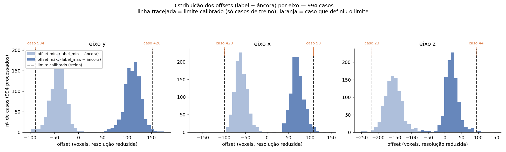

# Etapa 6 v2 — Âncora pela aorta (substitui a âncora por LCC)

> Parte da sequência do Capítulo 2 (Seção 2.3.1). Documenta a segunda tentativa da etapa 6, depois
> do achado bloqueante da primeira tentativa (via LCC) registrado em
> [step6_envelope.md](step6_envelope.md). Ver também [CODE_NOTES_bounding_box.md](CODE_NOTES_bounding_box.md).
>
> **Status em 2026-07-21**: a âncora pela aorta (centróide 3D via Hough+Level Set) continua válida
> e em uso. Mas a ideia de um **bbox de tamanho fixo** calibrado a partir dela — o "Caminho
> adotado" original descrito logo abaixo — foi **abandonada** depois de 3 variantes de calibração
> falharem em conciliar cobertura alta com `Rv` bom (ver seção "Decisão (2026-07-21)" mais adiante
> no documento). O pivô atual é um envelope individual por imagem, ainda não implementado.

## Por que uma segunda tentativa

A etapa 6 original (`docs/step6_envelope.md`) usava o centróide do `lcc_mask` (etapas 1-4) como
âncora para o bbox fixo. A sessão de 2026-07-15 mostrou que essa máscara isola o tronco inteiro, não
o coração — inviabilizando qualquer envelope calculado sobre ela (bbox ficaria perto do tamanho da
imagem original). **Confirmado em 2026-07-17** (ver [step6_envelope.md](step6_envelope.md#achado-bloqueante-lcc-não-isola-o-coração)):
isso não é uma limitação da reimplementação — o LCC nunca teve a intenção de isolar o coração no
pipeline original de Silva et al. (2026), sempre foi só limpeza grosseira antes da localização da
aorta. A âncora pela aorta adotada abaixo é, portanto, o mecanismo de localização que o pipeline
original sempre usou, não uma alternativa arbitrária.

Antes de adotar o LCC, Hélder já havia cogitado usar a posição da aorta (com uma margem em mm) como
base para a ROI cardíaca, e abandonou esse caminho em favor do LCC. Ao revisar o código original do
pipeline de segmentação arterial de Silva et al. (2026) — restaurado temporariamente na branch
`draft-coronary-centerline-detection` para este estudo — ficou claro que:

1. A detecção/segmentação da aorta (Hough Circle Transform + Level Set) já está implementada e
   validada em escala: a execução canônica salva em
   `output/segmentation/canonical/mid_res/test/2026-06-05_20-00-43/` (**não migrada para esta
   branch** — só citada como evidência) mostra 696/700 (99,4%) casos do split de teste com
   aorta/óstios detectados, zero erros de pipeline.
2. Uma margem fixa **só** ao redor da aorta detectada tende a cortar parte da árvore coronária: no
   caso de teste IMG_ID=1, a aorta (Hough+Level Set) foi localizada entre z=94 e z=274 (na
   resolução reduzida), mas o label real de artéria coronária desse mesmo caso vai de z=17 a
   z=182 — a árvore se estende bem abaixo de onde a aorta é rastreada (a aorta ascendente arqueia
   sobre o topo do coração; a árvore coronária desce pela superfície do coração em direção ao
   ápice). Isso é coerente com Hélder ter abandonado esse caminho antes.

## Caminho adotado (Opção A, decidida em 2026-07-15)

Em vez de usar a aorta para "segmentar o coração" com uma margem arbitrária, ou tentar isolar o
coração como etapa intermediária (o problema da tentativa anterior), a nova etapa 6:

1. Usa o **centróide 3D da máscara da aorta** (Hough + Level Set) como **âncora determinística por
   caso** — só depende da imagem, sem label, sem componente aprendido.
2. Calibra o **tamanho fixo do bbox empiricamente**, uma única vez, a partir dos limites do label
   coronário **em relação a essa âncora**, usando só o split de treino — uma agregação min/max
   determinística (não um modelo), da mesma natureza da "envelope conservador" já prevista desde o
   início do capítulo (`docs/CODE_NOTES_bounding_box.md`, Seção 8), só que relativa a uma âncora
   melhor e com offsets assimétricos por direção (não um único "extent" simétrico).
3. Valida a cobertura nos splits de validação/teste (dados fora da calibração) — evita o vazamento
   que o plano original teria (calculava o envelope sobre as 1000 imagens juntas, sem separar
   calibração de validação).

Isso conecta a etapa 6 diretamente à etapa 9 (cobertura de 100%) sem depender de "segmentar o
coração" como etapa intermediária.

## O que foi implementado

Módulos migrados da branch `draft-coronary-centerline-detection` (código herdado, não alterado),
mínimo necessário — sem vesselness nem detecção de óstios, que essa âncora não precisa:

- `src/utils/segmentation/aorta_localization.py` — `detect_aorta_circles` (Hough Circle Transform +
  rastreamento entre fatias).
- `src/utils/segmentation/aorta_segmentation.py` — `level_set_segmentation` (Morphological Geodesic
  Active Contour) + `remove_leaks_morphology`.
- `src/utils/processing/gpu_utils.py`, `src/utils/processing/binary_operations.py` — dependências
  dos dois acima (`keep_largest_component`, `binary_opening`); fallback CPU automático, GPU
  (`cupy`/`cucim`) opcional via `config["USE_GPU"]` (default `false`, sem exigir instalação).
- `config/pipeline_config.json` — blocos `CIRCLE_DETECTION` e `LEVEL_SET` (só esses; nenhum
  parâmetro de vesselness/óstios/region growing/fuzzy foi trazido de volta).

Código novo desta etapa:

- `src/utils/segmentation/bounding_box.py::compute_bounding_box_bounds(mask)` — limites
  mín/máx (inclusivos) por eixo de uma máscara 3D; complementa `compute_bounding_extent` (que só
  retorna o tamanho) quando os limites absolutos são necessários para calcular offsets em relação a
  um ponto de referência externo.
- `src/utils/segmentation/aorta_anchor.py` — módulo principal da etapa:
  - `segment_aorta(lcc_image, scaled_spacing, config)` — encadeia detecção de círculos + Level Set
    + limpeza, retorna `(mask, num_circulos_detectados)`. Máscara vazia (nenhuma aorta detectada)
    é um resultado válido, não uma exceção — tratado como falha um nível acima.
  - `process_case_for_aorta_anchor(img_id, base_path, block, config)` — roda etapas 1-4, segmenta a
    aorta, calcula a âncora (`compute_geometric_centroid` na máscara da aorta) e os limites do
    label coronário (`compute_bounding_box_bounds`). Erros por caso (aorta não detectada, arquivo
    ausente) viram `status="error"`, não interrompem o lote.
  - `process_block`/`run_aorta_anchor_batch` — mesmo padrão retomável por bloco de pasta da etapa 6
    v1, agora compartilhado via `src/utils/project/batch.py::run_resumable_batch` (extraído de
    `segmentation.envelope` nesta sessão para não duplicar a lógica de checkpoint incremental).
  - `calibrate_bbox_offsets(records_df, downscale_factors)` — para cada eixo, offset mínimo =
    o mais conservador (mais negativo) de `label_min - âncora` entre os casos de calibração; offset
    máximo = o mais conservador (mais positivo) de `label_max - âncora`. Garante, por construção,
    que `âncora + offset_min <= label_min` e `label_max <= âncora + offset_max` para todo caso
    usado na calibração.
  - `validate_coverage(records_df, calibration)` — aplica os offsets calibrados a casos **fora** da
    calibração e marca, por caso e por eixo, se o label ficaria coberto pelo bbox resultante.
- `src/run_aorta_anchor.py` — script executável: roda/retoma o lote sobre `dataset/`, calibra com o
  split de treino (`config/imagecas_splits.json`), valida cobertura em val/test, salva
  `calibration.json` + `coverage_val.csv`/`coverage_test.csv`.

## Validação

- `tests/test_bounding_box.py` — 5 testes novos para `compute_bounding_box_bounds` (consistente com
  `compute_bounding_extent`, convenção de eixos, casos de erro).
- `tests/test_batch.py` — 4 testes do runner genérico `run_resumable_batch` (skip de casos `ok`,
  reprocessa tudo com `resume=False`, re-tenta casos `error`, schema do CSV).
- `tests/test_aorta_anchor.py` — 8 testes: caminho `ok` (âncora + limites do label, com volume
  NIfTI sintético real via `nibabel`, `segment_aorta` mockada), caminho `error` (aorta não
  detectada, arquivo ausente), schema do `process_block`, calibração (offsets conservadores por
  eixo, escala para resolução integral), validação de cobertura (caso dentro/fora do bbox
  calibrado).
- `uv run pytest tests/ -v` — 38/38 passando.
- **Validação manual com dado real** (IMG_ID=1, fora dos testes automatizados): âncora
  `(y=82.3, x=154.6, z=185.8)`, 171 círculos detectados, 336651 voxels na máscara da aorta, limites
  do label `y=[53,205] x=[94,229] z=[17,182]` — consistente com a investigação anterior desta
  sessão. ~36s de processamento (detecção + Level Set) nesta máquina sem GPU.

## Execução do lote completo (1000 imagens) — concluída (2026-07-16), achado bloqueante novo

**Decisão (2026-07-15):** calibrar com o **maior split de treino disponível** entre os já
versionados no repositório — `config/imagecas_splits_train90.json` (90 casos de treino, 210 val,
700 test) — em vez do split default (`config/imagecas_splits.json`, só 30 casos de treino), para
reduzir o risco de um offset "conservador" subestimado por amostra pequena demais (ver ressalva que
motivou essa decisão, registrada abaixo em "decisões em aberto" antes de ser resolvida).
`imagecas_splits_train90.json` foi escolhido sobre `imagecas_splits_train60.json` (60 casos) por
ter mais casos de treino ainda; nenhum split com mais de 90 estava disponível no repo nesta data —
se um for criado depois, reconsiderar.

- **Comando**: `uv run python src/run_aorta_anchor.py --splits config/imagecas_splits_train90.json`
- **GPU**: não usada (`USE_GPU=false`, default) — ver achado de divergência algorítmica na sessão
  anterior (não repetir a configuração de GPU sem pedido explícito).
- **Custo estimado**: ~33-35s/caso em CPU × 1000 casos ≈ 9-10h. O processamento por caso
  (`block_<pasta>.csv` em `output/bounding_box/aorta_anchor/`) independe do split escolhido — só a
  calibração (`calibration_imagecas_splits_train90.json`) e a validação de cobertura
  (`coverage_val_imagecas_splits_train90.csv`, `coverage_test_imagecas_splits_train90.csv`) usam o
  split especificado. Rodando em background nesta sessão a partir de 2026-07-15; **retomável** — se
  interrompido, rodar o mesmo comando de novo pula os casos já processados (`status="ok"` nos CSVs
  de bloco).
- **Como acompanhar**: os CSVs de bloco em `output/bounding_box/aorta_anchor/block_*.csv` são
  atualizados incrementalmente, um caso por vez — dá para inspecionar o progresso a qualquer momento
  sem esperar o lote terminar (contar linhas com `status="ok"`).

A execução foi interrompida uma vez por um reinício não planejado da máquina (~04:42 de
2026-07-16, provavelmente atualização do Windows) com 766/1000 casos já processados; retomada com o
mesmo comando (`process_block`/`run_resumable_batch` pulou os casos já `status="ok"`) e concluída às
~11:00 de 2026-07-16. Tempo total efetivo de processamento: ~10h15min (excluindo o intervalo parado).

### Resultado — processamento por caso

**994/1000 casos processados com sucesso; 6 sem aorta detectada** (2 no split de treino, 0 no val,
4 no test — excluídos da calibração/validação, não substituídos por fallback, conforme decidido em
2026-07-15). Taxa de falha (0,6%) consistente com a execução canônica antiga citada acima (99,4%).

### Resultado — calibração (88 casos de treino válidos, `imagecas_splits_train90.json`)

```json
{
  "offset_min_reduced": {"y": -88.27, "x": -99.32, "z": -218.56},
  "offset_max_reduced": {"y": 151.97, "x": 108.03, "z": 94.02},
  "bbox_extent_reduced": {"y": 240.25, "x": 207.36, "z": 312.58}
}
```

### Resultado — cobertura (val/test, fora da calibração)

| Split | Cobertos | Total | Taxa |
|---|---|---|---|
| val | 203 | 210 | 96,67% |
| test | 659 | 696 | 94,68% |

**Não chegou a 100%** — 44 dos 906 casos de val+test (4,9%) ficam parcialmente fora do bbox
calibrado em pelo menos um eixo, mesmo com o split de treino maior disponível (88 vs. 30 casos).
Falhas espalhadas pelos 3 eixos (y: 2,7%, x: 1,7%, z: 2,2% no test), não concentradas em um só.
Magnitude do excesso (voxels fora do bbox, resolução reduzida) entre os que falham: mediana 6,9,
média 13,7, máximo 66,8 — a maioria é uma margem pequena, mas há casos claramente fora da faixa
vista no treino.

### ⚠️ Achado bloqueante novo: o bbox calibrado é enorme — `Rv` é ruim, às vezes negativo

`bbox_extent_reduced` acima, escalado para resolução integral
(`× downscale_factors = [2, 2, 1]`), dá **480,5 × 414,7 × 312,6 voxels**. Para comparação, as
imagens originais deste dataset têm tipicamente `512×512×(200-300)` voxels. Ou seja, o bbox
calibrado cobre **~94% da altura (y) e ~81% da largura (x) da imagem inteira**, e em **z chega a
ultrapassar o tamanho total** de boa parte dos casos (que têm 200-300 fatias, contra 312,6
necessários).

Calculei `Rv` real (não a estimativa otimista por caso da notebook) numa amostra de 60 casos reais,
usando o espaçamento físico de cada um:

- **Rv médio: 5,0%** (mediana 13,6%, desvio-padrão 11,8%, faixa: **-15,3% a 13,6%**)
- Valores negativos acontecem quando o bbox calibrado (312,6 fatias) excede o número real de
  fatias da imagem original daquele caso — o "bbox" seria fisicamente maior que a imagem inteira.

Isso **não é um bug de execução** — é uma consequência do método de calibração
(`calibrate_bbox_offsets`): o offset mínimo/máximo de cada eixo é tomado **independentemente**
entre os 88 casos de treino. Os casos que definiram os extremos são **pacientes diferentes em cada
eixo** (`argmin_case_per_axis`/`argmax_case_per_axis` no `calibration_*.json`: y_min do caso 934,
y_max do caso 428, x_min do caso 428, x_max do caso 90, z_min do caso 23, z_max do caso 44 — seis
casos distintos). O bbox final precisa satisfazer simultaneamente o extremo de y de um paciente, o
extremo de x de outro, e o extremo de z de um terceiro — uma combinação que nenhum paciente real
individual atinge, mas que o método de agregação por eixo produz de qualquer forma. **Ampliar o
split de treino piora esse efeito, não melhora**: mais casos aumenta a chance de ver um extremo
ainda maior em algum eixo isoladamente, sem necessariamente resolver a cobertura (que falha quando
um caso de fora tem um valor mais extremo que *qualquer* caso de treino num eixo, não uma
combinação).

**Isso ameaça a hipótese central do Cap. 2** (ganho simultâneo em qualidade *e* eficiência
computacional — VRAM, tempo de treino/inferência): um `Rv` de ~5% não representa redução de volume
relevante. Como no achado da etapa 6 v1 (LCC não isola o coração), estou documentando e parando
aqui em vez de escolher um caminho de correção por conta própria — decisão vinculada à validade
metodológica do capítulo.

**Evidência visual** (gerada em 2026-07-16 a partir de `output/bounding_box/aorta_anchor/`):



Para cada eixo, os offsets `label_min − âncora` (claro) e `label_max − âncora` (escuro) formam uma
distribuição razoavelmente concentrada — mas o limite calibrado (linha tracejada), definido pelo
extremo de só 88 casos, fica na cauda distante dessa distribuição mais ampla (994 casos), não perto
do grosso dela. É esperado que casos de fora da amostra de treino ultrapassem esse limite — a cauda
completa (994 casos) claramente vai além do que 88 casos capturaram, principalmente no eixo z.

**Atualizado em 2026-07-17:** o histograma agora também marca, por eixo/lado, os percentis
80/85/90/95/100% da distribuição completa (994 casos) — traços curtos, mais escuros quanto mais
perto de 100%, mostrando visualmente quantos casos ficariam de fora em cada nível de cobertura
marginal (`compute_coverage_percentiles()` em
[plot_aorta_anchor_extremes.py](../src/eda/plot_aorta_anchor_extremes.py), tabela apresentada em
[aorta_anchor_calibration_summary.ipynb](../src/eda/aorta_anchor_calibration_summary.ipynb),
Seção 2.1). Isso quantifica exatamente o que o parágrafo acima descreve: em **todos os 6
eixo/lado**, o limite calibrado com 88 casos já fica aquém do extremo real dos 994 processados —
gap de 10,7 a 24,5 voxels em y, 36,4 a 66,8 em x, 33,4 a 54,0 em z (resolução reduzida).


O eixo **z é o maior responsável pelas piores falhas de cobertura** (9 dos 20 piores casos), à
frente de x (6) e y (3) — coerente com o offset em z ter a maior amplitude entre os três
(`bbox_extent_reduced.z = 312,6`, contra 240,2 em y e 207,4 em x). O pior caso individual (IMG_ID
132, split test) fica ~67 voxels fora do bbox calibrado num dos eixos.

Gerado por `src/eda/plot_aorta_anchor_extremes.py` (`uv run python src/eda/plot_aorta_anchor_extremes.py`):
carrega `all_cases.csv` + `calibration_imagecas_splits_train90.json` +
`coverage_{val,test}_imagecas_splits_train90.csv`, calcula `offset_min/max = label_min/max −
âncora` por caso e eixo, plota histogramas com `matplotlib` marcando o limite calibrado e o caso
que o define (via `argmin_case_per_axis`/`argmax_case_per_axis`), e um gráfico de barras dos piores
casos de cobertura por excesso além do bbox. Reaproveitável se a calibração for refeita.

**Atualizado em 2026-07-17** — o histograma agora também marca, por eixo/lado, os percentis
80/85/90/95/100% da distribuição completa (994 casos): traços curtos, mais escuros quanto mais
perto de 100%, mostrando visualmente quantos casos ficariam de fora em cada nível de cobertura
marginal (`compute_coverage_percentiles()`, mesmo módulo). Em **todos os 6 combinações de
eixo/lado**, o limite calibrado com 88 casos já fica aquém do extremo real dos 994 processados —
gap de 10,7 a 24,5 voxels em y, 36,4 a 66,8 em x, 33,4 a 54,0 em z (resolução reduzida). Tabela
completa e comparação numérica em
[aorta_anchor_calibration_summary.ipynb](../src/eda/aorta_anchor_calibration_summary.ipynb),
Seção 2.1.

### Explorado: recalibração por percentil em vez de min/max — não abre um meio-termo viável

Testado em 2026-07-17, sem re-rodar o lote (reaproveita `all_cases.csv` + `coverage_*.csv` já
salvos): em vez de calibrar cada eixo pelo mínimo/máximo absoluto dos 88 casos de treino (nível de
cobertura 100%, o método atual), recalibrar por um percentil menos conservador — aceitando que uma
fração pequena dos próprios casos de treino fique fora do bbox — e medir o efeito na cobertura
**conjunta** (3 eixos simultâneos, não marginal) dos 906 casos de val+test e no `Rv` real (mesma
amostra de 60 casos da Seção 4).

| Cobertura no treino | Extensão do bbox (resolução integral, y×x×z) | Cobertura conjunta fora da calibração (val+test) | `Rv` médio |
|---|---|---|---|
| 100% (método atual) | 480,5 × 414,7 × 312,6 | 95,14% | 5,01% |
| 95% | 407,2 × 357,0 × 253,1 | 75,94% | 43,91% |
| 90% | 386,0 × 334,3 × 236,3 | 59,60% | 53,50% |
| 85% | 373,7 × 318,3 × 226,0 | 45,70% | 59,00% |
| 80% | 361,1 × 307,5 × 217,3 | 33,44% | 63,20% |

**Não existe meio-termo razoável nessa faixa**: já relaxar de 100% para 95% de cobertura no treino
(uma redução pequena, em tese) faz a cobertura conjunta fora da calibração despencar de 95,14% para 75,94% —
uma queda muito mais que proporcional — enquanto o `Rv` melhora de 5,01% para 43,91%. Não há um
ponto onde cobertura fique perto de 100% **e** `Rv` seja relevante ao mesmo tempo: ou a cobertura é
aceitável e o `Rv` é ruim (o achado já documentado acima), ou o `Rv` melhora e a cobertura
desmorona bem abaixo do que o capítulo exige.

Reproduzível via
[aorta_anchor_calibration_summary.ipynb](../src/eda/aorta_anchor_calibration_summary.ipynb),
Seção 4.1 (`calibrate_at_level`/`joint_coverage_rate`/`rv_for_extent` — generalizam
`calibrate_bbox_offsets`/`validate_coverage` para qualquer percentil, sem reprocessar o dataset).

**O que isso descarta e o que não descarta**: descarta a versão simples de "relaxar a agregação por
eixo com um corte de percentil marginal" — a sub-ideia mais direta do item 1 abaixo — como solução
suficiente sozinha; a queda de cobertura fora da calibração é desproporcional demais a qualquer ganho de `Rv`
que valha a pena. **Não descarta** abordagens que respeitem a correlação entre eixos por paciente
(ex.: um envelope conjunto/percentil multivariado, considerando os 3 eixos ao mesmo tempo por
caso, não marginal eixo a eixo) — essa variante mais sofisticada do item 1, e as demais direções
listadas abaixo, continuam em aberto.

### Explorado (2026-07-21): calibração conjunta por paciente único — também não resolve

Testado o restante do item 1 (a variante "que considere os 3 eixos conjuntamente por caso", citada
acima como ainda em aberto): em vez de combinar o extremo de cada eixo de pacientes diferentes
(`calibrate_bbox_offsets`) ou relaxar cada eixo isoladamente por percentil marginal (seção
anterior), usar o extent 3D de **um único paciente real** de treino — um triplete `(y, x, z)`
coerente, vindo do mesmo caso — como o bbox calibrado inteiro. Implementado em
`calibrate_bbox_size_joint()` (`src/utils/segmentation/aorta_anchor.py`, 8 testes em
`tests/test_aorta_anchor.py`), compatível com `validate_coverage()` sem alteração (mesmo schema de
dict de calibração que `calibrate_bbox_offsets()`).

Testados dois critérios de seleção do paciente de referência entre os 88 de treino:

| Critério de seleção | Caso escolhido | Extent (y, x, z), resolução reduzida | Cobertura conjunta (fora da calibração) | `Rv` médio |
|---|---|---|---|---|
| Maior volume (`extent_y × extent_x × extent_z`) | 291 | 176, 136, 224 | **1,99%** | 67,3% |
| Mais equilibrado (maior percentil mínimo entre os 3 eixos) | 570 | 178, 143, 205 | **12,69%** | 68,2% |

Ambos dão `Rv` ótimo, mas cobertura piores que o método marginal atual (95,14%) — não é uma opção
viável como está. Diagnóstico do caso 291 (maior volume): falha em 88% dos casos no eixo y e 95,7%
no eixo x, mas só 26,7% no eixo z — ele é extenso em z (por isso "maior volume"), mas estreito em x
e y. **"Maior volume" não implica "grande nos 3 eixos ao mesmo tempo"** — daí o critério
"equilibrado" (rank percentual mínimo entre os 3 eixos) ter sido testado como alternativa, com
melhora real (1,99% → 12,69%) mas ainda muito aquém do necessário.

**Conclusão**: nenhum paciente individual real, por melhor que seja escolhido, tem porte suficiente
para servir de envelope para os outros ~900 casos. Não é um problema do critério de seleção — é a
variabilidade anatômica entre pacientes (relativa à âncora da aorta) sendo grande demais para
qualquer método baseado em tamanho(s) real(is) observado(s), seja um paciente só ou min/max entre
vários. **Isso esgota, nas variantes testadas, a direção 1** (marginal-percentil e paciente-único
em 2 critérios) — ver decisão abaixo.

Reproduzível via consulta direta a `all_cases.csv` + `calibrate_bbox_size_joint()` +
`validate_coverage()`, sem reprocessar o dataset (mesmo padrão das explorações anteriores).

### Decisão (2026-07-21): abandonar bbox de tamanho fixo, pivotar para envelope individual por imagem

Com a direção 1 esgotada nas variantes testadas, Hélder decidiu **abandonar a ideia de um tamanho
de bbox fixo compartilhado por todas as imagens** (o desenho original da etapa 6 desde o início do
capítulo) e pediu um **envelope individual por imagem** — cada imagem com seu próprio tamanho de
bbox, não um tamanho único aplicado a todas.

**Isso ainda não foi implementado.** Ficou pendente uma decisão metodológica importante antes de
implementar: **de onde deve vir o tamanho do envelope de cada imagem?** Se vier do label verdadeiro
daquela mesma imagem, o resultado tem cobertura 100% trivial e `Rv` ótimo — mas usar o label de
val/test para definir o pré-processamento deles seria vazamento de informação que o pipeline não
teria disponível numa aplicação real (o Cap. 2 existe para localizar a região sem saber de antemão
onde está a artéria). Perguntado a Hélder; ele pediu para não aprofundar por ora e só consolidar o
que foi encontrado hoje (esta seção + commit). **Retomar essa pergunta explicitamente antes de
implementar qualquer envelope individual** — não presumir o critério.

### Possíveis direções (histórico — 1, marginal e paciente-único, esgotada; ver decisão acima para o rumo atual)

1. ~~Repensar a agregação da calibração~~ — testado em duas variantes (percentil marginal,
   2026-07-17; paciente único por 2 critérios, 2026-07-21), nenhuma resolve. Ver seções acima.
2. Revisar se a âncora (centróide da aorta) é o ponto de referência certo — a Opção B cogitada em
   2026-07-15 (ponto médio dos óstios, mais próximo anatomicamente do início da árvore coronária)
   poderia reduzir a dispersão dos offsets por eixo. **Detecção de óstios de verdade continua não
   testada.** Um proxy barato (`z_min` da máscara da aorta, sem detecção de óstios — ver
   "Diagnóstico exploratório (2026-07-22)" acima) foi testado como forma rápida de checar a
   hipótese antes de investir na detecção real: a dispersão em z **piorou**, não melhorou, e
   `z_min` mostrou-se sensível a onde o rastreamento Hough+Level Set termina (não uma referência
   anatômica estável). Isso não descarta a Opção B (óstios reais seriam uma referência anatômica
   precisa, diferente de `z_min`), mas também não a confirma — decisão sobre investir nisso segue
   em aberto.
3. Investigar os casos mais extremos (excesso de 30-67 voxels na cobertura, ou os 6 argmin/argmax
   da calibração) individualmente — podem ser outliers anatômicos genuínos ou indicar problema no
   label/dado de origem. Não testada.
4. **Adotada em 2026-07-21** (ver "Decisão" acima): abandonar bbox de tamanho fixo, envelope
   individual por imagem. Critério de tamanho ainda em aberto.

### Onde estão os resultados

- `output/bounding_box/aorta_anchor/all_cases.csv` — os 1000 casos processados (âncora, limites do
  label, status).
- `output/bounding_box/aorta_anchor/calibration_imagecas_splits_train90.json` — calibração completa.
- `output/bounding_box/aorta_anchor/coverage_val_imagecas_splits_train90.csv` /
  `coverage_test_imagecas_splits_train90.csv` — cobertura por caso e por eixo nos splits de fora.
- `output_run_aorta_anchor.log` (raiz do repo) — log completo da execução, incluindo a interrupção
  e retomada.

## Detalhe técnico confirmado (2026-07-21): qual lado da máscara da aorta é a raiz

Pergunta prática para qualquer posicionamento futuro que precise diferenciar "lado da raiz" (onde
ficam os óstios coronários) de "lado do arco" na máscara da aorta — depende da convenção de
orientação do NIfTI deste dataset, não é assumível sem checar.

**Orientação do NIfTI**: `nibabel.aff2axcodes()` em 5 casos de blocos diferentes do dataset
(`1-200` a `801-1000`) deu consistentemente `('L', 'A', 'S')` — o eixo z (3º eixo do array, o
mesmo `z` da convenção `(Y, X, Z)` usada em todo o projeto) cresce em direção **Superior
(craniana)**. `z_max` = mais próximo da cabeça; `z_min` = mais próximo dos pés.

**Lado da raiz**: verificado empiricamente (não só por dedução anatômica) — segmentando a aorta de
verdade (`segment_aorta`) em 3 casos reais de blocos diferentes e medindo a distância 3D mínima
(mm, com espaçamento físico) entre cada extremo da máscara da aorta (`z_min`, `z_max`) e o label
coronário real do mesmo caso:

| IMG_ID | aorta z=[min,max] (resolução reduzida) | dist. z_min → label | dist. z_max → label |
|---|---|---|---|
| 1   | [94, 274]  | **21,2 mm** | 53,2 mm |
| 250 | [138, 274] | **15,7 mm** | 39,6 mm |
| 500 | [157, 274] | **11,8 mm** | 18,2 mm |

Em todos os 3 casos, `z_min` da máscara da aorta fica 2-3× mais perto do label coronário do que
`z_max`. **Conclusão: `z_min` é o lado da raiz; `z_max` é o lado do arco** (mais distante do
coração).

**Por que faz sentido**: `z_max` bate exatamente em `num_slices − 1` nos 3 casos — não é
coincidência, é onde `detect_aorta_circles` **começa** a busca (última fatia do volume) e rastreia
para trás (z decrescente) até a geometria deixar de ser circular o bastante para o Hough, o que
acontece perto do anel/seios de Valsalva, na raiz — por isso o rastreamento tende a **parar**
perto da raiz (`z_min` observado), não a começar lá.

**Ressalva**: `('L','A','S')` é a orientação confirmada para este dataset/pipeline de carregamento
(`load_raw_img_and_label` via `nibabel`, sem reorientação), não uma garantia universal de todo
arquivo NIfTI — reconfirmar se outro dataset for usado no futuro.

Reproduzível chamando `segment_aorta(lcc_image, scaled_spacing, config)` (de
`aorta_anchor.py`) com a saída de `load_and_preprocess_image` para qualquer `img_id`, depois
`compute_bounding_box_bounds` na máscara resultante e no label (`label == 1`) para obter os
extremos em z e medir a distância até o label como acima.

## Diagnóstico exploratório (2026-07-22): a âncora atual mistura arco+descendente no eixo z?

Antes de decidir se vale reintroduzir a detecção de óstios (mais cara, mais código), testada a
hipótese de que parte da dispersão do offset em z (que motivou o bbox de 480×414×312, ver achado
acima) vem de ruído de captura — a extensão do trecho descendente da aorta dentro do campo de
visão varia por protocolo de aquisição, não por anatomia coronária — em vez de variabilidade
anatômica real entre pacientes. Se assim fosse, trocar o centróide 3D da máscara inteira por uma
âncora baseada só no lado proximal (`z_min`, o lado da raiz confirmado na seção anterior) deveria
reduzir a dispersão do offset em z.

**Método**: amostra estratificada de 50 casos (10 por bloco × 5 blocos, seed=42), reaproveitando
`label_min`/`label_max` e a âncora atual (centróide) já salvos em `all_cases.csv` — único
reprocessamento foi rodar `segment_aorta` de novo em cada caso da amostra, só para extrair `z_min`
via `compute_proximal_z_anchor` (nova função em `bounding_box.py`, wrapper sobre
`compute_bounding_box_bounds`). y/x da âncora candidata usam o mesmo centróide da âncora atual —
controle, não deveriam mudar entre as duas versões. Não altera nenhum artefato de produção:
script em `src/eda/diagnose_z_anchor_dispersion.py`, saída em
`output/bounding_box/aorta_anchor_z_diagnosis/` (pasta nova).

**Checagem de sanidade**: `z_min < z_max` em todos os 50 casos (sem inversão de lado).

**Resultado — dispersão do offset (`label − âncora`), desvio-padrão e amplitude (max−min) entre
os 50 casos, para as duas âncoras:**

| Eixo | Lado | std atual | amplitude atual | std candidata | amplitude candidata | Δ std | Δ amplitude |
|---|---|---|---|---|---|---|---|
| y | mín | 19,86 | 132,84 | 19,86 | 132,84 | 0,0% | 0,0% |
| y | máx | 20,00 | 103,84 | 20,00 | 103,84 | 0,0% | 0,0% |
| x | mín | 12,75 | 62,77 | 12,75 | 62,77 | 0,0% | 0,0% |
| x | máx | 12,20 | 53,27 | 12,20 | 53,27 | 0,0% | 0,0% |
| z | mín | 26,75 | 122,32 | 32,86 | 182,00 | **−22,8%** | **−48,8%** |
| z | máx | 22,07 | 126,30 | 28,34 | 206,00 | **−28,4%** | **−63,1%** |

(Δ negativo = a dispersão da âncora candidata é *maior* que a atual, não menor.) y/x com Δ
exatamente 0,0% nos 50 casos — confirma que o controle funcionou (mesma referência y/x nas duas
âncoras). Em z, a dispersão **piora** com a âncora candidata nos dois lados e nas duas métricas.

**Achado adicional**: `z_min` (âncora candidata) correlaciona com `num_circles_detected`
(r=−0,68) e com o tempo de processamento do caso (r=−0,71) na amostra — quanto mais círculos o
Hough/Level Set detecta (rastreamento mais longo), menor o `z_min` alcançado. Ou seja, `z_min`
reflete principalmente até onde o rastreamento consegue avançar (sensível a contraste, ruído,
parâmetros de tolerância do algoritmo) — não é uma referência anatômica estável, ao contrário do
centróide, que é uma média sobre todos os voxels da máscara e por isso menos sensível a onde
exatamente o rastreamento termina.

**Interpretação**: a hipótese não se sustenta nesta amostra — trocar o centróide por `z_min` como
componente z da âncora aumenta a dispersão do offset em z (22-28% em desvio-padrão, 49-63% em
amplitude), em vez de reduzi-la. A dispersão observada não parece ser, predominantemente, ruído de
FOV do trecho descendente absorvido pelo centróide; parece estar mais relacionada à
variabilidade de onde o rastreamento Hough+Level Set termina (achado adicional acima) e/ou a
variabilidade anatômica real entre pacientes — este diagnóstico não separa as duas. Decisão sobre
reintroduzir detecção de óstios (ou outra direção) não tomada aqui.

Reproduzível: `uv run python src/eda/diagnose_z_anchor_dispersion.py` (retomável via
`candidate_anchor_z.csv`; `--fresh` reprocessa do zero, `--sample-per-block N`/`--seed S` ajustam
a amostra). Dados: `output/bounding_box/aorta_anchor_z_diagnosis/{candidate_anchor_z,
offsets_detail,dispersion_comparison}.csv`.

## Diagnóstico complementar (2026-07-23): `num_circles_detected` explica o offset de calibração?

Extensão do diagnóstico anterior (2026-07-22, amostra de 50 casos) para a **população inteira**
(994 casos) e para o **offset de produção** (`label − anchor_z`, âncora = centróide, não o `z_min`
candidato testado ontem). Sem reprocessar nada: usa só `all_cases.csv`,
`calibration_imagecas_splits_train90.json` e `coverage_{val,test}_imagecas_splits_train90.csv`, já
salvos — `num_circles_detected` já estava persistido em todos os 994 casos `ok` (confirmado antes
de rodar esta análise). Script: `src/eda/analyze_num_circles_offset_correlation.py` (reproduz
localmente o ranking dos 20 piores casos com a mesma lógica de
`plot_aorta_anchor_extremes.plot_worst_coverage_cases`, sem chamar essa função — evita
re-salvar o PNG de produção).

**Correlações (994 casos), offset bruto e desvio absoluto da mediana, vs. `num_circles_detected`:**

| Comparação | Pearson r | Pearson p | Spearman r | Spearman p |
|---|---|---|---|---|
| `offset_min_z` (bruto) | 0,317 | <0,0001 | 0,085 | 0,0075 |
| `offset_max_z` (bruto) | 0,424 | <0,0001 | 0,046 | 0,148 (n.s.) |
| \|`offset_min_z` − mediana\| | 0,078 | 0,013 | 0,042 | 0,182 (n.s.) |
| \|`offset_max_z` − mediana\| | 0,235 | <0,0001 | 0,219 | <0,0001 |

Pearson e Spearman **divergem** bastante em 3 das 4 linhas (Pearson moderado/significativo,
Spearman fraco ou não-significativo) — sinal de que a correlação linear não é robusta a
outliers/não-linearidade, não uma relação monotônica limpa entre as variáveis.

**Sinal — poucos vs. muitos círculos (corte na mediana, 106 círculos):**

| Grupo | n | mediana de círculos | `offset_min_z` médio | `offset_min_z` mediana | `offset_max_z` médio | `offset_max_z` mediana |
|---|---|---|---|---|---|---|
| poucos círculos (≤ mediana) | 510 | 89 | −156,54 | −154,84 | 18,56 | 20,56 |
| muitos círculos (> mediana) | 484 | 126 | −151,95 | −155,30 | 22,98 | 17,79 |

Diferença de mediana entre os grupos é pequena (~0,5 em `offset_min_z`, ~2,8 em `offset_max_z`,
e inconsistente em sinal entre média e mediana) — **na população inteira, dividir por poucos vs.
muitos círculos não separa grupos com offset visivelmente diferente**, ao contrário do que as
correlações de Pearson por si só sugeririam.

**20 piores casos de cobertura (fora da calibração) x `num_circles_detected`:**

| Split de circles | n | Casos (img_id, nº círculos) |
|---|---|---|
| — | — | 132(47) 622(275) 738(11) 790(226) 306(9) 924(2) 777(17) 196(275) 593(7) 321(116) 823(261) 218(24) 73(81) 383(12) 347(23) 719(97) 601(183) 191(231) 202(107) 636(41) |

- População (994 casos): mediana 106, média 107,7, desvio-padrão 32,9.
- 20 piores: mediana **64,0** (bem abaixo da população), média 102,2 (próxima da população).
- 12 dos 20 (60%) ficam abaixo da mediana da população.
- **O mínimo (2 círculos, caso 924) e o máximo (275 círculos, casos 622 e 196) de toda a
  população de 994 casos aparecem entre os 20 piores** — não só a cauda baixa.

A divergência entre mediana (bem abaixo da população) e média (próxima da população) do grupo dos
20 piores já indicava que a distribuição deles não é simplesmente deslocada para baixo — o achado
do min/max confirma: há dois subgrupos nos 20 piores, um com poucos círculos (rastreamento
incompleto: 924, 593, 306, 738, 383, 777, 347, 218, 636, 132 — todos com <50 círculos) e outro com
muitos círculos, alguns nos extremos superiores da população inteira (622, 196, 823, 191, 601 —
todos ≥183 círculos). O eixo `z` é o mais frequente como `worst_axis` em ambos os subgrupos.

**Interpretação**: `num_circles_detected` não tem uma relação linear/monotônica simples e forte
com o offset de produção na população inteira (divergência Pearson/Spearman, grupos por mediana
quase idênticos) — mais fraco do que a correlação vista ontem numa amostra de 50 usando `z_min` da
máscara em vez do offset de produção. Mas o cruzamento com os 20 piores casos de cobertura sugere
que os **extremos** de `num_circles_detected` (rastreamento muito curto **ou** muito longo — não
só curto) estão sobrerrepresentados entre as falhas, incluindo o mínimo e o máximo observados em
toda a população. Isso é consistente com uma relação não-monotônica (pior nos dois extremos,
melhor no meio) — que explicaria por que correlações lineares/de rank ficam fracas mesmo havendo
sinal real nos extremos. Não testado formalmente aqui (fora do escopo desta rodada); decisão sobre
próximos passos não tomada nesta análise.

Reproduzível: `uv run python src/eda/analyze_num_circles_offset_correlation.py`. Dados:
`output/bounding_box/aorta_anchor_z_diagnosis/{num_circles_offset_detail,
num_circles_offset_correlations,num_circles_offset_sign_summary,worst_coverage_num_circles}.csv`.

## Diagnóstico complementar (2026-07-24): falha de cobertura em z por quintil de `num_circles_detected`

Continuação não-paramétrica dos diagnósticos de 2026-07-22/23 (correlação linear/rank, que assume
relação monotônica e por isso pode mascarar um padrão em U). Aqui os 906 casos de val+test são
agrupados em **quintis** de `num_circles_detected` (~181 casos por faixa) e reportamos a taxa de
falha de cobertura por faixa — sem ajustar modelo quadrático nem qualquer outra forma funcional,
propositalmente, para ver o padrão bruto antes de impor uma hipótese.

Sem reprocessar nada: `num_circles_detected` já vem direto em `coverage_{val,test}_imagecas_
splits_train90.csv` (confirmado por join com `all_cases.csv` via `img_id` — os valores batem em
todos os 906 casos, então nenhum merge era de fato necessário para uso, só para checagem da chave).
Script: `src/eda/analyze_num_circles_quintile_coverage.py`.

**Correção a um número citado na solicitação**: os "44 casos" já documentados na seção de
cobertura val/test são a falha **conjunta** (`covered`==False, qualquer eixo), não uma contagem
específica de z. A falha binária **só em z** é **18** de 906 (1,99%); em y é 22 (2,43%); em x é 16
(1,77%).

**Taxa de falha de cobertura por quintil de `num_circles_detected` (906 casos):**

| Quintil | `num_circles_detected` | N | Falhas y (n / %) | Falhas x (n / %) | Falhas z (n / %) |
|---|---|---|---|---|---|
| 1 | 2 – 83 | 182 | 12 / 6,59% | 6 / 3,30% | 11 / 6,04% |
| 2 | 84 – 99 | 186 | 1 / 0,54% | 1 / 0,54% | 0 / 0,00% |
| 3 | 100 – 112 | 176 | 1 / 0,57% | 4 / 2,27% | 0 / 0,00% |
| 4 | 113 – 130 | 187 | 0 / 0,00% | 2 / 1,07% | 0 / 0,00% |
| 5 | 131 – 275 | 175 | 8 / 4,57% | 3 / 1,71% | 7 / 4,00% |

**Padrão em U visível a olho nu em z (e também em y), sem ajuste de curva**: as duas faixas
extremas de `num_circles_detected` (menos de 84 círculos, ou mais de 130) concentram **18 das 18
falhas de z** (11 + 7 = 18 = 100%) e a maior parte das falhas de y (20 de 22 = 91%) — as três
faixas centrais (84–130 círculos, ~55% dos 906 casos) têm falha de z **zero**. O eixo x, usado como
controle, não segue o mesmo padrão de forma tão limpa: tem sua maior taxa na faixa central
(quintil 3, 2,27%) e não zera nas faixas do meio — é mais plano/ruidoso, sem o mesmo formato em U
nítido de y e z.

Isso é consistente com a hipótese de não-monotonicidade levantada no diagnóstico de 2026-07-23
(mínimo e máximo populacional de `num_circles_detected` entre os 20 piores casos de cobertura) —
aqui, agrupando por faixa em vez de correlacionar, o padrão em U fica visualmente muito mais claro
para z e y do que a correlação linear/rank sozinha sugeria.

**5 piores casos por excesso em z (voxels fora do bbox, não binário) entre os 906:**

| img_id | split | `num_circles_detected` | excesso em z (voxels) | `covered_z` |
|---|---|---|---|---|
| 622 | test | 275 | 53,97 | False |
| 790 | val | 226 | 39,84 | False |
| 924 | test | 2 | 33,38 | False |
| 777 | test | 17 | 31,57 | False |
| 196 | test | 275 | 30,62 | False |

Todos os 5 **coincidem** com casos já listados em `worst_coverage_num_circles.csv` (diagnóstico de
2026-07-23) com `worst_axis`=z — consistente, não é um achado novo isolado. Note que os 5 já
cobrem os dois extremos: 2 casos com `num_circles_detected` no teto da população (622, 196 —
275 círculos, o máximo de toda a população de 994), 1 no piso (924 — 2 círculos, o mínimo), e 2 em
valores intermediários mas ainda fora da faixa central sem falha (790 com 226, 777 com 17).

Nenhuma coincidência com os 5 `img_id` citados na seção "Achado bloqueante novo" (934, 428, 90, 23,
44) — aqueles são os casos que definiram os extremos do **split de treino** usado na calibração
(`argmin/argmax_case_per_axis`), não os piores casos de cobertura em val/test; são conjuntos
diferentes por construção e não há razão a priori para coincidirem.

Reproduzível: `uv run python src/eda/analyze_num_circles_quintile_coverage.py`. Dados:
`output/bounding_box/aorta_anchor_z_diagnosis/{num_circles_quintile_coverage,
worst_z_excess_cases}.csv`. Nenhum artefato de produção alterado (não reprocessa, não regrava
`calibration.json` nem os CSVs de cobertura). Interpretação do padrão em U (o que causa a faixa
central ser "boa") e decisão sobre próximos passos não tomadas aqui, propositalmente.

### Passo 1 (extra): os casos que definiram a calibração são outliers de `num_circles_detected`?

Os 5 `img_id` citados na seção "Achado bloqueante novo" (`argmin/argmax_case_per_axis` do
`calibration_imagecas_splits_train90.json`) contra a distribuição de `num_circles_detected` nos
994 casos (mediana 106, média 107,7, std 32,9):

| img_id | eixo definido | `num_circles_detected` | percentil (994 casos) | faixa (cortes do passo anterior: Q1 ≤ 83, Q5 ≥ 131) |
|---|---|---|---|---|
| 934 | y_min | 162 | 95,9% | quintil 5 |
| 428 | y_max / x_min | 172 | 97,2% | quintil 5 |
| 90 | x_max | 139 | 86,7% | quintil 5 |
| 23 | z_min | 28 | 1,7% | quintil 1 |
| 44 | z_max | 186 | 97,9% | quintil 5 |

**Os 5 caem todos numa faixa extrema (quintil 1 ou 5) — nenhum no meio da distribuição.** Reforça
a leitura do padrão em U: os casos que forçaram os extremos do bbox calibrado (e portanto o
`bbox_extent_reduced` de 240×207×313, ver "Achado bloqueante novo") parecem ser, em boa parte,
outliers de rastreamento Hough+Level Set — não necessariamente pacientes com anatomia coronária
mais extrema de verdade. Não implica causalidade nem propõe correção; é só uma correlação a mais
apontando na mesma direção dos passos anteriores.

### Passo 2 (extra): inspeção visual dos 5 piores casos de excesso em z

Reprocessados só estes 5 casos (`load_and_preprocess_image` + `segment_aorta` — os únicos passos
caros; label e demais campos vêm de `all_cases.csv`/coverage, não recomputados). Script:
`src/eda/inspect_worst_z_excess_cases.py`. Cortes sagital e coronal (fixados no centróide da
máscara), com a máscara da aorta e o label coronário sobrepostos e as linhas de `label_z_min/max` e
do bbox calibrado em z marcadas, salvos em
`output/bounding_box/aorta_anchor_z_diagnosis/img/case_<id>_z_inspection.png`.

| img_id | `num_circles_detected` | hipótese esperada | mask z (min–max) | extensão (fatias) | label z (min–max) | observado |
|---|---|---|---|---|---|---|
| 622 | 275 | over-tracking | 0 – 274 | 274 | 26 – 236 | over-tracking, mas como **leak** (ver abaixo) |
| 196 | 275 | over-tracking | 0 – 274 | 274 | 19 – 218 | over-tracking, mesmo padrão de leak |
| 790 | 226 | checar qual padrão | 39 – 274 | 235 | 29 – 265 | over-tracking / leak, não under-tracking |
| 924 | 2 | under-tracking | 263 – 274 | 11 | 17 – 264 | under-tracking confirmado |
| 777 | 17 | under-tracking | 258 – 274 | 16 | 16 – 201 | under-tracking confirmado |

**Under-tracking (924, 777) confirmado visualmente, e mais severo do que o esperado**: em ambos, a
máscara é um fragmento minúsculo (11–16 fatias) preso bem no **topo do volume** (fatias 258–274, a
borda superior do campo de visão), com uma lacuna enorme até o início do label coronário (924:
label começa em z=17, mask só existe a partir de z=263 — quase 250 fatias de distância). Não
parece "parou um pouco cedo": o rastreamento praticamente não encontrou nada além de um resquício
no topo da imagem.

**Over-tracking (622, 196, 790) confirmado, mas com uma correção qualitativa ao esperado**: nos 3
casos a máscara não é um tubo aórtico simplesmente mais longo que o normal — é um **blob único e
contíguo, muito maior e com formato irregular**, que na sobreposição visual parece incluir bem mais
tecido do que a aorta (em 622/196 o blob cobre quase toda a extensão vertical do corte, com contorno
que acompanha o que parece ser a silhueta do coração; em 790 tem um formato arredondado grande
condizente com uma câmara cardíaca, não uma aorta tubular). Isto é uma leitura visual qualitativa,
não confirmada contra nenhuma referência anatômica formal além do label coronário disponível — mas
sugere que a causa provável não é "o algoritmo seguiu a aorta longe demais no eixo z", e sim um
**vazamento de segmentação (level-set) para uma estrutura vizinha muito maior**, que incidentalmente
também é muito mais alto/baixo em z do que uma aorta ascendente real.

Nenhuma correção proposta nesta etapa, conforme solicitado — só o que foi observado.

Reproduzível: `uv run python src/eda/inspect_worst_z_excess_cases.py`. Dados/imagens:
`output/bounding_box/aorta_anchor_z_diagnosis/worst_z_excess_visual_inspection_summary.csv` e
`output/bounding_box/aorta_anchor_z_diagnosis/img/*.png`. Nenhum artefato de produção alterado.

## Diagnóstico complementar (2026-07-25): quantificação do leak (volume + área por fatia), 10 casos

Continuação quantitativa da inspeção visual anterior. Dois grupos de 5 casos, mesmo método para
os dois: volume total da máscara (voxels) comparado à referência de **IMG_ID=1 (336651 voxels,
validado manualmente como caso "normal" — ver "Execução do lote completo")**, e o perfil de área de
seção transversal por fatia axial ao longo do range z da máscara, para localizar saltos abruptos
(assinatura esperada de leak) vs. área pequena e constante (assinatura esperada de truncamento).
Script: `src/eda/quantify_aorta_mask_leak.py` (reaproveita `plot_case` de
`inspect_worst_z_excess_cases.py` para as imagens sagital/coronal). Reprocessa só estes 10 casos
(`load_and_preprocess_image` + `segment_aorta`); volume total já estava em `all_cases.csv`
(`aorta_voxels`) para todos os 10 sem precisar reprocessar, mas o perfil de área por fatia não é um
campo salvo em produção, daí o reprocessamento.

**Grupo 1 — 5 piores casos de excesso em z** (já inspecionados visualmente antes):

| img_id | volume (voxels) | vs. referência (336651) | mask z (min–max) | maior salto (z, Δ, x mediana) | CV da área |
|---|---|---|---|---|---|
| 622 | 1.569.468 | **4,66x** | 0 – 274 | z=1, Δ=1000 (0,16x) | 0,64 |
| 196 | 1.667.441 | **4,95x** | 0 – 274 | z=1, Δ=647 (0,11x) | 0,59 |
| 790 | 724.192 | **2,15x** | 39 – 274 | z=40, Δ=491 (0,15x) | 0,42 |
| 924 | 1.836 | **0,005x** | 263 – 274 | z=274, Δ=46 (0,28x) | 0,35 |
| 777 | 16.986 | **0,05x** | 258 – 274 | z=274, Δ=130 (0,12x) | 0,13 |

**Grupo 2 — 5 casos que definiram os extremos da calibração original** (2026-07-16):

| img_id | eixo | volume (voxels) | vs. referência (336651) | mask z (min–max) | maior salto (z, Δ, x mediana) | CV da área |
|---|---|---|---|---|---|---|
| 934 | y_min | 681.114 | **2,02x** | 103 – 274 | z=104, Δ=484 (0,10x) | 0,43 |
| 428 | y_max/x_min | 536.221 | **1,59x** | 93 – 274 | z=274, Δ=219 (0,07x) | 0,26 |
| 90 | x_max | 489.841 | **1,46x** | 126 – 274 | z=127, Δ=514 (0,23x) | 0,47 |
| 23 | z_min | 66.303 | **0,20x** | 247 – 274 | z=274, Δ=204 (0,08x) | 0,08 |
| 44 | z_max | 1.024.748 | **3,04x** | 10 – 205 | z=11, Δ=763 (0,12x) | 0,44 |

**Achado 1 — nenhum dos 5 casos calibradores tem volume perto da referência**: variam de 0,20x a
3,04x — a mesma assinatura já vista no grupo 1 (piores casos de cobertura), reforçando que os
casos que definiram o tamanho do bbox calibrado (`bbox_extent_reduced` = 240×207×313, `Rv` ~5%) não
parecem ter uma máscara de aorta "normal" em nenhum dos dois sentidos (nem os 4 grandes demais, nem
o 1 pequeno demais).

**Achado 2 — a métrica de "maior salto" não localiza bem o leak**: em 8 dos 10 casos, o maior salto
de área entre fatias consecutivas ocorre exatamente na **primeira ou última fatia da máscara**
(z=z_min+1 ou z=z_max) — ou seja, é só a transição natural de entrar/sair de área zero, não um
salto *interno* que marcaria onde o vazamento começa. Essa métrica, como definida aqui (maior
diferença absoluta entre fatias consecutivas), não separa bem leak de truncamento; o **coeficiente
de variação (CV) da área ao longo da máscara** é mais informativo: os 3 casos de fragmento truncado
(924, 777, 23) têm CV entre 0,08 e 0,35 (777 e 23 claramente baixos; 924 intermediário, não tão
constante quanto o esperado), enquanto os casos de blob/leak variam mais (CV 0,26–0,64, sem
separação limpa de um único corte).

**Achado 3 — todas as 10 máscaras terminam exatamente na última fatia do volume**: `mask_z_max`
coincide com `volume_shape_z − 1` nos 10 casos (274 para os 9 casos com 275 fatias; 205 para o
caso 44, que tem só 206 fatias) — **inclusive os 3 fragmentos truncados** (924, 777, 23), cuja
pequena máscara também está colada na borda superior do FOV, não solta no meio do volume. Não
investigado a fundo aqui, mas sugere que a fatia mais superior do campo de visão desempenha algum
papel sistemático nesses 10 casos-problema (estrutura anatômica real perto do desfiladeiro
torácico/tronco braquiocefálico, artefato de borda do FOV, ou os dois) — não dá para distinguir
causa com os dados já disponíveis.

**Achado 4 — nem todo caso "grande" tem a forma de blob**: na inspeção visual, 622, 196, 790, 934 e
44 mostram um blob arredondado, sem formato tubular, condizente com vazamento para outra estrutura
(provável câmara cardíaca) — mas **428 e 90 têm formato de tubo/arco curvo plausível para uma
aorta**, só que maior/mais longo que a referência e indo até a borda do FOV. Não dá para descartar
que 428 e 90 sejam rastreamento correto de uma aorta genuinamente mais visível no campo de visão
daquele exame (FOV maior), em vez de vazamento — distinção que a leitura visual sozinha não resolve.

Nenhuma correção proposta. Reproduzível: `uv run python src/eda/quantify_aorta_mask_leak.py`.
Dados/imagens: `output/bounding_box/aorta_anchor_z_diagnosis/mask_leak_quantification_summary.csv`,
`output/bounding_box/aorta_anchor_z_diagnosis/img/case_<id>_area_profile.png` e
`case_<id>_z_inspection.png` (regenerado para os 5 já existentes, novo para os 5 calibradores).
Nenhum artefato de produção alterado.

## Diagnóstico complementar (2026-07-26): "colar na borda do FOV" é raro ou universal?

Dois passos de baixo custo, sem reprocessar o lote completo (994 casos).

### Passo 1 — prevalência de `mask_z_max == volume_shape_z - 1` na população

O diagnóstico anterior (2026-07-25) achou essa igualdade nos 10 casos-problema (5 piores cobertura
+ 5 calibradores) e não sabia dizer se isso discrimina esses casos ou é comum. `mask_z_max` **não é
um campo salvo em `all_cases.csv`** para os 994 casos — só existe para a amostra de 50 casos já
reprocessada no diagnóstico de 2026-07-22 (`candidate_anchor_z.csv`, coluna `z_max_mask`).
Reprocessar os 994 casos completos só para obter esse campo estaria fora do escopo pedido (sem
reprocessar o lote completo); em vez disso, reaproveitamos essa amostra de 50, sem processar nada
de novo. Script: `src/eda/check_z_max_edge_prevalence.py`.

**Resultado: 50 de 50 casos da amostra (100%) têm `mask_z_max == volume_shape_z - 1`,  em todos os
5 quintis de `num_circles_detected` (5/5, 7/7, 13/13, 11/11, 14/14) — igual aos 10/10 (100%) dos
casos-problema.** Ou seja, **"colar na borda do FOV" não é raro nem discrimina os casos-problema —
é universal** (dentro da amostra disponível, 50 de 994 casos, não exaustivo). O achado 3 do
diagnóstico anterior (todas as 10 máscaras terminam na borda) precisa ser lido à luz disso: **não é
uma assinatura dos casos-problema, é o comportamento normal de praticamente todo caso** — a aorta
ascendente detectada por Hough+Level Set aparentemente sempre se estende até a última fatia
disponível do exame, problemático ou não. O que diferencia os casos-problema não é *chegar* na
borda, é o que acontece **antes** de chegar lá (blob grande demais vs. fragmento minúsculo).

Dados: `output/bounding_box/aorta_anchor_z_diagnosis/z_max_edge_prevalence_sample50.csv`.

### Passo 2 — inspeção da imagem HU bruta (sem máscara) nas últimas fatias do FOV

Para os 10 casos-problema + IMG_ID=1 (referência): as 5 últimas fatias do FOV (`z_max` até
`z_max - 4`), imagem HU bruta, sem sobreposição de máscara, sem rodar
`load_and_preprocess_image`/`segment_aorta` (só carrega o NIfTI bruto — mais barato que os
diagnósticos anteriores; o eixo z não é reduzido de resolução, `DOWNSCALE_FACTORS[2] == 1`, então o
índice de fatia bate 1:1 com o resto do diagnóstico). Script:
`src/eda/inspect_fov_top_slices_raw.py`.

**Estatísticas agregadas de HU na última fatia não mostram nada atípico**: médias entre -413 e -262
HU, p99 entre 461 e 991 HU, todos os 11 casos (incluindo a referência) na mesma faixa — nenhum
valor isolado se destaca como anômalo.

**Observação visual qualitativa**: em todos os 11 casos, as últimas fatias mostram o mesmo nível
anatômico — próximo ao desfiladeiro torácico/base do pescoço (clavículas visíveis na borda superior
da imagem, traqueia, grandes vasos do arco/tronco braquiocefálico em corte transversal como
estruturas redondas e claras). **Não parece artefato de reconstrução ou truncamento de FOV** — são
estruturas anatômicas coerentes e nítidas, não ruído ou corte abrupto na borda da imagem. A
diferença qualitativa entre a referência (IMG_ID=1, 1 estrutura vascular redonda claramente
dominante nesse nível) e alguns casos-problema (622, 924, 44 — 2 a 4 estruturas redondas de
brilho/tamanho parecido, próximas entre si) é sugestiva de uma região com múltiplos vasos de
calibre semelhante (candidatos ambíguos para o Hough), mas **não é conclusiva** — amostra pequena
(11 casos), sem comparação sistemática contra casos "bons" além da única referência, e a
classificação de "quantos vasos redondos aparecem" foi feita visualmente, não com uma métrica
objetiva.

Nenhuma correção proposta — só o observado. Reproduzível:
`uv run python src/eda/inspect_fov_top_slices_raw.py`. Dados/imagens:
`output/bounding_box/aorta_anchor_z_diagnosis/fov_top_slices_raw_summary.csv` e
`output/bounding_box/aorta_anchor_z_diagnosis/img/case_<id>_fov_top_raw.png` (11 casos, incluindo a
referência `case_1_fov_top_raw.png`). Nenhum artefato de produção alterado.

## Diagnóstico complementar (2026-07-27): tentativa de objetivar "múltiplos vasos ambíguos" — resultado negativo

Tentativa de transformar a observação qualitativa de 2026-07-26 (múltiplas estruturas redondas de
calibre parecido perto do topo do FOV, em casos-problema vs. referência) numa métrica objetiva, em
amostra maior (40 casos: os 10 já conhecidos + 30 de comparação com `aorta_voxels` entre 0,7x-1,3x
da referência, 336651 voxels, amostra estratificada por bloco, sem reprocessar nada para a
seleção). Método: **só a detecção de círculos** (`detect_aorta_circles`/
`_detect_circles_in_slice` de `aorta_localization.py`), sem Level-Set, aplicada nas 15 fatias mais
próximas do topo do FOV — muito mais barato que os diagnósticos anteriores (~5-10s/caso, sem
Level-Set, vs. 40-220s/caso). Script: `src/eda/measure_ambiguous_circle_candidates.py`.

**Métrica**: em cada fatia analisada, roda `detect_aorta_circles` real (mesma config de produção,
janela de 15 fatias) para obter "o círculo principal" rastreado; separadamente, roda
`_detect_circles_in_slice` (sem restrição de ROI, `total_num_peaks_initial`=15 picos) na própria
fatia e nas duas adjacentes para obter todos os candidatos Hough. Um candidato conta como
"ambíguo" se não é o próprio círculo principal, tem raio dentro de ±20% do raio principal, e centro
a menos de 2x o raio médio de distância.

**Resultado — a métrica, como especificada, NÃO confirma a diferença vista visualmente**:

| grupo | n casos | média | mediana | desvio-padrão | mín | máx |
|---|---|---|---|---|---|---|
| problema (10) | 10 | 290,9 | 295,0 | 121,8 | 1 | 419 |
| normal (30) | 30 | 332,4 | 346,0 | 85,8 | 12 | 513 |

As distribuições **se sobrepõem quase inteiramente** (problema: 238–419 excluindo 1 outlier;
normal: 191–513 excluindo 1 outlier) — a mediana do grupo "normal" é até um pouco **maior** que a do
grupo "problema", o oposto do que a hipótese visual sugeria.

**Causa provável — efeito-teto nos parâmetros da métrica, não ausência de sinal real**: com
`total_num_peaks_initial`=15 picos por fatia e faixa de raio de Hough de só 18–30px (12px de
amplitude total, config de produção), uma tolerância de raio de ±20% sobre um raio típico de
~20–25px (±4–5px) já cobre boa parte de toda a faixa de busca permitida — e um limiar de distância
de 2x o raio médio (~40–50px) é uma fração grande de uma fatia de 256×256. Nessas condições, a
maioria dos picos Hough detectados em qualquer fatia (de qualquer caso, problemático ou não)
trivialmente satisfaz os dois critérios simultaneamente — o método super-conta candidatos
"ambíguos" quase universalmente, mascarando qualquer diferença real entre os grupos.

**Duas exceções informativas, mas por razões diferentes**: `img_id=924` (grupo problema, só 1
ambíguo) tem apenas **2 círculos reais rastreados** de 15 fatias (rastreamento falhou cedo — poucos
candidatos principais para comparar, não indica ausência de ambiguidade na imagem). `img_id=190`
(grupo normal, 12 ambíguos) rastreou as 15 fatias **normalmente** e ainda assim teve poucos
candidatos ambíguos — esse sim é um caso genuinamente de baixa ambiguidade dentro da amostra,
mas é o único.

**Conclusão**: com os parâmetros exatamente como especificados no pedido, a métrica objetiva **não
confirma** a diferença observada visualmente em 2026-07-26 — mas a razão mais provável é uma
limitação do desenho da métrica (tolerâncias largas demais relativas à faixa de busca do Hough
configurada em produção), não uma refutação da hipótese original. Recalibrar os limiares (ex.:
tolerância de raio menor, ou normalizar pela faixa de busca em vez de por porcentagem fixa) poderia
mudar o resultado, mas isso seria uma escolha de método nova, não coberta por este diagnóstico.
Nenhuma correção proposta.

Reproduzível: `uv run python src/eda/measure_ambiguous_circle_candidates.py`. Dados:
`output/bounding_box/aorta_anchor_z_diagnosis/ambiguous_circle_candidates_summary.csv`. Nenhum
artefato de produção alterado.

## Divisão em 7 tarefas com o orientador (reunião 2026-07-22): critérios de exclusão de casos problemáticos

Depois dos diagnósticos acima (2026-07-22 a 07-27, nenhuma correção proposta), a reunião com o
orientador de 2026-07-22 dividiu o próximo passo em 7 tarefas: calcular o tamanho de envelope por
caso (tarefa 1), testar critérios de exclusão candidatos isoladamente (tarefas 2, 3, 3b — inserida
depois da 3), comparar/decidir entre eles (tarefa 5) e, a partir da decisão, recalibrar e validar
(tarefas 4, 6, 7 — conteúdo exato ainda não recebido nesta sessão). Todo o código destas tarefas
está em `src/utils/segmentation/aorta_anchor.py`; testes em `tests/test_aorta_anchor.py`.

### Tarefa 1/7 — tamanho de envelope por caso (`compute_per_case_envelope_size`)

`compute_per_case_envelope_size(records_df, downscale_factors)`
(`src/utils/segmentation/aorta_anchor.py:304`) expõe, por caso e por eixo, o mesmo cálculo que
`calibrate_bbox_offsets` já fazia internamente (`offset = label - anchor`), mas sem agregar
min/max entre casos — o tamanho de envelope (`envelope_extent = offset_max - offset_min`) que cada
caso exigiria individualmente, na resolução reduzida e em resolução integral. Validado contra os
994 casos reais de `all_cases.csv` (2026-07-28): os 5 casos que definiram os extremos da
calibração original batem exatamente (diferença 0,0) com os offsets já persistidos em
`calibration_imagecas_splits_train90.json`.

**Achado cruzado (2026-07-28):** `img_id=924` é o caso de maior `envelope_extent_z` de toda a
população (247, resolução reduzida) — o mesmo caso já identificado no diagnóstico de 2026-07-24/25
acima como pior excesso de cobertura em z na produção (under-tracking, só 2 círculos detectados).
Duas métricas totalmente independentes (excesso do bbox calibrado vs. tamanho de envelope por
caso, sem depender de calibração) concordam no mesmo caso — referência usada nas comparações
abaixo. (Nota lateral, sem impacto na função: os 5 casos calibradores **não** são os de maior
`envelope_extent_z` da população — `argmin/argmax_case_per_axis` pega o extremo de um lado só por
eixo, enquanto `envelope_extent` soma os dois lados do mesmo caso; não é um bug.)

### Tarefa 2/7 — critério A: percentil de `num_circles_detected`

`select_cases_by_circle_count_percentile(records_df, exclusion_pct)`
(`src/utils/segmentation/aorta_anchor.py:368`) exclui as duas caudas da distribuição de
`num_circles_detected` (proxy de under-/over-tracking do Hough+Level Set, motivado pelo padrão em
U do diagnóstico de 2026-07-24 acima). `exclusion_pct` total, dividido igualmente entre as caudas,
via percentil (não contagem fixa de casos).

Validação sobre os 994 casos (2026-07-28):

| exclusion_pct | N excluído | Calibradores excluídos (de 934/428/90/23/44) | Caso 924 excluído? |
|---|---|---|---|
| 5% | 49 | 2/5 (23, 44) | Sim |
| 10% | 99 | 4/5 (23, 44, 428, 934) | Sim |
| 15% | 147 | 4/5 (23, 44, 428, 934) | Sim |
| 20% | 194 | 4/5 (23, 44, 428, 934) | Sim |

O caso 90 (`x_max` da calibração original, `num_circles_detected` no percentil 86,7%) nunca é
excluído até 20%.

### Tarefa 3/7 — critério B: percentil de `envelope_extent` — reclassificado como critério de curadoria de dataset (2026-07-28)

`select_cases_by_envelope_size_percentile(envelope_df, exclusion_pct, axis)`
(`src/utils/segmentation/aorta_anchor.py:431`) exclui as duas caudas da distribuição de
`envelope_extent_{axis}` (saída da tarefa 1), um eixo por vez. Mesma lógica de divisão de caudas
da tarefa 2, para manter os critérios comparáveis.

**Reclassificação metodológica (2026-07-28, decidida ao abrir a tarefa 3b):** este critério usa
`label_min`/`label_max` do próprio caso — ou seja, **depende do label coronário**, que só existe
porque o ImageCAS é um dataset rotulado. Por isso só serve como critério de **curadoria de
dataset** (decidir quais dos 1000 casos já rotulados entram no estudo, análogo a critérios de
inclusão/exclusão de qualquer benchmark) — **não pode ser parte do pipeline determinístico**
aplicado a uma imagem nova sem anotação, que é o objetivo do Cap. 2. Os números abaixo (já
registrados antes desta reclassificação) não mudam — só a interpretação de para que servem.

Validação sobre os 994 casos, `axis="z"` (2026-07-28):

| exclusion_pct | N excluído | Calibradores excluídos | Caso 924 excluído? |
|---|---|---|---|
| 5% | 50 | 0/5 | Sim |
| 10% | 97 | 0/5 | Sim |
| 15% | 143 | 1/5 (934) | Sim |
| 20% | 189 | 1/5 (934) | Sim |

O caso 90 nunca é excluído até 20%, nem em z (`envelope_extent_z` no percentil 24,5%) nem em x
(`envelope_extent_x` no percentil 86,3%, o eixo em que ele define o extremo original — perto do
limiar de 20% mas não o suficiente).

### Tarefa 3b/7 — critério C: percentil de `aorta_voxels` (contraponto elegível para produção)

`select_cases_by_aorta_volume_percentile(records_df, exclusion_pct)`
(`src/utils/segmentation/aorta_anchor.py:507`) — mesmo desenho do critério A, trocando
`num_circles_detected` por `aorta_voxels` (volume da máscara da aorta segmentada). Ao contrário do
critério B, **não depende do label coronário** — derivável só da imagem, elegível para uso no
pipeline de produção, não só como curadoria de dataset. Motivado pelo mesmo achado do diagnóstico
de 2026-07-25 acima (volume da máscara muito distante da referência nos casos-problema, tanto por
under-tracking quanto por over-tracking/leak).

Validação sobre os 994 casos (2026-07-28):

| exclusion_pct | N excluído | Calibradores excluídos | Caso 924 excluído? |
|---|---|---|---|
| 5% | 50 | 3/5 (23, 44, 934) | Sim |
| 10% | 100 | 5/5 (23, 44, 90, 428, 934) | Sim |
| 15% | 150 | 5/5 | Sim |
| 20% | 200 | 5/5 | Sim |

Percentil de `aorta_voxels` na população (994 casos) para os 5 calibradores + caso 924:

| img_id | eixo/motivo | `aorta_voxels` | percentil |
|---|---|---|---|
| 934 | y_min | 681.114 | 98,1% |
| 428 | y_max/x_min | 536.221 | 96,8% |
| 90 | x_max | 489.841 | 95,6% |
| 23 | z_min | 66.303 | 2,1% |
| 44 | z_max | 1.024.748 | 99,1% |
| 924 | maior `envelope_extent_z` | 1.836 | 0,2% |

**O critério C é o primeiro a capturar os 5 calibradores simultaneamente**, a partir de
`exclusion_pct=10%` — inclusive o caso 90, que os critérios A e B nunca capturam até 20% (caso 90
passa a ser excluído pelo critério C a partir de `exclusion_pct=9%`).

### Sobreposição entre os três critérios (`exclusion_pct=10%`, checagem preliminar para a tarefa 5)

Sem decidir nada ainda — só uma checagem de quanto os três critérios concordam, usando os
resultados já obtidos acima (`N(A)=99`, `N(B)=97`, `N(C)=100`, todos com `exclusion_pct=10%`,
`B` em `axis="z"`).

**Correção (2026-07-28): a tabela original desta seção rotulava as interseções pareadas como
"(total)" sem deixar explícito se eram interseções totais (incluindo o terceiro critério) ou as
regiões exclusivas do diagrama de Venn de 7 partes — eram interseções *totais*, mas a rotulagem
era ambígua. Reescrita abaixo com as duas visões separadas e sem ambiguidade; nenhum valor mudou.**

**Regiões exclusivas do diagrama de Venn (7 partes, sem sobreposição entre si — a soma bate
exatamente com o total da união A∪B∪C):**

| Região | N | img_id |
|---|---|---|
| só A (não B, não C) | 29 | — |
| só B (não A, não C) | 81 | — |
| só C (não A, não B) | 29 | — |
| A ∩ B, excluindo C | 2 | — |
| **A ∩ C, excluindo B** | **57** | `15, 23, 25, 44, 66, 80, 111, 112, 164, 182, 191, 196, 199, 218, 225, 247, 280, 297, 301, 306, 331, 347, 368, 383, 402, 415, 421, 428, 436, 467, 508, 522, 537, 563, 575, 592, 593, 609, 631, 636, 650, 726, 738, 739, 777, 792, 816, 823, 838, 850, 864, 906, 934, 941, 951, 973, 976` |
| B ∩ C, excluindo A | 3 | — |
| A ∩ B ∩ C (tripla) | 11 | `47, 97, 176, 299, 601, 622, 724, 754, 790, 904, 924` |
| **soma das 7 regiões** | **212** | igual à união A∪B∪C (212) ✓ |

**Interseções pareadas totais** (inclui casos que também estão no terceiro critério — cada uma é
a soma da região exclusiva do par + a região tripla acima):

| Par | interseção total | = excl. do par + tripla | união do par | Jaccard (interseção / união) |
|---|---|---|---|---|
| A, C | 68 | 57 + 11 | 131 | **0,5191** |
| A, B | 13 | 2 + 11 | 183 | 0,0710 |
| B, C | 14 | 3 + 11 | 183 | 0,0765 |

**Leitura com Jaccard (normalizada, não só contagem absoluta): A e C concordam em ~52% dos casos
que qualquer um dos dois exclui — mais de 7× a concordância de A ou C com B (~7%)**. Confirma a
leitura anterior (agora numericamente precisa): `num_circles_detected` (A) e `aorta_voxels` (C)
parecem capturar um sinal parecido (ambos refletem o comportamento do rastreamento
Hough+Level Set), enquanto `envelope_extent` (B, que usa o label) captura majoritariamente outra
coisa.

**Os 57 casos em A ∩ C excluindo B** (tabela acima) incluem **4 dos 5 calibradores** (23, 44, 428,
934) — só o caso 90 fica de fora, mas por um motivo diferente: ele está em "só C" (não em A nem em
B a 10%, ver tarefas 2/3 acima), não em A∩C. **O caso 924 não está nesse grupo** — ele está na
região tripla A∩B∩C (é excluído pelos três critérios simultaneamente a 10%), não exclusivo de
A∩C. Interpretação e decisão sobre qual(is) critério usar ficam para a tarefa 5 — não avaliado
aqui.

### Tarefa 4/7 — recalibração e cobertura sobre o subconjunto filtrado

`evaluate_exclusion_criterion(records_df, train_ids, val_ids, test_ids, criterion_column,
exclusion_pct, downscale_factors)` (`src/utils/segmentation/aorta_anchor.py:677`) recalibra
`calibrate_bbox_offsets` só com o treino **depois de filtrado** por um critério de exclusão, e
avalia `validate_coverage` sobre val+test filtrados pelo mesmo limiar. Ponto de desenho importante
(pedido explicitamente nesta tarefa): o limiar (percentil inferior/superior de
`criterion_column`) é calculado **só com os 88 casos de treino**, e o valor absoluto resultante —
não um novo percentil — é aplicado igualmente aos três splits, para não vazar informação de
val/test na definição do corte. Só usa `aorta_voxels` (critério C) e `num_circles_detected`
(critério A) — **o critério B (`envelope_extent`) fica de fora**, por depender do label
coronário (reclassificado como curadoria de dataset na tarefa 3b, não elegível para pipeline).

**Duas ressalvas de leitura, importantes para não interpretar mal a tabela abaixo:**

1. **`exclusion_pct=0` não significa "nenhum caso excluído".** O limiar em `exclusion_pct=0` é o
   mínimo/máximo exato dos 88 casos de treino — mas essa faixa pode não cobrir toda a distribuição
   de val/test (906 casos), do mesmo jeito que o offset do bbox já mostrou (seção "Achado
   bloqueante novo" acima: o limite calibrado com 88 casos fica aquém do extremo real dos 994
   processados). Por isso `n_val_excluded`/`n_test_excluded` já são maiores que zero em
   `exclusion_pct=0%` na tabela abaixo — são casos fora do range jamais visto no treino, não uma
   exclusão intencional.
2. **`Rv` aqui é uma aproximação por contagem de voxels** (`volume_shape_{y,x,z}` já persistido,
   escalado para resolução integral por `downscale_factors`) — não o volume físico (mm³) real
   calculado com o espaçamento de cada NIfTI. **Correção (2026-07-28, ver "Esclarecimento 1"
   abaixo): checado com espaçamento real e o proxy de voxels dá o número idêntico** — a ressalva
   original aqui superestimava o risco dessa aproximação.

### Esclarecimentos pós-tarefa 4 (2026-07-28)

Dois pontos levantados depois da tabela acima, checados pontualmente (sem gerar nova grade de
sweep), antes da reunião de quarta-feira.

**Esclarecimento 1 — `Rv` com volume físico real (spacing por caso) para o ponto de maior
interesse (critério C, `exclusion_pct=5%`):** recalculado lendo o cabeçalho NIfTI (`shape` +
`get_zooms()`, sem carregar o volume completo) dos 932 casos incluídos nesse corte. Resultado:
**`Rv` médio físico = 16,11% — idêntico ao proxy de voxels já reportado** (diferença média
`-0,00000002`, máxima `0,00000007`, ruído de ponto flutuante). Não é coincidência: como o bbox e o
volume original são medidos no mesmo sistema de coordenadas do mesmo caso, o espaçamento **cancela
algebricamente** na razão `Rv = 1 - V_bbox/V_original` — `V_bbox/V_original` depende só da razão
entre extents em voxels, não do espaçamento físico, **desde que a reconstrução do shape em
resolução integral a partir do shape reduzido seja exata**. Confirmado empiricamente: nos 932
casos, `volume_shape_{y,x,z} × downscale_factors` bate **exatamente** com o shape real do NIfTI em
100% dos casos (0 discrepâncias) — x/y por serem reduzidos por um fator inteiro exato (512/2=256),
z por não ser reduzido (`downscale_factors[2]=1`). **Conclusão: a afirmação "`Rv` mais que dobra"
(6,64%→16,11%) se sustenta em unidade física, não é um artefato da aproximação por voxels — os dois
números são a mesma medida.** Script ad-hoc, dados salvos em
`output/bounding_box/aorta_anchor_z_diagnosis/task4_physical_rv_check_criterion_c_5pct.csv`.

**Esclarecimento 2 — por que `coverage_z` cai de 99,62% (15%) para 96,95% (20%) no critério A:**
recalibrando e validando cobertura pontualmente nos dois cortes (sem gerar grade nova),
`bbox_extent_full_resolution.z` encolhe de **290,0 para 268,0** (−22,0 voxels, resolução integral)
entre os dois cortes — o limite superior do bbox em z (`anchor_z + offset_max_z`) cai exatamente
22,0 unidades para todo caso (offset fixo, o mesmo deslocamento em todos), porque o caso de treino
que definia o `z_max` aos 15% passou a ser excluído aos 20% (mais um outlier de
`num_circles_detected` retirado do treino), e o próximo caso mais extremo define um `offset_max_z`
menor.

Isso **exclui os 21 casos de val/test cujo `label_z_max` caía exatamente na faixa de 22 voxels que
deixou de estar coberta** — todos os 21 (`5, 16, 103, 114, 202, 240, 273, 321, 418, 419, 482, 499,
519, 529, 534, 720, 733, 762, 807, 926, 943`) eram `covered_z=True` aos 15% e viram `covered_z=
False` aos 20%, **permanecendo avaliados nos dois cortes** (não são casos que saíram de escopo — é
falha de cobertura genuína, causada pelo encolhimento do bbox). O caso mais marginal é o `img_id=5`
(`label_z_max=189,0` vs. novo teto do bbox em `188,9` — falha por 0,1 voxel).

Confirma a hipótese: **sim, o bbox ficou pequeno demais em z para os extremos remanescentes de
val/test que não foram excluídos do treino** — a exclusão de outliers de `num_circles_detected` no
treino reduz o bbox calibrado, mas não tem como garantir que os casos de val/test que dependiam
justamente daquela folga (agora removida) também sejam excluídos — eles continuam no conjunto
avaliado e agora falham.

Efeito secundário que amplifica a queda (não é a causa raiz, mas soma na mesma direção): dos 906
casos de val/test, **29 saem do conjunto avaliado entre 15% e 20%** (mais casos de val/test caem
fora do range do critério A conforme o corte aperta) — desses 29, **28 eram `covered_z=True`** e só
1 era `covered_z=False`, então a saída desses casos do denominador também puxa a média para baixo
(remove desproporcionalmente mais casos "bons" do que "ruins"). Contagens exatas: `N` avaliado
782→753, `covered_z` 779→730 (`-49` = `-21` que viram falha + `-28` que saíram cobertos),
`uncovered_z` 3→23 (`+21` novas falhas `-1` que saiu já falhando = `+20`).

Script ad-hoc, sem gerar CSV novo (checagem pontual, não grade de sweep), reaproveitando só
`calibrate_bbox_offsets`/`validate_coverage` já existentes sobre `all_cases.csv` +
`config/imagecas_splits_train90.json`. Nenhuma função nem resultado já commitado foi alterado.

**Validação sobre os 994 casos, `downscale_factors=(2, 2, 1)`, `exclusion_pct` em
[0, 5, 10, 15, 20]:**

**Critério C (`aorta_voxels`):**

| exclusion_pct | N excl. treino/val/test | bbox full-res (y×x×z) | Rv médio | Rv mediana | Cobertura conjunta (N avaliado) |
|---|---|---|---|---|---|
| 0% | 0 / 3 / 22 | 480,5 × 414,7 × 312,6 | 6,64% | 13,60% | 96,94% (881) |
| **5%** | 6 / 10 / 46 | 465,9 × 414,7 × 290,0 | **16,11%** | 22,26% | **96,59%** (850) |
| 10% | 10 / 17 / 81 | 457,8 × 386,5 × 275,9 | 26,94% | 32,28% | 94,18% (808) |
| 15% | 14 / 23 / 106 | 457,8 × 368,3 × 275,9 | 30,27% | 35,46% | 92,54% (777) |
| 20% | 18 / 34 / 151 | 457,8 × 368,3 × 268,0 | 32,27% | 37,31% | 92,93% (721) |

**Critério A (`num_circles_detected`), mesma grade:**

| exclusion_pct | N excl. treino/val/test | bbox full-res (y×x×z) | Rv médio | Rv mediana | Cobertura conjunta (N avaliado) |
|---|---|---|---|---|---|
| 0% | 0 / 4 / 22 | 480,5 × 414,7 × 312,6 | 6,59% | 13,60% | 97,05% (880) |
| **5%** | 6 / 11 / 65 | 472,4 × 386,5 × 297,1 | **18,96%** | 24,75% | **95,54%** (830) |
| 10% | 10 / 19 / 91 | 472,4 × 386,5 × 297,1 | 19,30% | 24,75% | 95,48% (796) |
| 15% | 12 / 23 / 101 | 457,8 × 386,5 × 290,0 | 23,65% | 28,81% | 94,88% (782) |
| 20% | 17 / 30 / 123 | 457,8 × 386,5 × 268,0 | 29,39% | 34,22% | 93,23% (753) |

**Ponto de maior interesse, sem decidir nada (destacado em negrito nas duas tabelas): `exclusion_
pct=5%` do critério C** — `Rv` mais que dobra (6,64%→16,11%) com queda de cobertura de só 0,35pp
(96,94%→96,59%). O próximo corte (5%→10%, critério C) tem custo bem pior por unidade de `Rv`
ganho: `Rv` quase dobra de novo (16,11%→26,94%) mas a cobertura cai 2,4pp — mais de 6× o custo
marginal do primeiro corte. O critério A em 5% ganha `Rv` parecido (6,59%→18,96%) mas com o dobro
do custo de cobertura (1,5pp) do que o critério C no mesmo corte — nessa grade, **C parece ter uma
relação `Rv`/cobertura mais favorável que A no corte mais brando**. Interessante notar também que,
no critério A, o `bbox` e o `Rv` **não mudam entre 5% e 10%** — os mesmos casos definem os
extremos em ambos os cortes. Nenhuma decisão tomada aqui — tabela completa para a reunião de
quarta-feira.

Reproduzível: script usado para gerar a tabela não versionado (rodado ad-hoc, reaproveita só
`evaluate_exclusion_criterion` sobre `all_cases.csv` + `config/imagecas_splits_train90.json`, sem
reprocessar nada). Dados salvos em
`output/bounding_box/aorta_anchor_z_diagnosis/task4_exclusion_criterion_evaluation.csv`. Nenhum
artefato de produção alterado (`calibration_imagecas_splits_train90.json` original intacto) —
teste exploratório.

### Tarefa nova (esclarecimento pós-reunião, 2026-07-28/29): bbox por percentil, com perda parcial em vez de cobertura binária

Reteste direto do experimento de 2026-07-17 ("Explorado: recalibração por percentil em vez de
min/max" acima, que concluiu não haver meio-termo viável) — mas agora medindo **perda parcial**
por caso, não só cobertura binária conjunta/`Rv`. Motivação: o achado de 2026-07-17 usava cobertura
**binária** (um único voxel do label fora do bbox já conta como falha total do caso) — uma métrica
muito rígida que pode mascarar um meio-termo real quando a maior parte da "falha" é, na prática,
perda pequena de uma pequena fração da árvore, não perda catastrófica.

`evaluate_percentile_bbox_tradeoff(records_df, train_ids, val_ids, test_ids, offset_percentile,
downscale_factors, exclude_via_criterion=None, exclusion_pct=None)`
(`src/utils/segmentation/aorta_anchor.py:873`) define o bbox por um percentil do offset em cada
eixo (não mínimo/máximo absoluto) sobre o treino — opcionalmente já filtrado por um critério de
exclusão (reaproveita a mesma lógica de limiar de
:func:`evaluate_exclusion_criterion`/tarefa 4, extraída para um helper compartilhado
`_filter_splits_by_train_threshold`, `src/utils/segmentation/aorta_anchor.py:677`, sem alterar o
comportamento já testado dessa função). `offset_percentile=100` reproduz `calibrate_bbox_offsets`
exatamente (regressão coberta em teste).

**Ressalva importante sobre a perda parcial (não é a máscara real do label):** `records_df` não
guarda a máscara voxel a voxel da árvore coronária — só `label_{y,x,z}_min/max`, os limites da
caixa delimitadora (mesma limitação de todas as tarefas anteriores desta linha, que só agregam
sobre `all_cases.csv`/`calibration_*.json`/`coverage_*.csv` já existentes, sem reler NIfTI). Por
isso a perda é aproximada tratando a árvore coronária como um **bloco retangular preenchendo sua
própria caixa delimitadora** — a mesma aproximação que `validate_coverage` já usa para o teste
binário, estendida para uma fração contínua (`perda = 1 - volume_interseção/volume_caixa_label`).
**Não é a fração real de voxels perdidos** — a árvore coronária é uma estrutura fina e ramificada,
não um bloco sólido, então o proxy provavelmente **superestima** a perda real em casos onde só a
"casca" da caixa delimitadora é cortada mas a árvore em si (concentrada mais ao centro) continua
intacta. Se for necessário o número exato de voxels perdidos, precisaria reler a máscara do label
por caso (reprocessamento fora do escopo deste esclarecimento pontual — viável como tarefa
separada se for útil para a reunião).

**Validação sobre os 906 casos de val+test (`offset_percentile` em
[100, 97.5, 95, 90, 85, 80]), duas grades:**

**(a) Sem filtro de caso (reteste direto de 2026-07-17):**

| offset_percentile | bbox full-res (y×x×z) | Rv médio | perda média | perda mediana | perda=0 | perda <5% | perda 5-20% | perda ≥20% |
|---|---|---|---|---|---|---|---|---|
| 100% | 480,5 × 414,7 × 312,6 | 6,70% | 0,47% | 0,00% | 862 | 23 | 15 | 6 |
| 97,5% | 428,4 × 364,4 × 284,8 | 33,41% | 1,29% | 0,00% | 765 | 71 | 54 | 16 |
| 95% | 407,2 × 357,0 × 253,1 | 44,90% | 2,16% | 0,00% | 688 | 113 | 75 | 30 |
| 90% | 386,0 × 334,3 × 236,3 | 54,33% | 3,83% | 0,00% | 540 | 181 | 137 | 48 |
| 85% | 373,7 × 318,3 × 226,0 | 59,73% | 5,59% | 0,83% | 414 | 211 | 209 | 72 |
| 80% | 361,1 × 307,5 × 217,3 | 63,86% | 7,51% | 3,14% | 303 | 230 | 274 | 99 |

**(b) Com filtro prévio pelo critério C a 5% (ponto de melhor custo-benefício da tarefa 4), mesma grade (N=850 avaliados):**

| offset_percentile | bbox full-res (y×x×z) | Rv médio | perda média | perda mediana | perda=0 | perda <5% | perda 5-20% | perda ≥20% |
|---|---|---|---|---|---|---|---|---|
| 100% | 465,9 × 414,7 × 290,0 | 16,11% | 0,25% | 0,00% | 821 | 19 | 7 | 3 |
| 97,5% | 426,3 × 361,0 × 252,0 | 41,96% | 1,02% | 0,00% | 719 | 74 | 48 | 9 |
| 95% | 408,5 × 357,2 × 243,1 | 46,90% | 1,40% | 0,00% | 657 | 112 | 72 | 9 |
| 90% | 385,5 × 333,4 × 230,7 | 55,62% | 3,08% | 0,00% | 500 | 188 | 135 | 27 |
| 85% | 374,2 × 319,5 × 223,6 | 59,98% | 4,52% | 0,55% | 399 | 202 | 206 | 43 |
| 80% | 362,7 × 305,6 × 216,3 | 64,12% | 6,50% | 2,83% | 281 | 234 | 260 | 75 |

**Leitura, sem decidir nada:**

- **O resultado negativo de 2026-07-17 ("sem meio-termo viável") era específico da métrica
  binária, não se sustenta do mesmo jeito quando a métrica é perda parcial.** Em 100%
  (arm sem filtro), `n_loss_zero`=862/906=95,14% — bate exatamente com a cobertura conjunta
  binária já documentada (95,14%), confirmando que as duas métricas coincidem no nível de
  referência. Mas em **97,5%**, onde a cobertura binária conjunta já tinha caído para um nível
  ruim (documentado em 2026-07-17), a mediana da perda parcial continua **0%** e **84,4% dos
  casos (765/906) ainda têm perda zero** — a maior parte dos casos que "falhariam" no critério
  binário só perde uma fração pequena da árvore, não a árvore inteira. Em **90%**, com `Rv` já em
  54,33% (um ganho grande), a perda média é de só 3,83% e a mediana continua **0%** — só 48 dos
  906 casos (5,3%) perdem ≥20% da árvore (pelo proxy da caixa delimitadora).
- **Filtrar primeiro pelo critério C (arm b) desloca a curva favoravelmente, mas não
  dramaticamente**: em todo nível de percentil, o `Rv` fica mais alto e a cauda de perda alta
  (`perda ≥20%`) fica menor com o filtro prévio (ex.: em 90%, 27 casos com filtro vs. 48 sem) —
  consistente com a tarefa 4 (remover outliers de segmentação ajuda), mas o formato geral da curva
  (perda mediana 0% até uns 85-90%, crescendo depois) é parecido nas duas grades.
- Nenhuma decisão tomada aqui — as duas curvas completas ficam disponíveis para a reunião. O
  achado mais importante para discutir é a diferença de leitura entre cobertura binária (achado de
  2026-07-17: "sem meio-termo") e perda parcial (aqui: parece haver um meio-termo bem mais
  favorável do que a métrica binária sozinha sugeria) — mas isso depende de aceitar a aproximação
  de bloco retangular como proxy razoável da perda real, o que não está confirmado contra a
  máscara voxel a voxel.

Reproduzível: script ad-hoc não versionado, reaproveita só `evaluate_percentile_bbox_tradeoff`
sobre `all_cases.csv` + `config/imagecas_splits_train90.json`, sem reprocessar nada. Dados salvos
em `output/bounding_box/aorta_anchor_z_diagnosis/task5_percentile_bbox_tradeoff.csv`. Nenhum
artefato de produção alterado.

### Correção (2026-07-28/29): perda real (voxel a voxel) vs. proxy geométrico — comparação lado a lado

A leitura acima (seção anterior) usava só o **proxy geométrico** (árvore = bloco retangular
preenchendo sua caixa delimitadora). A pedido, releu-se a máscara real do label coronário
(reduzida à mesma resolução de `label_{y,x,z}_min/max`, via `downscale_image_ndi(order=0)`) para
os 906 casos de val+test, e recalculou-se a perda real: voxels do label que caem fora do bbox
dividido pelo total de voxels do label daquele caso — **não mais aproximação de caixa**. Custo:
~906 leituras de NIfTI + downscale, ~1.730s (~29 min) de processamento, cacheado em
`output/bounding_box/aorta_anchor_z_diagnosis/label_voxel_cache_valtest.pkl` para não precisar
reprocessar de novo.

**Por que os dois podem divergir**: o proxy assume que a árvore coronária ocupa uniformemente
toda a sua caixa delimitadora — mas é uma estrutura fina e ramificada, tipicamente mais concentrada
perto do centro/tronco principal do que nos cantos/bordas da caixa. Cortar uma fatia da caixa
delimitadora pode remover **pouco ou nenhum voxel real** da árvore (se o corte só afeta uma região
onde a árvore não passa) ou remover **uma fração desproporcionalmente grande** (se o corte
atravessa um ramo principal) — o proxy não distingue os dois casos, só mede geometria da caixa.

**(a) Sem filtro de caso** — `proxy` = já reportado acima; `real` = voxel a voxel, 906 casos:

| offset_percentile | Rv médio | perda mediana (proxy / real) | perda média (proxy / real) | perda=0 (proxy / real) | perda <5% (proxy / real) | perda 5-20% (proxy / real) | perda ≥20% (proxy / real) |
|---|---|---|---|---|---|---|---|
| 100% | 6,70% | 0,00% / 0,00% | 0,47% / 0,39% | 862 / 862 | 23 / 26 | 15 / 12 | 6 / 6 |
| 97,5% | 33,41% | 0,00% / 0,00% | 1,29% / 1,17% | 765 / 765 | 71 / 87 | 54 / 39 | 16 / 15 |
| 95% | 44,90% | 0,00% / 0,00% | 2,16% / 1,97% | 688 / 688 | 113 / 141 | 75 / 46 | 30 / 31 |
| 90% | 54,33% | 0,00% / 0,00% | 3,83% / 3,49% | 540 / 540 | 181 / 228 | 137 / 88 | 48 / **50** |
| 85% | 59,73% | 0,83% / 0,18% | 5,59% / 5,19% | 414 / 414 | 211 / 276 | 209 / 135 | 72 / **81** |
| 80% | 63,86% | 3,14% / 1,39% | 7,51% / 7,01% | 303 / 303 | 230 / 316 | 274 / 180 | 99 / **107** |

**(b) Com filtro prévio pelo critério C a 5%** (N=850):

| offset_percentile | Rv médio | perda mediana (proxy / real) | perda média (proxy / real) | perda=0 (proxy / real) | perda <5% (proxy / real) | perda 5-20% (proxy / real) | perda ≥20% (proxy / real) |
|---|---|---|---|---|---|---|---|
| 100% | 16,11% | 0,00% / 0,00% | 0,25% / 0,24% | 821 / 821 | 19 / 18 | 7 / 8 | 3 / 3 |
| 97,5% | 41,96% | 0,00% / 0,00% | 1,02% / 0,95% | 719 / 719 | 74 / 91 | 48 / 30 | 9 / 10 |
| 95% | 46,90% | 0,00% / 0,00% | 1,40% / 1,24% | 657 / 657 | 112 / 143 | 72 / 37 | 9 / **13** |
| 90% | 55,62% | 0,00% / 0,00% | 3,08% / 2,81% | 500 / 500 | 188 / 225 | 135 / 96 | 27 / 29 |
| 85% | 59,98% | 0,55% / 0,10% | 4,52% / 4,16% | 399 / 399 | 202 / 270 | 206 / 123 | 43 / **58** |
| 80% | 64,12% | 2,83% / 1,30% | 6,50% / 6,13% | 281 / 281 | 234 / 308 | 260 / 178 | 75 / **83** |

**Leitura — o proxy não erra numa direção só, e a correção muda a conclusão da seção anterior:**

1. **`perda=0` é idêntico entre proxy e real em toda a grade (862=862, 765=765, ..., 821=821...)**
   — não é coincidência: quando a caixa delimitadora do label cabe inteira dentro do bbox
   calibrado, todo voxel real também cabe, então os dois métodos concordam **estruturalmente**
   nesse caso. Essa parte da leitura anterior (cobertura zero-perda igual à cobertura binária em
   100%, 95,14%) continua válida.
2. **Na faixa intermediária (perda `<5%` e `5-20%`), o proxy superestima a perda**: real tem
   sistematicamente mais casos em `<5%` e menos em `5-20%` do que o proxy (ex.: 90% sem filtro:
   proxy tem 181/137 nas duas faixas, real tem 228/88 — bem mais casos migram para a faixa "quase
   sem perda"). Confirma a hipótese: a árvore fina não preenche a caixa, então um corte parcial da
   caixa tende a perder menos voxels reais do que a geometria sozinha sugere.
3. **Mas na cauda (`perda ≥20%`), a partir de ~90% de percentil, o real é igual ou PIOR que o
   proxy** (destacado em negrito acima) — na grade sem filtro: 90%→+2 casos reais a mais, 85%→+9,
   80%→+8; na grade filtrada: 85%→+15 casos reais a mais (58 vs. 43, a maior divergência de toda a
   tabela). Ou seja, **o proxy subestima o número de casos com perda grave nos cortes mais
   agressivos** — o oposto do que a leitura anterior (só com o proxy) sugeria para a cauda.
4. **Conclusão revisada**: a leitura da seção anterior ("parece haver um meio-termo bem mais
   favorável do que a métrica binária sugeria") **se sustenta para o grosso dos casos** — a maioria
   ainda tem perda zero ou pequena, consistente e às vezes até melhor que o proxy indicava. Mas
   **não se sustenta igualmente para a cauda de casos graves**: em cortes mais agressivos (85-90% e
   abaixo), há mais casos reais perdendo ≥20% da árvore do que o proxy indicava — o meio-termo é
   real para a maior parte da população, mas o risco de perda grave numa fração pequena de casos é
   **subestimado**, não superestimado, pelo proxy geométrico.

Reproduzível: script ad-hoc não versionado, reaproveita `evaluate_percentile_bbox_tradeoff` (Rv/
bbox, idênticos ao proxy) + leitura/downscale do label real (cache em `label_voxel_cache_valtest.
pkl`) para a perda exata. Dados salvos em
`output/bounding_box/aorta_anchor_z_diagnosis/task5_percentile_bbox_tradeoff_real_vs_proxy.csv`.
Nenhum artefato de produção alterado.

### Fechamento da tarefa 5 (2026-07-29): os 13 casos da cauda severa no ponto recomendado (critério C 5% + `offset_percentile=95%`)

Identificação nominal, sem reprocessar (reaproveita o cache de máscaras da seção anterior), dos 13
casos com perda real ≥20% especificamente no ponto de maior interesse combinado — critério C a 5%
de exclusão + bbox por percentil 95% (`arm` "com filtro critério C 5%", `offset_percentile=95`,
`bbox_z_full=243,1`, `Rv=46,90%`, ver tabela (b) acima).

| img_id | perda real | split | conhecido? |
|---|---|---|---|
| 132 | 61,21% | test | novo |
| 191 | 53,20% | test | novo |
| 601 | 49,86% | test | novo |
| 941 | 47,62% | test | novo |
| 754 | 39,37% | test | novo |
| 321 | 37,82% | test | novo |
| 976 | 30,86% | test | novo |
| 499 | 29,95% | test | novo |
| 554 | 28,30% | test | novo |
| 529 | 27,97% | test | novo |
| 401 | 22,34% | val | novo |
| 202 | 21,40% | test | novo |
| 246 | 20,67% | test | novo |

**Nenhum dos 13 coincide com os 5 calibradores originais (934, 428, 90, 23, 44) nem com os 5
piores casos de cobertura já inspecionados visualmente (622, 196, 790, 924, 777)** — a cauda
severa neste ponto é inteiramente formada por casos ainda não caracterizados nesta investigação
(12 de test, 1 de val — proporção compatível com o tamanho dos splits, 700 vs. 210).

**`num_circles_detected`/`aorta_voxels` dos 13, e proximidade do limiar do critério C
(`[103.452, 675.318]` voxels, calculado só no treino filtrado a 5%):**

| img_id | `num_circles_detected` (percentil pop.) | `aorta_voxels` (percentil pop.) | margem até o limiar mais próximo |
|---|---|---|---|
| 132 | 47 (2,6%) | 118.395 (7,0%) | **14.943 acima do limiar inferior** (2,6% da faixa) |
| 246 | 55 (3,4%) | 146.144 (17,2%) | 42.692 acima do inferior (7,5% da faixa) |
| 601 | 183 (97,5%) | 658.323 (97,9%) | **16.995 abaixo do limiar superior** (3,0% da faixa) |
| 976 | 214 (98,8%) | 655.260 (97,8%) | **20.058 abaixo do superior** (3,5% da faixa) |
| 554 | 156 (94,8%) | 622.614 (97,6%) | 52.704 abaixo do superior (9,2% da faixa) |
| 529 | 147 (90,9%) | 597.836 (97,3%) | 77.482 abaixo do superior (13,6% da faixa) |
| 754 | 232 (99,4%) | 587.670 (97,1%) | 87.648 abaixo do superior (15,3% da faixa) |
| 941 | 184 (97,7%) | 485.459 (95,1%) | 189.859 abaixo do superior (33,2% da faixa) |
| 499 | 140 (87,5%) | 430.596 (91,0%) | 244.722 abaixo do superior (42,8% da faixa) |
| 401 | 161 (95,6%) | 265.993 (69,8%) | 162.541 acima do inferior (28,4% da faixa) |
| 202 | 107 (51,3%) | 226.840 (57,5%) | 123.388 acima do inferior (21,6% da faixa) |
| 321 | 116 (63,8%) | 225.288 (56,5%) | 121.836 acima do inferior (21,3% da faixa) |
| 191 | 231 (99,2%) | 567.766 (97,0%) | 107.552 abaixo do superior (18,8% da faixa) |

(faixa total do limiar = 675.318 − 103.452 = 571.866 voxels; "% da faixa" = margem ÷ faixa total)

**Leitura, sem decidir nada:**

- **Todos os 13 estão dentro do limiar do critério C** (nenhum deveria ter sido excluído pela
  regra atual) — a pergunta é se o limiar está "frouxo" para alguns deles especificamente, ou se é
  um mecanismo de falha diferente que `aorta_voxels` não captura.
- **5 casos estão relativamente perto da borda do limiar** (margem ≤10% da faixa): 132 e 246 perto
  do limiar inferior (under-tracking, poucos círculos/máscara pequena — mesmo perfil dos casos
  924/777 já conhecidos), e 601, 976, 554 perto do limiar superior (over-tracking/leak, muitos
  círculos/máscara grande — mesmo perfil dos casos 622/196 já conhecidos). Apertar o corte de 5%
  para algo como 7-10% provavelmente capturaria esses 5.
- **8 casos NÃO estão perto de nenhuma borda** (margem >13% da faixa, alguns >30-40%: 941, 499,
  754, 529, 401, 202, 321, 191) — `aorta_voxels` desses casos é "normal" o suficiente para não ser
  candidato a exclusão por percentil, mesmo apertando bastante o corte. Isso sugere que, para pelo
  menos parte destes 8, a perda severa em z **não é explicada pelo mesmo mecanismo** (volume total
  da máscara da aorta) que motivou o critério C — pode ser variabilidade anatômica real, ou um
  padrão de falha ainda não identificado nos diagnósticos anteriores (nenhum desses 8 apareceu nas
  listas de "piores casos" já investigadas). **Não caracterizado além disso aqui** — candidato a
  inspeção visual futura, se a reunião decidir que vale a pena.

Reproduzível: script ad-hoc, reaproveita o cache `label_voxel_cache_valtest.pkl` (sem reler NIfTI
de novo) + `all_cases.csv`. Dados salvos em
`output/bounding_box/aorta_anchor_z_diagnosis/task5_severe_tail_case_c5_p95.csv`. Nenhum artefato
de produção alterado.

## Calibração sobre população inteira, garantia de cobertura total (2026-07-29)

Tarefa fora da numeração 1-7, motivada pelo esclarecimento do objetivo real do bbox: a premissa é
**cobertura de 100% dos labels, inegociável** (o bbox existe para permitir maior resolução por
imagem dentro do mesmo orçamento de VRAM, não para descartar anotação alguma) — diferente do
desenho das tarefas 1-5, que calibravam só no split de treino e mediam cobertura/perda em val/test
como teste de generalização. Aqui não há mais essa distinção: `calibrate_bbox_offsets` é aplicada
sobre a **população inteira filtrada pelo critério de qualidade** (treino+val+test juntos, sem
holdout), de modo que a cobertura de 100% é garantida **por construção** (o mínimo/máximo vem da
mesma população que ele cobre) — qualquer caso não coberto sinalizaria bug, não resultado
esperado.

**Método**: `select_cases_by_aorta_volume_percentile`/`select_cases_by_circle_count_percentile`
(critérios C/A, sem alteração) aplicados aos 994 casos inteiros (não só treino);
`calibrate_bbox_offsets` sobre o conjunto filtrado resultante inteiro; `validate_coverage` sobre
esse mesmo conjunto (não um holdout) só como checagem de sanidade. `Rv` por caso via
`volume_shape_{y,x,z}` (mesmo proxy de voxels já usado nas tarefas 4/5, confirmado equivalente ao
volume físico real). Sem reprocessar segmentação — tudo já está em `all_cases.csv`.

**Confirmação de sanidade: cobertura = 100,0000% em todas as 10 combinações testadas** (2
critérios × 5 níveis de `exclusion_pct`) — nenhum caso não coberto em nenhum ponto, como esperado
por construção.

| critério | exclusion_pct | N excluído (qualidade) | bbox full-res (y×x×z) | `Rv` médio | `Rv` mediana | `Rv` mín/máx | casos com `Rv`<0 | N final (de 1000) |
|---|---|---|---|---|---|---|---|---|
| C (`aorta_voxels`) | 0% | 0 | 550,8 × 621,1 × 399,9 | **−104,94%** | −89,78% | −214,4% / −88,4% | 994/994 (100%) | 994 |
| C | 5% | 50 | 550,8 × 589,3 × 320,5 | **−56,06%** | −44,30% | −139,1% / −43,3% | 944/944 (100%) | 944 |
| C | 10% | 100 | 530,6 × 589,3 × 302,1 | **−41,56%** | −31,04% | −92,7% / −30,1% | 894/894 (100%) | 894 |
| C | 15% | 150 | 495,2 × 449,7 × 290,9 | 2,88% | 10,14% | −32,2% / 10,8% | 257/844 (30,5%) | 844 |
| C | 20% | 200 | 495,1 × 449,7 × 290,9 | 2,97% | 10,16% | −23,5% / 10,8% | 242/794 (30,5%) | 794 |
| A (`num_circles_detected`) | 0% | 0 | 550,8 × 621,1 × 399,9 | **−104,94%** | −89,78% | −214,4% / −88,4% | 994/994 (100%) | 994 |
| A | 5% | 49 | 530,6 × 589,3 × 302,7 | **−41,98%** | −31,31% | −117,5% / −30,4% | 945/945 (100%) | 945 |
| A | 10% | 99 | 495,2 × 449,7 × 302,1 | −0,75% | 6,68% | −37,2% / 7,4% | 299/895 (33,4%) | 895 |
| A | 15% | 147 | 495,2 × 449,7 × 302,1 | −0,48% | 6,68% | −37,2% / 7,4% | 277/847 (32,7%) | 847 |
| A | 20% | 194 | 495,2 × 449,7 × 302,1 | −0,39% | 6,68% | −37,2% / 7,4% | 260/800 (32,5%) | 800 |

(N final de 1000 = 1000 − 6 falhas de detecção da aorta já conhecidas − N excluído pelo filtro de
qualidade nesse corte.)

**Leitura, sem decidir nada:**

- **`Rv` é negativo em 7 das 10 combinações testadas — inclusive em 100% dos casos individuais em
  `exclusion_pct` 0% e 5%, para os dois critérios.** `Rv` negativo significa que o bbox calibrado é
  **maior que o volume original daquele caso** (o "recorte" na verdade aumentaria a imagem, não
  reduziria) — não é um resultado marginal, é a maioria ou totalidade da população nos cortes mais
  brandos.
- **Mesmo no corte mais agressivo testado (20% de exclusão), `Rv` médio mal passa de 3%** (critério
  C) **ou continua negativo** (critério A, −0,39%) — e ainda assim **~30-33% dos casos individuais
  continuam com `Rv` negativo**, mesmo depois de excluir a quinta parte da população por qualidade
  de segmentação.
- **Causa provável (mesma família do achado bloqueante original)**: calibrar sobre uma população
  muito maior (794-994 casos aqui, contra 82-88 casos de treino nas tarefas 1-5) captura extremos
  reais mais distantes — quanto maior a amostra usada para o mínimo/máximo, mais extremo o valor
  observado tende a ser. O bbox por mínimo/máximo sobre a população inteira precisa satisfazer
  simultaneamente o pior caso de cada eixo entre **quase mil pacientes**, não só 88 — o mesmo
  mecanismo já documentado na seção "Achado bloqueante novo" acima, mas agravado pela população
  maior.
- **Isso ameaça diretamente a premissa que motivou esta tarefa** (permitir maior resolução por
  imagem dentro do mesmo orçamento de VRAM): garantir cobertura de 100% por mínimo/máximo simples
  sobre a população inteira, mesmo depois de filtrar os piores 20% por qualidade de segmentação,
  não produz redução de volume que valha a pena — o ganho de eficiência computacional (a segunda
  metade da hipótese central do capítulo) não se sustenta com este método, nesta forma.
- **N final do dataset** (1000 menos falhas de detecção da aorta menos exclusão de qualidade)
  varia de 994 (sem filtro) a 794/800 (20% de exclusão) — este é o tamanho de dataset sobre o qual
  o Capítulo 1 precisaria ser retreinado, dependendo do corte final escolhido.

Nenhuma decisão tomada aqui — tabela completa para a reunião. Reproduzível: script ad-hoc,
reaproveita `select_cases_by_aorta_volume_percentile`/`select_cases_by_circle_count_percentile`/
`calibrate_bbox_offsets`/`validate_coverage` já existentes, sem reprocessar nada. Dados salvos em
`output/bounding_box/aorta_anchor_z_diagnosis/task_full_population_calibration.csv`. Nenhum
artefato de produção alterado (`calibration_imagecas_splits_train90.json` original intacto).

## Otimização N × Rv com perda real zero garantida (2026-07-29)

Substitui a curva de percentil da tarefa 5 como candidato a **método final de produção** — a
tarefa 5 permanece só como exploração diagnóstica (usava `offset_percentile` calibrado só no
treino, validado em val/test, e tolerava perda parcial). Aqui a régua muda: **perda real zero é
obrigatória** (não mais tolerada), e o `offset_percentile` é calibrado sobre a **população inteira
já filtrada pelo critério C** (não só treino) — porque o objetivo agora é definir o bbox final de
produção sobre o dataset que sobra, não medir generalização treino→teste.

**Regra de inclusão explícita — definição de domínio de aplicabilidade, não regra de pipeline:**
um caso só entra no dataset final de um ponto da grade se seu **label real** (voxel a voxel, não o
proxy de caixa) cabe **inteiramente** dentro do bbox calibrado. Isso usa o label do próprio caso —
é exatamente a mesma natureza do critério B (envelope_extent), já reclassificado na tarefa 3b como
**curadoria de dataset, não pipeline determinístico aplicável a uma imagem nova sem anotação**. O
resultado desta seção define **quais das 1000 imagens do ImageCAS entram no estudo** em cada corte
de `offset_percentile` — não um procedimento para decidir isso numa imagem nova.

**Método**: `select_cases_by_aorta_volume_percentile` (critério C, `exclusion_pct=5%`, sobre os
994 casos inteiros) → 944 casos incluídos, 50 excluídos. Cache de máscaras estendido de 906
(`label_voxel_cache_valtest.pkl`, só val+test) para os 994 casos `ok` inteiros
(`label_voxel_cache_all_ok.pkl`, +88 casos de treino recarregados — ~169s, dentro do esperado).
Para cada nível de `offset_percentile` em `[100, 99, 98, 97, 96, 95, 92.5, 90, 85, 80]`: bbox
calibrado por percentil do offset **sobre os 944 casos filtrados** (não só treino); por caso,
checagem voxel a voxel se o label cabe inteiro (perda real = 0); `N_final` = sobreviventes;
`Rv` calculado **só sobre os sobreviventes** (não sobre os 944 testados).

**Checagem de consistência**: em `offset_percentile=100%`, o resultado bate exatamente com a linha
"C @ 5%" já reportada na seção anterior (bbox 550,8×589,3×320,5, `Rv` médio −56,06%, `N`=944,
0 excluídos por não caber) — confirma que as duas análises usam a mesma base.

| offset_percentile | bbox full-res (y×x×z) | N final | `Rv` médio | `Rv` mediana | `Rv` mín | excl. por critério C | excl. por não caber | N total excluído (de 1000) |
|---|---|---|---|---|---|---|---|---|
| 100% | 550,8 × 589,3 × 320,5 | 944 | **−56,06%** | −44,30% | −139,1% | 50 | 0 | 56 |
| 99% | 458,0 × 398,6 × 272,7 | 893 | **25,32%** | 30,94% | −14,4% | 50 | 51 | 107 |
| 98% | 436,2 × 379,0 × 257,4 | 848 | 36,26% | 40,97% | 2,2% | 50 | 96 | 152 |
| 97% | 425,9 × 368,2 × 248,7 | 801 | 41,65% | 45,91% | 27,8% | 50 | 143 | 199 |
| 96% | 414,4 × 361,7 × 242,6 | 757 | 45,63% | 49,57% | 32,7% | 50 | 187 | 243 |
| 95% | 408,9 × 356,5 × 240,2 | 716 | 47,64% | 51,44% | 35,2% | 50 | 228 | 284 |
| 92,5% | 393,5 × 346,0 × 232,5 | 618 | 52,61% | 56,09% | 41,4% | 50 | 326 | 382 |
| 90% | 384,9 × 336,3 × 227,0 | 533 | 55,92% | 59,24% | 45,6% | 50 | 411 | 467 |
| 85% | 370,2 × 321,3 × 215,9 | 387 | 61,41% | 64,36% | 52,4% | 50 | 557 | 613 |
| 80% | 357,5 × 308,4 × 208,2 | 280 | 65,61% | 68,16% | 57,5% | 50 | 664 | 720 |

(N total excluído = 6 falhas de detecção da aorta + 50 excluídos pelo critério C a 5% + excluídos
por não caber inteiro no bbox deste percentil; constante em 6+50=56 em toda a grade, a última
coluna varia só pelo termo de "não caber".)

**Custo marginal (casos perdidos por ponto percentual de `Rv` ganho), para achar o "joelho" sem
prescrever nada:**

| transição | ΔN (casos perdidos) | Δ`Rv` médio (pp) | casos perdidos por pp de `Rv` |
|---|---|---|---|
| 100%→99% | −51 | +81,38 | **0,63** |
| 99%→98% | −45 | +10,94 | 4,11 |
| 98%→97% | −47 | +5,39 | 8,72 |
| 97%→96% | −44 | +3,98 | 11,06 |
| 96%→95% | −41 | +2,01 | 20,40 |
| 95%→92,5% | −98 | +4,97 | 19,72 |
| 92,5%→90% | −85 | +3,31 | 25,68 |
| 90%→85% | −146 | +5,49 | 26,59 |
| 85%→80% | −107 | +4,20 | 25,48 |

**Leitura, sem escolher o ponto ótimo:**

- **O "joelho" mais nítido da curva fica logo na primeira transição, 100%→99%**: só 51 casos
  (5,4% dos 944) saem, e o `Rv` médio salta de −56,06% para +25,32% — um ganho de 81,4 pontos
  percentuais ao custo de 0,63 caso por ponto, disparado mais barato que qualquer transição
  seguinte. Isso confirma o achado da seção anterior: o mínimo/máximo absoluto (100%) é dominado
  por um punhado de casos extremos — removê-los (ainda que só do bbox, não do dataset final,
  já que 99% ainda inclui a maioria) já resolve a maior parte do problema de `Rv` negativo.
- **Da 99% em diante, o custo marginal cresce de forma razoavelmente suave** (de ~4 para ~25-27
  casos por ponto de `Rv`), sem um segundo joelho tão nítido — é mais um platô de retornos
  decrescentes do que um segundo ponto de inflexão abrupta. Os pontos de custo marginal mais alto
  ficam entre 90% e 80% (~25-27 casos/pp), onde o dataset final já caiu para 280-533 casos (de
  1000 originais).
- **Trade-off central para a decisão humana**: em 95%, `N_final`=716 (71,6% do dataset original)
  com `Rv` médio de 47,6%; em 85%, `N_final`=387 (38,7%) com `Rv` médio de 61,4%. Não há um ponto
  "correto" identificável só pelos dados — depende de quanto do dataset o Cap. 1 pode perder e
  ainda re-treinar de forma válida, uma decisão fora do escopo desta análise.

### Quebra por split original (treino/val/test do `imagecas_splits_train90.json`)

Os 944 casos filtrados pelo critério C se dividem em 82 de treino, 204 de val, 658 de test.
`N_final` de cada ponto da grade, agora por split (checagem cruzada: os totais batem exatamente
com `n_final` da tabela acima em todos os 10 pontos):

| offset_percentile | treino sobrevive (de 82) | val sobrevive (de 204) | test sobrevive (de 658) | % treino | % val | % test |
|---|---|---|---|---|---|---|
| 100% | 82 | 204 | 658 | 100,0% | 100,0% | 100,0% |
| 99% | 79 | 191 | 623 | 96,3% | 93,6% | 94,7% |
| 98% | 74 | 184 | 590 | 90,2% | 90,2% | 89,7% |
| 97% | 71 | 178 | 552 | 86,6% | 87,3% | 83,9% |
| 96% | 65 | 167 | 525 | 79,3% | 81,9% | 79,8% |
| 95% | 59 | 156 | 501 | 72,0% | 76,5% | 76,1% |
| 92,5% | 49 | 135 | 434 | 59,8% | 66,2% | 66,0% |
| 90% | 41 | 118 | 374 | 50,0% | 57,8% | 56,8% |
| 85% | 25 | 92 | 270 | 30,5% | 45,1% | 41,0% |
| 80% | 19 | 64 | 197 | 23,2% | 31,4% | 29,9% |

**Achado adicional, sem explicação causal confirmada**: a partir de ~96%, o **treino sobrevive
sistematicamente a uma taxa menor que val/test** — a diferença cresce com o corte (72,0% vs.
76,1-76,5% em 95%; 30,5% vs. 41,0-45,1% em 85%; 23,2% vs. 29,9-31,4% em 80%). Hipóteses possíveis,
não testadas aqui: (i) o split de treino (só 82 casos) é uma amostra bem menor que val (204) e test
(658), então a proporção é naturalmente mais ruidosa/sensível a poucos casos extremos; (ii) o
split `train90` foi o mesmo usado para calibrar o bbox de tamanho fixo original (tarefas 1-5), cujos
5 casos-calibradores (934, 428, 90, 23, 44) vêm todos do treino — se o treino de fato concentra
mais casos de janela de label extrema por composição do split (não por causa), isso explicaria a
menor sobrevivência sem precisar de nenhum mecanismo novo. Não investigado além disso.

Reproduzível: script ad-hoc, reaproveita `select_cases_by_aorta_volume_percentile` já existente +
o cache de máscaras estendido (`label_voxel_cache_all_ok.pkl`), sem reprocessar segmentação. Dados
salvos em `output/bounding_box/aorta_anchor_z_diagnosis/task_n_rv_curve_zero_loss.csv` (totais) e
`output/bounding_box/aorta_anchor_z_diagnosis/task_n_rv_curve_zero_loss_by_split.csv` (quebra por
split). Nenhum artefato de produção alterado.

## Não incluído nesta etapa / decisões em aberto

- Etapas 7 (posicionamento do bbox) e 8 (corte em resolução integral) ainda não implementadas.
  **A fórmula `bbox_min/max = âncora + offset_min/max_full_resolution` (por eixo) valia para um
  bbox de tamanho FIXO — não vale mais** desde a decisão de 2026-07-21 de usar um envelope
  individual por imagem (ver seção "Decisão" acima). Não implementar etapas 7-8 até o critério de
  tamanho do envelope individual ser decidido.
